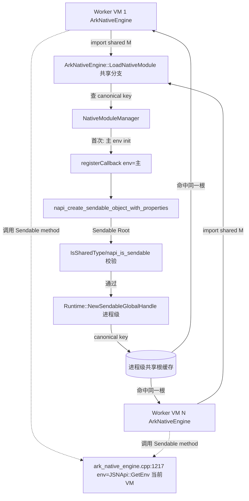
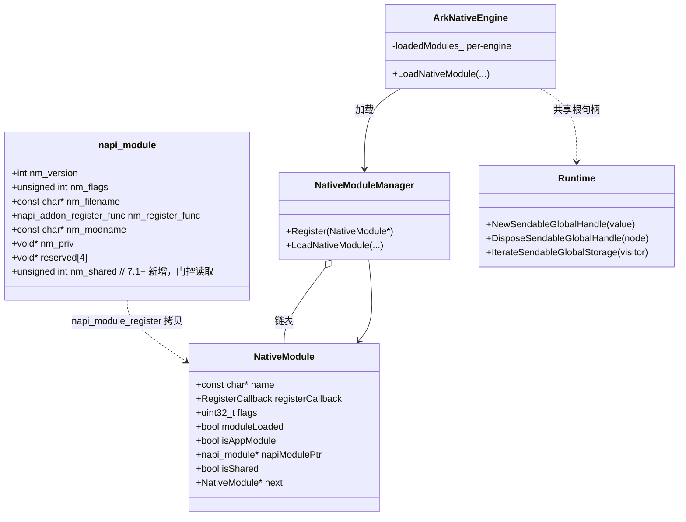
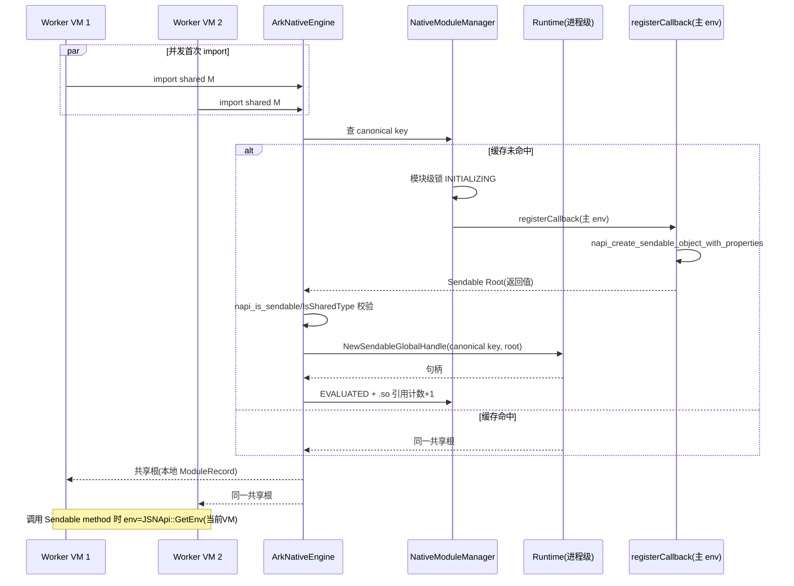

# Design

## 需求基线摘要

> 详见 `proposal.md`。设计阶段额外强调：本变更采用「共享导出根对象、ModuleRecord 保持本地」（路径 B）——native init 在主 env context 执行一次、返回完整 Sendable Root、由进程级 Sendable 句柄持有；各 VM 仍创建本地 ModuleRecord 但获得同一导出根。`napi_module_register` 经 `napi_module` 新增字段区分 sendable module（见 spec 接口变更分析；OQ-1 已定）。不涉及共享 ModuleRecord/Namespace/统一模块状态（属路径 C，非目标）。

## 代码事实基线

| 事实项 | 代码引用（文件:行） | 对设计的约束 |
|--------|-------------------|-------------|
| `napi_module` 结构体含末尾 `void* reserved[4]` | `//third_party/node/src/node_api.h:34-42` | 新增命名字段 `nm_shared` 置于 `reserved[4]` 之后；旧 .so 无此字段，须门控读取；本特性不用 `nm_flags` |
| `napi_module_register` 拷贝 nm_flags→`NativeModule.flags` | `native_engine/native_node_api.cpp:35-52` | 此处仅存 `napi_module*` 指针入 `NativeModule`（不解引用 `nm_shared`，永远安全）；`nm_shared` 读取推迟到 `LoadNativeModule` 经 apiVersion 门控 |
| `napi_module_with_js_register` 未拷 flags | `native_node_api.cpp:54-72` | 混合模块共享支持需补字段拷贝（OQ-5，首期可不做） |
| `NativeModule` 结构体（flags/refCount/registerCallback/next/moduleLoaded/isAppModule/apiAllowListChecker） | `module_manager/native_module_manager.h:57-75` | 须新增共享属性字段；复用 next/moduleLoaded 参与链表 |
| `Register()`：`flags==IS_APP_MODULE_FLAGS(==100)` 特判 App 前缀，链表节点未拷 flags | `native_module_manager.cpp:315-369`，`IS_APP_MODULE_FLAGS=100`(`:45`) | 须在链表节点拷贝 `napi_module*` 指针（用于延迟读 `nm_shared`）；现有 flags==100 语义保持不变 |
| `LoadNativeModule`：exports=`ObjectRef::New(vm_)`；`registerCallback` 返回值被忽略；`CheckArkApiAllowList` 生成 `exportCopy` LocalHeap 副本；`loadedModules_` per-engine | `ark_native_engine.cpp:838-907`（:884/:889-890/:894-897/:849,900） | 共享分支须：用 callback 返回值、校验 Sendable、allowlist 构造前过滤、进程级缓存替代 per-engine |
| Sendable API 要求 `IsMainEnvContext()`，非主 env 返回 `napi_invalid_arg` | `native_api.cpp:1422,1725`，签名 `native_api.h:160,169,187` | 共享根 init 必须在主 env context 执行一次；Worker VM 仅消费 |
| Sendable Function 跨 VM env 切换 | `ark_native_engine.cpp:1217`（`info->isSendable`→`env=JSNApi::GetEnv(vm)`） | 共享根上的方法可在消费方 VM 动态获取 env 执行（基础已具备） |
| 进程级 Sendable Global Storage | `ets_runtime/ecmascript/runtime.h:385-387,588-593`（`NewSendableGlobalHandle`/`DisposeSendableGlobalHandle`/`IterateSendableGlobalStorage`，`Runtime::GetInstance()` 进程级） | 复用此机制持有共享根，不新建进程级缓存；释放与 GC 迭代已有路径 |
| `SetApiVersion`/`apiVersion_` = app/worker `apiTargetVersion`（目标 SDK） | `native_engine/native_engine.cpp:722-733`；调用方 `ability_runtime/.../ohos_js_environment_impl.cpp:199`；worker 继承 `ark_native_engine.cpp:2385` | per-engine，反映 .so 编译 SDK；可作 `nm_shared` 读取门控（app 目标 SDK ↔ .so 编译 SDK） |

## 设计约束

1. 公共 API 稳定：`napi_create_sendable_object_with_properties` 等 Sendable API 签名/错误码不改；`napi_module_register` 签名不改。
2. Ark VM 线程安全不变量：不跨线程传递 `napi_env`；native callback 跨 Worker 线程执行时模块原生状态须线程安全。
3. opt-in 兼容：未声明共享的模块（app 目标 SDK<7.1 时 apiVersion 门控不读 `nm_shared`，或 `nm_shared=0`）走原普通本地模块路径，行为逐项不变；`nm_flags==100` 语义不变。
4. 主 env context 约束：Sendable Root 创建须在主 env context（Sendable API 限制）。
5. 不破坏现有 DFX/日志/错误码；改公共符号后同步 `ace_napi.versionscript`。

## 非目标

- 共享 ModuleRecord / 共享 Namespace / 全局统一模块状态与循环依赖语义（路径 C）。
- 修改 ArkTS 共享模块编译器与 ABC 产物；JIT/AOT/字节码格式变更。
- `napi_module_with_js` 混合模块共享（首期，留 OQ-5）。
- 大规模应用迁移、SDK 发布流程。

## 方案概述

在 `napi_module` 末尾新增 `nm_shared` 字段标识共享模块（旧 .so 无此字段，靠 `apiVersion_` 门控在 `LoadNativeModule` 安全跳过读取；`napi_module_register` 只存 `napi_module*` 指针、不解引用），使 `napi_module_register` → `NativeModuleManager::Register` → `ArkNativeEngine::LoadNativeModule` 在共享分支上：于主 env context 调用模块 init 回调、取其返回的 Sendable Root、经 `napi_is_sendable`/`IsSharedType` 校验后存入进程级 `Runtime` Sendable Global Storage（以 canonical module key 寻址）；各 Worker VM 的本地 ModuleRecord 命中同一共享根，其 Sendable 方法借既有 `info->isSendable`→`JSNApi::GetEnv(vm)` 机制在消费方 VM 执行。`.so` 经强引用计数在共享根存活期间禁止 `dlclose`。allowlist 在构造 Sendable Root 前过滤 descriptor，避免 LocalHeap 副本。

## 架构图

## 类图

## 模块影响

| 子系统 | 仓库 | 模块/路径 | 影响类型 | 相关设计决策 |
|--------|------|-----------|---------|-------------|
| arkui | foundation/arkui/napi | `//third_party/node/src/node_api.h`（napi_module） | 修改（新增尾部命名字段 `nm_shared`） | DD-1 |
| arkui | foundation/arkui/napi | `native_engine/native_node_api.cpp`（register 存 `napi_module*` 指针，不解引用 nm_shared） | 修改 | DD-1 |
| arkui | foundation/arkui/napi | `module_manager/native_module_manager.h/.cpp`（NativeModule 字段+Register 链表拷贝+canonical key） | 修改 | DD-1, DD-5 |
| arkui | foundation/arkui/napi | `native_engine/impl/ark/ark_native_engine.cpp`（LoadNativeModule 共享分支+apiVersion 门控读 nm_shared+callback 返回值+校验+进程级缓存+allowlist 前置过滤） | 修改 | DD-1, DD-2, DD-3, DD-4 |
| arkui | foundation/arkui/napi | `native_engine/native_sendable.cpp`（复用 Sendable 构造） | 复用 | DD-3 |
| arkcompiler | arkcompiler/ets_runtime | `ecmascript/runtime.h/.cpp`（NewSendableGlobalHandle 桥接） | 复用/桥接 | DD-3 |
| arkui | foundation/arkui/napi | `ace_napi.versionscript` | 修改（公共符号同步） | 约束 5 |

## 实现入口

| Entry Point | 代码引用（文件:行） | 当前职责 | 调用方 | 被调用方 | 预期变更 |
|-------------|-------------------|----------|--------|----------|----------|
| `napi_module_register` | `native_node_api.cpp:35` | 拷贝 napi_module→NativeModule 并 Register | .so constructor | `NativeModuleManager::Register` | 存 `napi_module*` 指针入 NativeModule（不解引用 `nm_shared`，安全） |
| `NativeModuleManager::Register` | `native_module_manager.cpp:315` | 链表插入（未拷 flags） | napi_module_register | 链表节点 | 链表节点拷贝 `napi_module*` 指针 |
| `ArkNativeEngine::LoadNativeModule` | `ark_native_engine.cpp:838` | 每 VM 加载+registerCallback+per-engine 缓存 | 模块解析 | registerCallback/CheckArkApiAllowList | 增共享分支：apiVersion 门控读 `nm_shared`+用返回值+校验+进程级缓存+前置 allowlist |
| `napi_create_sendable_object_with_properties` | `native_api.cpp:1725` | 创建 Sendable Object（要求主 env） | init 回调 | NapiCreateSObjectWithProperties | 不改（复用） |
| `Runtime::NewSendableGlobalHandle` | `ets_runtime/runtime.h:385` | 进程级 Sendable 句柄 | ArkNativeEngine 共享分支 | SendableGlobalStorage | 桥接调用 |
| Sendable Function env 切换 | `ark_native_engine.cpp:1217` | isSendable→当前 VM env | Sendable method 调用 | JSNApi::GetEnv | 不改（复用） |
| `NativeEngine::SetApiVersion`/`apiVersion_` | `native_engine.cpp:722` | 设 app 目标 SDK（per-engine） | ability runtime | LoadNativeModule | 门控 `nm_shared` 读取（OH 7.1 API level TBD） |

## 既有模式复用

| Pattern | 参考代码（文件:行） | 复用方式 | 适用 Task |
|---------|-------------------|----------|-----------|
| napi_module_register 拷贝链 | `native_node_api.cpp:45-49` | `napi_module*` 指针按同模式存入 NativeModule（不读 `nm_shared`） | T-字段拷贝 |
| 链表节点字段拷贝 | `native_module_manager.cpp:344-355,367+` | 在 head/tail 节点拷贝时加入共享字段 | T-Register |
| per-engine loadedModules_ 缓存 | `ark_native_engine.cpp:849,900` | 共享分支改为查进程级缓存，未命中再 init | T-LoadNativeModule |
| Sendable 构造 | `native_api.cpp:1725`→`NapiCreateSObjectWithProperties` | init 回调内复用构造 Sendable Root | T-init 契约 |
| napi_set/clear_last_error | `native_api.cpp:1422,1725` | 共享分支沿用 last_error 约定 | T-错误处理 |

## 关键设计决策

| 决策 ID | 问题 | 推荐方案 | 备选方案 | 选择理由 |
|---------|------|----------|----------|---------|
| DD-1 | 共享标记字段位置与安全读取 | 新增命名字段 `nm_shared`（置于 `reserved[4]` 之后）+ `napi_module_register` 存 `napi_module*` 指针（不解引用）+ `LoadNativeModule` 内按 `apiVersion_` 门控解引用 `nm_shared` | 复用 `reserved[0]` | 命名字段语义清晰；`apiVersion_`=app 目标 SDK（`ohos_js_environment_impl.cpp:199`）↔ .so 编译 SDK，门控使 app 目标<7.1 的旧 .so 不解引用 `nm_shared`→无 OOB、二进制兼容。门控阈值=OH 7.1 对应 API level（TBD）。罕见边角：7.1 OS 残留 7.0 系统 .so（BSS 零多半读到 0）。关联 spec OQ-1 |
| DD-2 | .so 生命周期 | 强引用计数：共享根引用计数>0 时阻止 `dlclose`，最后释放时再卸载 | 进程驻留（永不 dlclose） | 强引用计数可在最后 VM 销毁时释放，避免无界驻留；复用 SendableGlobal 释放时点。关联 AC-1.6 |
| DD-3 | 共享根持有机制 | 复用进程级 `Runtime::NewSendableGlobalHandle`（runtime.h:385），key=canonical module key | 新建进程级缓存表 | 进程级 Sendable Global Storage 已存在并参与 GC 迭代，不重复造轮子。关联 AC-1.1 |
| DD-4 | allowlist 兼容 | 共享分支在构造 Sendable Root **前**过滤 descriptor，不生成 LocalHeap `exportCopy` | 构造后复制为共享视图 | 现有 `CheckArkApiAllowList` 生成 LocalHeap 副本会破坏共享根身份；前置过滤保身份。关联 AC-1.4 |
| DD-5 | canonical module key 隔离 | key 含 bundle/namespace/加载域维度，避免不同应用/HSP 同名模块误共享 | 仅用 nm_modname | 防跨应用误共享（安全/兼容）。关联 AC-1.1, BR-5 |
| DD-6 | 首期模块类型范围 | APP/OHOS/INTERNAL；STATIC 与 `napi_module_with_js` 留 OQ-5 后续 | 全类型首期支持 | 控制风险，先覆盖主路径。关联 OQ-5 |

> 字段名/类型与 `NativeModule.isShared` 等确切字段属本设计钉死，实现不得自行发明不一致抽象（见类图）。

## 状态归属与不变量

- **Ownership**：共享根 owner = 进程级 `Runtime` SendableGlobalStorage；key = canonical module key（DD-5）；创建时机 = 主 env context 首次 import（约束 4）；清理触发 = 最后引用 VM 销毁（DD-2 引用计数归零）；只读消费者 = 各 Worker VM；不变量 = 同一 canonical key 全局唯一共享根身份；验证方法 = AC-1.1 跨 VM 严格相等；关联 AC-1.1/1.5。
- **Lifecycle**：`UNINITIALIZED → INITIALIZING → EVALUATED`，异常分支 `→ ERRORED`；创建在主 env；清理在最后 VM 销毁；异常恢复 = ERRORED 状态在所有 VM 一致可见、可重建可抛异常；不变量 = init 执行次数恰为 1、失败状态跨 VM 一致；验证 = AC-1.2/1.4；关联 AC-1.2/1.4。
- **Concurrency**：模块级锁串行化 init（canonical key 粒度），**不在持锁时执行 native callback**（callback 解耦）；Sendable method 跨 VM 无锁（env 动态获取，ark_native_engine.cpp:1217）；不变量 = 并发首次 import 不死锁、init 恰 1 次；验证 = AC-1.2, EX-3/4；关联 AC-1.2。
- **Compatibility**：app 目标 SDK<7.1 → apiVersion 门控不读 `nm_shared`→普通路径逐项不变；`nm_shared=0`→非共享；`nm_flags==100` 语义不变；Sendable API 签名不变；新增字段改 struct 布局，旧 .so 靠 apiVersion 门控跳过解引用（`napi_module_register` 只存指针）→二进制兼容；不变量 = 普通 NAPI 模块行为基线一致；验证 = AC-1.3；关联 AC-1.3。
- **Performance**：init once 减少 RSS/PSS；共享堆常驻增量随模块数有界（监控）；模块锁仅 init 期持有，不阻塞消费路径；不变量 = 多 Worker RSS/PSS 不超独立加载基线、1h 无持续增长；验证 = AC-1.7；关联 AC-1.7。
- **Capacity**：共享根数量随注册模块数增长，无硬上限→监控 + 最后 VM 销毁释放；不变量 = 无界进程级缓存风险可控；验证 = AC-1.5/1.6 生命周期释放；关联 AC-1.6。

## 安全基础检查

> 触发：`proposal.md` 安全/权限维度 = 「是」（跨 VM 共享堆跨信任边界 + .so 生命周期内存安全 + 跨线程 native callback + Ark VM 线程安全不变量）。

### 信任边界交叉分析

| 交互类型 | 边界描述 | 通信双方 | 权限管控机制 | 关联 AC |
|---------|----------|----------|-------------|---------|
| 跨 VM/Worker（同进程） | 共享堆跨 VM 传递 Sendable 对象 | 创建方主 env ↔ 消费方 Worker VM | Sendable 类型校验（IsSharedType）+ canonical key 隔离（DD-5） | AC-1.1, AC-1.4 |
| 跨线程（native callback） | callback 在不同 Worker 线程执行 | native 模块静态状态 ↔ 多 Worker 线程 | 线程安全契约（BR-4）+ 禁止保存 VM 专属 env/ref | AC-1.5, AC-2.1 |
| .so 生命周期 | native callback 地址 vs dlclose | 共享根存活 ↔ .so 卸载 | 强引用计数阻止 dlclose（DD-2） | AC-1.6 |

### 基础安全要求检查

| 检查项 | 检查结果 | 说明/措施 |
|--------|----------|-----------|
| 加密算法合规 | N/A | 不涉及加解密 |
| 密钥管理安全 | N/A | 不涉及密钥 |
| 随机数安全 | N/A | 不涉及随机数 |
| 输入验证完备 | ✅ | 共享根 Sendable 类型双重校验（NAPI 层 + 模块记录层 IsSharedType）；非 Sendable 拒绝（AC-1.4） |
| 错误处理安全 | ✅ | 失败走一致错误状态，不泄露内部指针/地址；沿用 last_error 不打印敏感路径 |
| 配置安全 | ✅ | 默认非共享（opt-in）；reserved=NULL→普通路径 |

### 敏感数据处理

本次变更不涉及敏感数据处理（无 PII/密钥/凭证/生物特征）。

### 深度威胁分析（如需）

命中高风险判据：「关键安全组件」（Ark VM 线程安全不变量 + .so 生命周期内存安全）+ 跨信任边界（共享堆跨 VM）。建议运行 `/odk-security-threat-model` 产出独立 `threat-model.md`。摘要：

| TH-ID | 风险 | 缓解 | 关联 Task |
|-------|------|------|-----------|
| TH-1 | .so 在共享根存活期间被 dlclose → native callback 地址悬空 → 崩溃/RCE | 强引用计数阻止 dlclose（DD-2）；AC-1.6 验证 | T-.so 生命周期 |
| TH-2 | 跨 Worker 误共享（不同应用/HSP 同名模块）→ 跨信任域数据泄漏 | canonical key 含 bundle/namespace/加载域（DD-5）；AC-1.1 验证 | T-canonical key |
| TH-3 | native 静态状态非线程安全 → 数据竞争/UAF | 线程安全契约（BR-4）+ 禁止 VM 专属 env/ref；AC-1.5 验证 | T-init 契约 |
| TH-4 | 非 Sendable 对象进共享根 → 跨 VM 访问 LocalHeap → UAF | 双重 Sendable 校验（DD-4/BR-2）；AC-1.4 验证 | T-校验 |

## FFI 接口设计

> arkruntime profile additional_section。

- **ABI 兼容**：新增尾部命名字段 `nm_shared`（DD-1）改变 struct 布局；旧 .so 无此字段，靠 `apiVersion_` 门控在 `LoadNativeModule` 跳过解引用（`napi_module_register` 只存 `napi_module*` 指针、不解引用）→旧 .so 二进制兼容、无需重编译；新 .so（7.1+ 编译）设 `nm_shared`。门控阈值=OH 7.1 API level（TBD）。
- **跨 VM env 所有权**：Sendable Function 不持有创建方 `napi_env`，调用时 `JSNApi::GetEnv(vm)` 动态获取消费方 env（ark_native_engine.cpp:1217）；native 模块禁止保存 env 跨 VM 使用。
- **.so 函数地址所有权**：共享根上的 Sendable Function 持 native callback 地址，其生命周期绑定 .so（DD-2 强引用计数）；`dlclose` 须延迟。
- **FFI 内存所有权**：共享根由进程级 SendableGlobalStorage 持有（Runtime owner），消费方 VM 只读引用；释放由 Runtime 在最后 VM 销毁时统一处理，消费方不主动 free。

## GC 策略设计

> arkruntime profile additional_section。

- 共享根由 `Runtime::IterateSendableGlobalStorage` 参与 GC root 迭代（runtime.h:387），不引入新 root 集合。
- 共享根无 refCount（Sendable 引用特性），须由模块级强引用计数（DD-2）显式管理生命周期，**无自动清理**——最后 VM 销毁时手动释放。
- GC 不得回收存活共享根所引用的对象；.so 生命周期保护（DD-2）避免 callback 地址被「回收」后访问。

## JIT/AOT 编译策略

> arkruntime profile additional_section。

不涉及。路径 B 不改 ABC/字节码/JIT/AOT，无字节码格式版本变更（spec 兼容性声明：配置/数据格式不变）。

## 时序设计

## 风险与缓解

| 风险 | 可能性 | 影响 | 缓解措施 |
|------|--------|------|----------|
| .so 被 dlclose 后 callback 悬空 | 中 | 高（崩溃/RCE） | DD-2 强引用计数；AC-1.6；TH-1 |
| 跨应用同名模块误共享 | 中 | 高（数据泄漏） | DD-5 canonical key 隔离；AC-1.1；TH-2 |
| native 状态非线程安全 | 中 | 高（数据竞争/UAF） | BR-4 契约；AC-1.5；TH-3 |
| 非 Sendable 进共享根 | 低 | 高（跨 VM UAF） | DD-4/BR-2 双重校验；AC-1.4；TH-4 |
| apiVersion 门控边角：7.1 OS 拋留 7.0 系统 .so | 低 | 中（OOB/UB） | 门控跳过读取；BSS 零多半读到 0；AC-1.3 回归 |
| allowlist 前置过滤遗漏 | 中 | 中 | 构造前过滤 + 复用现有过滤逻辑；AC-1.4 |
| 主 env context 不可用导致 init 失败 | 低 | 中 | 错误状态一致可见；AC-1.4 |

## 验证思路

| 验证场景 | 方法 | 通过标准 |
|----------|------|----------|
| 共享根跨 VM 身份 | ≥2 Worker import + napi_is_sendable + 严格相等 | AC-1.1 |
| 单次初始化 | 并发 import + 计数器 | AC-1.2 |
| 向后兼容 | 普通模块回归 | AC-1.3 |
| 非 Sendable 拒绝 | 异常用例 | AC-1.4 |
| 跨 VM 生命周期 | VM 销毁后调用 | AC-1.5 |
| .so 不悬空 | 卸载路径 | AC-1.6 |
| 内存基线 | RSS/PSS 采集 | AC-1.7 |

> 兼容性验证详见 spec.md 兼容性声明。
