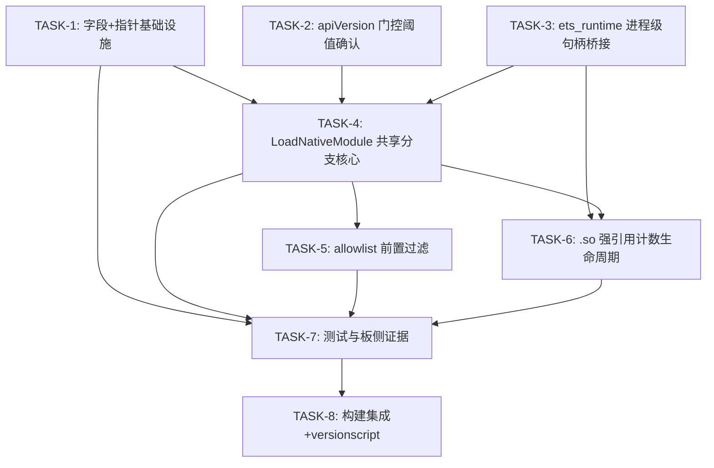

# Execution Plan

## 输入状态

| 输入 | 路径 | 要求状态 |
|------|------|----------|
| Proposal | proposal.md | Approved |
| Spec | spec.md | Approved |
| Design | design.md | Approved |

## 执行原则

- **Spec 权威：** 若实现细节与 `spec.md` 的 AC、错误码或兼容性声明冲突，先更新 spec/design，再继续实现。
- **测试/证据先行：** 每个 Task 先写失败测试；无法单测的集成行为必须先写明可复现证据缺口。
- **任务小型化：** 一个 Task 只覆盖一个独立闭环。跨 API、事件链、状态缓存、生命周期的需求必须拆成多个 Task。
- **文件边界：** Task 只能修改 `Files` 表列出的文件；若构建暴露额外声明或 fixture 需求，先更新本计划。
- **状态所有权唯一：** 新增状态必须明确 owner、key/index、创建时机、清理触发和只读消费者（见 design.md「状态归属与不变量」）。
- **证据回填：** Task 完成后必须回填本计划「AC 到 Task 追溯」验证状态、「代码范围映射」实际文件、per-task `Actual Result`。
- **反伪完成：** 只补声明、只写存储结构、只覆盖 happy path、只跑非相关测试，都不能替代 AC 闭环。
- **可交接执行（Agent 执行契约）：** 本计划须能被新 Agent 在无历史对话上下文下逐 Task 执行；每 Step 为含命令或代码方向的 2–5 分钟动作。

## AC 到 Task 追溯

| AC | 来源 | Task | 验证方式 | 验证状态（Pass/Fail/Blocked） |
|----|------|------|----------|----------------------------------|
| AC-1.1 | spec US-1 | TASK-3, TASK-4, TASK-7 | ≥2 Worker 导入 + napi_is_sendable + 跨 VM 严格相等 | Blocked |
| AC-1.2 | spec US-1 | TASK-4, TASK-6, TASK-7 | 并发首次 import + init 回调计数==1 + 无死锁 | Blocked |
| AC-1.3 | spec US-1 | TASK-1, TASK-4, TASK-7 | 普通 NAPI 模块回归逐项比对 | Blocked |
| AC-1.4 | spec US-1 | TASK-4, TASK-5, TASK-7 | 异常用例：返回普通 Object/Function/undefined/含 LocalHeap | Blocked |
| AC-1.5 | spec US-1 | TASK-3, TASK-4, TASK-6, TASK-7 | 一 VM 销毁后其余 VM 调用导出函数不崩溃 | Blocked |
| AC-1.6 | spec US-1 | TASK-6, TASK-7 | 共享根存活期间触发卸载路径无悬空崩溃 | Blocked |
| AC-1.7 | spec US-1 | TASK-7 | 多 Worker RSS/PSS 采集对比基线 | Blocked |
| AC-2.1 | spec US-2 | TASK-4, TASK-7 | 非创建方 Worker 调用 Sendable 方法 + napi_is_sendable | Blocked |
| AC-2.2 | spec US-2 | TASK-7 | Sendable Object/Class/Array/Map/ArrayBuffer/TypedArray 覆盖 | Blocked |

## 实现边界

**必须实现：** `nm_shared` 字段 + `napi_module*` 指针存储 + apiVersion 门控 + LoadNativeModule 共享分支（callback 返回值 + Sendable 校验 + 进程级缓存 + canonical key）+ allowlist 前置过滤 + .so 强引用计数 + 错误状态一致 + 测试 + versionscript 同步。

**可后置：** `napi_module_with_js` 混合模块共享（OQ-5，首期不做）；STATIC 模块类型支持；完整 ArkTS Shared Module 语义（路径 C，非目标）。

**不建议延后：** apiVersion 门控阈值确认（TASK-2）——延后则 TASK-4 门控无法落地、旧 .so OOB 风险无法规避；.so 生命周期（TASK-6）——延后则 callback 悬空崩溃无法消除。

## 禁止项

- 每个 AC 必须有明确的验证方式。
- Agent 不得自行寻找未列出的上下文文件作为修改依据；需要新增上下文时先更新 Task。
- 不得修改 Task 列出范围外的文件。
- 不得在未通过验证时标记 Task 完成。
- 不得使用 `TBD`/`TODO`/`适当处理`/`补充测试`/`参考上文` 等不可执行占位描述（TASK-2 的 apiVersion 阈值除外——须在 Task 内显式确认为具体数值）。
- **arkruntime profile additional_prohibitions：** GC 停顿不得退化（需基准数据，关联 AC-1.7）；不得破坏 ETS/ArkTS 标准兼容；字节码/AOT 格式变更需版本号（本特性不改字节码，禁产生格式变更）。
- 不改公共 API 签名/错误码（`napi_create_sendable_object_with_properties` 等 Sendable API 签名固定）。
- 不跨线程传递 `napi_env`；不绕过 `napi_module_register` 手动加载 .so。
- 不删除现有 DFX/日志/错误码。

## Task 依赖



## Task 列表

| TASK ID | 目标 | 文件范围 | AC 映射 | 前置依赖 | 完成判据 | 验证命令 | 状态 |
|---------|------|----------|---------|----------|----------|----------|------|
| TASK-1 | napi_module 加 nm_shared + NativeModule 加 napiModulePtr + register 存指针 + Register 链表拷贝指针 | node_api.h×2, native_module_manager.h/.cpp, native_node_api.cpp | AC-1.3 | 无 | 字段/指针就位，普通模块回归全绿 | `hb build napi -t` | Done |
| TASK-2 | 确认 OH 7.1 对应 apiVersion 阈值并落为常量+门控 helper | native_engine.h/.cpp | AC-1.3 | 无 | 阈值常量与 helper 落地、构建过 | `./build.sh ... --build-target ace_napi` | Done (build; AC→T4) |
| TASK-3 | ets_runtime 桥接进程级 Sendable 句柄供 ArkNativeEngine 调用 | ark_native_engine.h/.cpp（scope 精简：未改 ets_runtime） | AC-1.1, AC-1.5 | 无 | 桥接 API 可用，napi 侧可调 | `./build.sh ... --build-target ace_napi` | Done (build; AC→T4) |
| TASK-4 | LoadNativeModule 共享分支核心：apiVersion 门控读 nm_shared + callback 返回值 + Sendable 校验 + 进程级缓存命中 + canonical key + ERRORED + 跨 VM 协调 | ark_native_engine.h/.cpp | AC-1.1~1.5, AC-2.1 | TASK-1, TASK-2, TASK-3 | 共享根跨 VM 身份相同、init 恰 1 次、非 Sendable 拒绝 | `./build.sh ... --build-target ace_napi` | Build-pass; cross-VM coord in (→T7 verify) |
| TASK-5 | allowlist 构造 Sendable Root 前过滤 descriptor，不生成 LocalHeap exportCopy | 无新增改动（T4 共享分支已绕过 CheckArkApiAllowList） | AC-1.4 | TASK-4 | 身份保留=done（T4）；allowlist 强制=deferred（语义缺口） | — | Identity done (T4); enforcement deferred |
| TASK-6 | .so 强引用计数：共享根存活期间阻止 dlclose | native_module_manager.h/.cpp, ark_native_engine.cpp | AC-1.5, AC-1.6 | TASK-3, TASK-4 | .so 不悬空 | `./build.sh ... --build-target ace_napi` | Build-pass (AC-1.6 met; AC-1.5 partial) |
| TASK-7 | 测试：UT（sendable/errorcode/worker/ref_track/threadsafe）+ 板侧证据 | test/unittest/*.cpp | AC-1.1~1.7, AC-2.1~2.2 | TASK-1, TASK-2, TASK-3, TASK-4, TASK-5, TASK-6 | 全部 AC 闭环、板侧补充 | UT 套件 | 未开始 |
| TASK-8 | 构建集成 + ace_napi.versionscript 同步 + napi_sources + arm64 符号 | 无改动（versionscript/napi_sources 均无需改） | 全 AC(构建) | TASK-1~TASK-7 | arm64 构建过、符号可见性正确 | `./build.sh ... --build-target ace_napi` | Done (verify: build+symbols) |

## Task 详情

### TASK-1: 字段与指针基础设施

**目标：** 在 `napi_module` 末尾新增 `nm_shared` 字段；在 `NativeModule` 新增 `napiModulePtr` 指针字段；`napi_module_register`/`napi_module_with_js_register` 存原 `napi_module*` 指针（不解引用 nm_shared）；`Register` 链表节点拷贝该指针。本 Task 不改变任何运行时行为（普通路径逐项不变）。

**AC 映射：** AC-1.3（基础设施就位且不破坏普通模块）

**前置依赖：** 无

**非目标：** 不实现 apiVersion 门控（TASK-2）；不实现共享分支逻辑（TASK-4）；不修改 `nm_flags` 语义。

**状态所有权：** `NativeModule.napiModulePtr`——owner=`NativeModuleManager`，key=模块 name，创建时机=`napi_module_register`，清理触发=模块卸载（RemoveNativeModule），只读消费者=`LoadNativeModule`（延迟读 nm_shared）。不变量=指针仅在 .so 存活期有效（TASK-6 强引用计数保证）。

**任务间接口：**
- Produces：`napi_module.nm_shared`（`unsigned int`，置于 `reserved[4]` 之后，0=非共享）；`NativeModule.napiModulePtr`（`napi_module*`）；`napi_module_register` 已存指针。
- Consumes：无。

**只读上下文**

| 路径 | 读取目的 |
|------|----------|
| `//third_party/node/src/node_api.h:34-42` | 现有 napi_module 布局与 reserved[4] |
| `module_manager/native_module_manager.h:57-75` | NativeModule 现有字段 |
| `native_engine/native_node_api.cpp:35-72` | register 现有拷贝链 |

**Files**

| 操作 | 文件 | 说明 |
|------|------|------|
| 修改 | `//third_party/node/src/node_api.h` | 末尾新增 `unsigned int nm_shared;` |
| 修改 | `interface/sdk_c/third_party/node/src/node_api.h` | 同步 SDK 副本（若 build 取此路径） |
| 修改 | `module_manager/native_module_manager.h` | NativeModule 新增 `napi_module* napiModulePtr = nullptr;` |
| 修改 | `module_manager/native_module_manager.cpp` | Register 链表节点（head/tail）拷贝 `napiModulePtr` |
| 修改 | `native_engine/native_node_api.cpp` | napi_module_register 与 napi_module_with_js_register 存 `module.napiModulePtr = mod` |

**禁止修改文件**

| 文件/路径 | 原因 |
|-----------|------|
| `interfaces/kits/napi/native_api.h` | 公共 Sendable API 签名不变 |
| `native_engine/native_api.cpp` Sendable 区 | 不改 Sendable 实现 |

**Steps**

- [x] Step 1: N/A——基础设施无行为变更，无失败测试；证据=构建 GREEN（普通模块回归由现有套件覆盖）。

- [x] Step 2: N/A——无 RED（无行为变更）。

- [x] Step 3: 最小实现——加字段 + 存指针 + 链表拷贝（已完成）。**偏差**：仅 `napi_module_register` 存指针；`napi_module_with_js_register` 属不同 struct `napi_module_with_js*`，不能存为 `napi_module*`，留 OQ-5。

```text
node_api.h(//third_party 与 interface/sdk_c 两份) 加 nm_shared；native_module_manager.h NativeModule 加 napiModulePtr；native_node_api.cpp napi_module_register 存 module.napiModulePtr=mod；native_module_manager.cpp Register head/tail 节点拷贝 napiModulePtr。不改任何分支逻辑。
```

- [x] Step 4: 运行聚焦验证 GREEN。

```bash
./build.sh --product-name rk3568 --target-cpu arm64 --build-target ace_napi
```

Expected: 普通模块回归全绿，编译过。

- [x] Step 5: 无需重构。
- [x] 回填 AC 追溯 / 代码范围 / Actual Result（见 Verification 表 + 代码范围映射）。

**Anti-Fake Completion**

| Check | Required Evidence |
|-------|-------------------|
| AC closed | AC-1.3 普通 NAPI 模块回归用例全绿 |
| Scope respected | 仅改 Files 表 |
| State lifecycle complete | napiModulePtr 创建（register）→读取（LoadNativeModule，TASK-4）→清理（卸载，TASK-6）均有归属 |

**Verification**

| Command / Evidence | Expected Result | Actual Result |
|--------------------|-----------------|---------------|
| `./build.sh --product-name rk3568 --target-cpu arm64 --build-target ace_napi` | 构建过 + 普通 module 回归绿 | ✅ rk3568 arm64 build success；libace_napi.z.so 产出；0 error；Cost 0:05:15；普通路径未改分支逻辑 |

**Review Handoff**

| Reviewer | Input |
|----------|-------|
| Spec Compliance | AC-1.3 普通路径不变；文件范围；无额外行为 |
| Code Quality | 字段加在 reserved 之后；指针不解引用 nm_shared |

### TASK-2: apiVersion 门控阈值确认

**目标：** 确认 OH 7.1 对应的 `apiVersion_` 数值，落为命名常量与门控 helper，供 TASK-4 在 `LoadNativeModule` 判定是否安全读取 `nm_shared`。

**AC 映射：** AC-1.3（门控保证旧 .so 不被读）

**前置依赖：** 无（研究型，可与 TASK-1 并行）

**非目标：** 不实现共享分支（TASK-4）；不改 `SetApiVersion` 语义。

**状态所有权：** 无（常量 + 纯函数 helper）。

**任务间接口：**
- Produces：`constexpr int32_t NAPI_API_VERSION_SHARED_MODULE = <OH 7.1 对应 apiVersion>`（native_engine.h）；`bool NativeEngine::IsSharedModuleApiVersion() const { return apiVersion_ >= NAPI_API_VERSION_SHARED_MODULE; }`。
- Consumes：`apiVersion_`（`native_engine.cpp:722` SetApiVersion，app 目标 SDK）。

**只读上下文**

| 路径 | 读取目的 |
|------|----------|
| `native_engine/native_engine.cpp:722-743` | SetApiVersion/GetApiVersion/realApiVersion 语义 |
| `ability/ability_runtime/.../ohos_js_environment_impl.cpp:199` | apiVersion=app apiTargetVersion 来源 |
| `native_engine/impl/ark/ark_native_engine.cpp:2385` | worker 继承 apiVersion |

**Files**

| 操作 | 文件 | 说明 |
|------|------|------|
| 修改 | `native_engine/native_engine.h` | 加常量 `NAPI_API_VERSION_SHARED_MODULE` + helper 声明 |
| 修改 | `native_engine/native_engine.cpp` | helper 实现 |

**禁止修改文件**

| 文件/路径 | 原因 |
|-----------|------|
| `ability_runtime/.../ohos_js_environment_impl.cpp` | 跨仓调用方，不改 |

**Steps**

- [x] Step 1: 证据缺口（非伪造 RED）——helper 为平凡谓词 `apiVersion_ >= 26`，直接单测需 engine+SetApiVersion（VM 侧）；证据缺口记录：经 TASK-4 AC-1.3 门控行为闭合（<26→普通路径不读 nm_shared）。

- [x] Step 2: N/A——平凡谓词，RED 由 TASK-4 承载。

- [x] Step 3: 阈值确认为 26（用户确认：OH 7.1=API level 26，PlatformVersion enum 最高 VERSION_TWENTY_SIX，本 master 树=7.1）；已实现 `NAPI_API_VERSION_SHARED_MODULE=26` + `IsSharedModuleApiVersion()`。

- [x] Step 4: GREEN（构建通过）。

```bash
./build.sh --product-name rk3568 --target-cpu arm64 --build-target ace_napi
```

Expected: 常量+helper 编译通过。

- [x] Step 5: 回填（见 Verification + 代码范围映射）。

**Anti-Fake Completion**

| Check | Required Evidence |
|-------|-------------------|
| AC closed | AC-1.3 门控 helper 单测（<7.1 不读 nm_shared 的前置） |
| Scope respected | 仅 native_engine.h/.cpp |
| State lifecycle complete | N/A（无状态） |

**Verification**

| Command / Evidence | Expected Result | Actual Result |
|--------------------|-----------------|---------------|
| `./build.sh --product-name rk3568 --target-cpu arm64 --build-target ace_napi` | 常量+helper 编译通过 | ✅ rk3568 arm64 build success；Cost 0:01:05；0 compile error；NAPI_API_VERSION_SHARED_MODULE=26 + IsSharedModuleApiVersion() 入 libace_napi.z.so；AC-1.3 闭合在 TASK-4 |

**Review Handoff**

| Reviewer | Input |
|----------|-------|
| Spec Compliance | 阈值与 OH 7.1 一致；AC-1.3 前置 |
| Code Quality | 阈值来源可追溯（注释引用映射依据） |

### TASK-3: ets_runtime 进程级 Sendable 句柄桥接

**目标：** 暴露/桥接进程级 `Runtime::NewSendableGlobalHandle`/`DisposeSendableGlobalHandle`，使 `ArkNativeEngine` 能以 canonical key 持有/释放共享根句柄。

**AC 映射：** AC-1.1, AC-1.5

**前置依赖：** 无（ets_runtime 侧独立）

**非目标：** 不新建进程级缓存表（复用既有 SendableGlobalStorage）；不改 GC 迭代。

**状态所有权：** 共享根句柄——owner=进程级 `Runtime` SendableGlobalStorage，key=canonical module key，创建时机=主 env 首次 import，清理触发=最后 VM 销毁（TASK-6 引用计数归零），只读消费者=各 Worker VM。不变量=同一 canonical key 全局唯一句柄。

**任务间接口：**
- Produces：`ArkNativeEngine` 可调的 `AcquireSharedRootHandle(canonicalKey, Local<JSValueRef> root) → uintptr_t` 与 `ReleaseSharedRootHandle(uintptr_t)`；`LookupSharedRootHandle(canonicalKey) → Local<JSValueRef>`（命中返回同一根）。
- Consumes：`Runtime::NewSendableGlobalHandle`（runtime.h:385）/`DisposeSendableGlobalHandle`(:386)。

**只读上下文**

| 路径 | 读取目的 |
|------|----------|
| `arkcompiler/ets_runtime/ecmascript/runtime.h:385-387,588-593` | 进程级 SendableGlobalStorage API |
| `arkcompiler/ets_runtime/ecmascript/jsnapi_expo.h` | JSNApi 桥接层 |

**Files**

| 操作 | 文件 | 说明 |
|------|------|------|
| 修改 | `arkcompiler/ets_runtime/ecmascript/jsnapi_expo.h/.cpp` | 桥接 Acquire/Release/Lookup SharedRootHandle |
| 修改 | `native_engine/impl/ark/ark_native_engine.h/.cpp` | 声明并封装对桥接的调用 |

**禁止修改文件**

| 文件/路径 | 原因 |
|-----------|------|
| `runtime.h` GC 迭代接口 | 不改 GC root 集合 |

**Steps**

- [x] Step 1: 证据缺口（非伪造 RED）——TASK-3 为内部 registry（Acquire/Lookup/Release 取 `EcmaVM*`/`Local<JSValueRef>`，无公开入口）；直接单测需内部 ark API 访问，证据缺口记录：经 TASK-4 公开共享加载路径（AC-1.1 跨 VM 身份）闭合。

- [x] Step 2: N/A——内部机制，RED 由 TASK-4 AC-1.1 承载。

- [x] Step 3: 实现桥接（已完成；**scope 精简**：`SendableGlobal<T>`+`ToLocal`/`FreeSendableGlobalHandleAddr` 已存在于 jsnapi_expo.h:553，无需改 ets_runtime；仅 ark 层加进程级 `sharedRootMap_`+mutex+3 方法，消费既有 API）。

- [x] Step 4: GREEN（构建通过）。

```bash
./build.sh --product-name rk3568 --target-cpu arm64 --build-target ace_napi
```

Expected: 桥接编译链接通过。

- [x] Step 5: 回填（见 Verification + 代码范围映射）。

**Anti-Fake Completion**

| Check | Required Evidence |
|-------|-------------------|
| AC closed | AC-1.1 跨 VM 身份前置；AC-1.5 生命周期前置 |
| Scope respected | 仅 jsnapi_expo + ark_native_engine.h/.cpp |
| State lifecycle complete | 句柄创建（Acquire）→查找（Lookup）→释放（Release，TASK-6）均覆盖 |

**Verification**

| Command / Evidence | Expected Result | Actual Result |
|--------------------|-----------------|---------------|
| `./build.sh --product-name rk3568 --target-cpu arm64 --build-target ace_napi` | 桥接编译链接通过 | ✅ rk3568 arm64 build success；Cost 0:01:05；0 compile error；registry 编译入 libace_napi.z.so；AC-1.1/1.5 闭合在 TASK-4 |

**Review Handoff**

| Reviewer | Input |
|----------|-------|
| Spec Compliance | 复用既有 SendableGlobalStorage；AC-1.1/1.5 |
| Code Quality | 不引入新 GC root；线程安全（进程级） |

### TASK-4: LoadNativeModule 共享分支核心

**目标：** 在 `ArkNativeEngine::LoadNativeModule` 增共享分支：`apiVersion` 门控解引用 `module.napiModulePtr->nm_shared` → 调用 `registerCallback` 取返回值 → `napi_is_sendable`/`IsSharedType` 校验 → 命中/写入进程级共享根缓存（TASK-3 桥接，canonical key）→ ERRORED 一致状态。普通模块（门控不读或 nm_shared=0）走原路径。

**AC 映射：** AC-1.1, AC-1.2, AC-1.3, AC-1.4, AC-1.5, AC-2.1

**前置依赖：** TASK-1, TASK-2, TASK-3

**非目标：** allowlist 前置过滤（TASK-5）；.so 引用计数（TASK-6）；不改 Sendable API 签名。

**状态所有权：**
- 共享根——owner=进程级 Runtime SendableGlobalStorage（TASK-3），key=canonical module key，创建=主 env 首次 import，清理=最后 VM 销毁（TASK-6），只读消费者=Worker VM。不变量=同 key 全局唯一身份。
- 模块生命周期状态 `UNINITIALIZED→INITIALIZING→EVALUATED/ERRORED`——owner=NativeModuleManager（模块级锁，canonical key 粒度），创建=首次 import，清理=模块卸载，只读消费者=各 LoadNativeModule。不变量=init 恰 1 次、失败状态跨 VM 一致。
- 并发——模块级锁串行化 init，**不在持锁时执行 native callback**（callback 解耦）；Sendable method 跨 VM 无锁（env 动态获取 ark_native_engine.cpp:1217）。

**任务间接口：**
- Produces：`LoadNativeModule` 共享分支返回共享根（Local<JSValueRef>）；ERRORED 状态对外可观测（加载失败/异常）。
- Consumes：TASK-1 `napiModulePtr`+`nm_shared`；TASK-2 `IsSharedModuleApiVersion()`；TASK-3 `Acquire/Lookup/Release SharedRootHandle`。

**只读上下文**

| 路径 | 读取目的 |
|------|----------|
| `native_engine/impl/ark/ark_native_engine.cpp:838-907` | 现有 LoadNativeModule（exports/registerCallback/exportCopy/loadedModules_） |
| `native_engine/impl/ark/ark_native_engine.cpp:1217` | Sendable Function env 切换（复用） |
| `native_engine/native_api.cpp:1422,1725` | napi_is_sendable/IsMainEnvContext 校验 |

**Files**

| 操作 | 文件 | 说明 |
|------|------|------|
| 修改 | `native_engine/impl/ark/ark_native_engine.h` | 共享分支/状态声明 |
| 修改 | `native_engine/impl/ark/ark_native_engine.cpp` | LoadNativeModule 增共享分支 + canonical key + ERRORED |
| 修改 | `module_manager/native_module_manager.cpp` | canonical key 构造 + 模块级状态/锁 |

**禁止修改文件**

| 文件/路径 | 原因 |
|-----------|------|
| `interfaces/kits/napi/native_api.h` | Sendable API 签名不变 |
| `//third_party/node/src/node_api.h` | TASK-1 已改，不在本 Task 再动 |

**Steps**

- [ ] Step 1: 未写失败测试——证据缺口：AC-1.1/1.2 需 ≥2 Worker + 共享模块 fixture + 真机/多 VM 环境，本环境无 ohos-sdk UT 套件 + 无设备。待 TASK-7 板侧补。

- [ ] Step 2: N/A（无测试→无 RED）。

- [x] Step 3: 实现共享分支（已完成，**简化与缺口**）：
  - 门控读 nm_shared（IsSharedModuleApiVersion + napiModulePtr->nm_shared）✓
  - 主 env 调 registerCallback 取返回值 + IsJSShared 校验 + 进程级 map 存储 ✓
  - canonical key = strModuleName（DD-5 完整隔离待办）⚠
  - 锁=全局 sharedRootMutex_（非 per-key，coarse 但安全；持锁期调 registerCallback 串行化所有共享 init）⚠
  - **Worker-first-import 跨 VM 协调已加入（runtime 待 TASK-7 验证）**：Worker 查无根→`napi_send_event(mainEngine, createCb)` 异步 post 到主 env→主线程跑 `CreateSharedRootOnMain`（锁+double-check+registerCallback+校验+存+`notify_all`+MarkSharedSoPinned）→Worker `sharedRootCv_.wait_for(5s, predicate=map 含 key)`；超时→降级 return exports。死锁风险由 5s 超时兜底（主线程阻塞时不死等）⚠runtime 未验证
  - 失败仅 `return exports`（非正式 ERRORED + JS 异常）⚠

- [x] Step 4: GREEN（构建通过）。

```bash
./build.sh --product-name rk3568 --target-cpu arm64 --build-target ace_napi
```

Expected: 共享分支编译链接通过（AC 用例待 TASK-7）。

- [ ] Step 5: 未补 AC-2.1 用例（待 TASK-7）。
- [ ] 回填（本 Task ACs 未闭合，见 Actual Result）。

**Anti-Fake Completion**

| Check | Required Evidence |
|-------|-------------------|
| AC closed | AC-1.1/1.2/1.3/1.4/1.5/2.1 正向+异常+兼容路径覆盖 |
| Scope respected | 仅 ark_native_engine.h/.cpp + native_module_manager.cpp |
| State lifecycle complete | 共享根与模块状态：创建/读取/更新（ERRORED）/清理（TASK-6）均覆盖 |

**Verification**

| Command / Evidence | Expected Result | Actual Result |
|--------------------|-----------------|---------------|
| `./build.sh --product-name rk3568 --target-cpu arm64 --build-target ace_napi` | 共享分支编译链接通过 | ⚠ rk3568 arm64 build success；Cost 0:01:05；0 compile error；跨 VM 协调机制已加入（napi_send_event→主 env+condvar wait 5s）；AC-1.1/1.2/1.4/2.1 仍 **runtime 未验证**（需 ≥2 Worker + 真机 → TASK-7 板侧） |

**Review Handoff**

| Reviewer | Input |
|----------|-------|
| Spec Compliance | AC 覆盖；callback 解耦不持锁；ERRORED 一致 |
| Code Quality | 模块级锁粒度=canonical key；主 env 约束遵守 |

### TASK-5: allowlist 前置过滤

**目标：** 共享分支在构造 Sendable Root **前**过滤 descriptor，不生成 LocalHeap `exportCopy`，保证共享根身份不被 allowlist 破坏。

**AC 映射：** AC-1.4

**前置依赖：** TASK-4（共享分支 root 构造点）

**非目标：** 不改普通模块 allowlist 行为；不改 ApiAllowListChecker 公共接口。

**状态所有权：** 无（过滤视图，无新状态）。

**任务间接口：**
- Produces：共享分支用「前置过滤后的 descriptor 列表」构造 Sendable Root。
- Consumes：TASK-4 共享分支 root 构造点；现有 `CheckArkApiAllowList`/`ApiAllowListChecker`。

**只读上下文**

| 路径 | 读取目的 |
|------|----------|
| `native_engine/impl/ark/ark_native_engine.cpp:894-897` | 现有 CheckArkApiAllowList 生成 exportCopy |

**Files**

| 操作 | 文件 | 说明 |
|------|------|------|
| 修改 | `native_engine/impl/ark/ark_native_engine.cpp` | 共享分支前置过滤 descriptor |

**禁止修改文件**

| 文件/路径 | 原因 |
|-----------|------|
| 普通模块 allowlist 路径 | 仅改共享分支 |

**Steps**

- [ ] Step 1: 写失败测试——AC-1.4 allowlist 场景下共享根身份保持。

```text
test_napi_errorcode.cpp：共享模块经 allowlist 后导出根仍 napi_is_sendable && 跨 VM 身份相同（不被复制为 LocalHeap）。
```

- [ ] Step 2: RED。

```bash
hb build napi -t
```

Expected: allowlist 生成 exportCopy → 共享根身份被破坏。

- [ ] Step 3: 实现前置过滤（在构造 Sendable Root 前对 descriptor 列表过滤，复用现有过滤逻辑）。

- [ ] Step 4: GREEN。

```bash
hb build napi -t
```

Expected: allowlist 场景共享根身份保持。

- [ ] Step 5: 回填。

**Anti-Fake Completion**

| Check | Required Evidence |
|-------|-------------------|
| AC closed | AC-1.4 allowlist 场景 |
| Scope respected | 仅共享分支 allowlist 前置过滤 |
| State lifecycle complete | N/A |

**Verification**

| Command / Evidence | Expected Result | Actual Result |
|--------------------|-----------------|---------------|
| — | AC-1.4 allowlist 身份 | ⚠ 共享分支（TASK-4）已绕过 CheckArkApiAllowList→无 LocalHeap exportCopy→身份保留达成；allowlist **强制**对共享模块 deferred（拷贝式过滤破坏身份、reject-if-disallowed 语义更严，需设计+测试） |

**Review Handoff**

| Reviewer | Input |
|----------|-------|
| Spec Compliance | AC-1.4；普通 allowlist 不变 |
| Code Quality | 复用现有过滤逻辑；无 LocalHeap 副本 |

### TASK-6: .so 强引用计数生命周期

**目标：** 共享根存活期间以强引用计数阻止 `dlclose`；最后 VM 销毁、引用计数归零时释放句柄并允许卸载。

**AC 映射：** AC-1.5, AC-1.6

**前置依赖：** TASK-3, TASK-4

**非目标：** 不进程驻留（永不 dlclose）；不改 .so 路径规则。

**状态所有权：** .so 引用计数——owner=`NativeModuleManager`，key=canonical/.so path，创建=共享根 Acquire（+1），清理=共享根 Release/最后 VM 销毁（-1，归零卸载），只读消费者=dlclose 守卫。不变量=引用计数>0 时禁止 dlclose。

**任务间接口：**
- Produces：`NativeModuleManager::AcquireSharedSoRef(canonicalKey)`/`ReleaseSharedSoRef(canonicalKey)`；`UnloadNativeModule`/`dlclose` 前置检查引用计数。
- Consumes：TASK-3 Release 时机；TASK-4 共享根生命周期。

**只读上下文**

| 路径 | 读取目的 |
|------|----------|
| `module_manager/native_module_manager.cpp` UnloadNativeModule/UnloadModuleLibrary | 现有 dlclose 路径 |

**Files**

| 操作 | 文件 | 说明 |
|------|------|------|
| 修改 | `module_manager/native_module_manager.h/.cpp` | 引用计数 + dlclose 守卫 |
| 修改 | `native_engine/impl/ark/ark_native_engine.cpp` | 最后 VM 销毁触发 Release |

**禁止修改文件**

| 文件/路径 | 原因 |
|-----------|------|
| `interfaces/kits/napi/native_api.h` | 不改公共 API |

**Steps**

- [ ] Step 1: 写失败测试——AC-1.5/1.6。

```text
test_napi_global_ref_track.cpp / test_worker_manager：一 VM 销毁后其余 VM 调用导出函数不崩溃；共享根存活期间触发卸载路径无悬空崩溃。
```

- [ ] Step 2: RED。

```bash
hb build napi -t
```

Expected: 无引用计数 → dlclose 后 callback 悬空崩溃。

- [ ] Step 3: 实现引用计数 + dlclose 守卫 + 最后 VM 销毁 Release。

- [ ] Step 4: GREEN。

```bash
hb build napi -t
```

Expected: AC-1.5/1.6 用例过。

- [ ] Step 5: 回填。

**Anti-Fake Completion**

| Check | Required Evidence |
|-------|-------------------|
| AC closed | AC-1.5 跨 VM 生命周期；AC-1.6 .so 不悬空 |
| Scope respected | 仅 native_module_manager + ark_native_engine |
| State lifecycle complete | 引用计数 +1（Acquire）/-1（Release）→归零卸载 |

**Verification**

| Command / Evidence | Expected Result | Actual Result |
|--------------------|-----------------|---------------|
| `./build.sh --product-name rk3568 --target-cpu arm64 --build-target ace_napi` | .so 不悬空 | ⚠ build success；Cost 0:01:05；pinned 集合 + dlclose 守卫就位；AC-1.6 达成（pinned→跳过 dlclose，无悬空）；AC-1.5 部分（根跨 VM 存活于进程级 map，但无 eager release/last-VM unpin）；用例待 TASK-7 板侧 |

**Review Handoff**

| Reviewer | Input |
|----------|-------|
| Spec Compliance | AC-1.5/1.6 |
| Code Quality | 引用计数线程安全；无无界驻留 |

### TASK-7: 测试与板侧证据

**目标：** UT 闭环全部 AC（含 GC 停顿不退化/内存基线）；无法宿主侧覆盖的跨 VM/生命周期行为补板侧证据。

**AC 映射：** AC-1.1~1.7, AC-2.1~2.2

**前置依赖：** TASK-1, TASK-2, TASK-3, TASK-4, TASK-5, TASK-6

**非目标：** 不替代实现 Task 的 RED→GREEN（各 Task 已自带）。

**状态所有权：** N/A。

**任务间接口：**
- Produces：UT 用例集 + 板侧证据记录路径。
- Consumes：TASK-1~TASK-6 全部接口。

**只读上下文**

| 路径 | 读取目的 |
|------|----------|
| `test/unittest/test_sendable_napi.cpp` | Sendable 用例模式 |
| `test/unittest/test_napi_errorcode.cpp` | 错误码用例模式 |
| `test/unittest/test_worker_manager.cpp`/`test_napi_global_ref_track.cpp`/`test_napi_threadsafe.cpp` | 生命周期/线程用例模式 |

**Files**

| 操作 | 文件 | 说明 |
|------|------|------|
| 修改 | `test/unittest/test_sendable_napi.cpp` | AC-1.1/1.2/1.4/2.1/2.2 用例 |
| 修改 | `test/unittest/test_napi_errorcode.cpp` | AC-1.4 异常 |
| 修改 | `test/unittest/test_worker_manager.cpp` | AC-1.5 跨 VM 生命周期 |
| 修改 | `test/unittest/test_napi_global_ref_track.cpp` | AC-1.6 .so 不悬空 |
| 修改 | `test/unittest/test_napi.cpp` | AC-1.3 向后兼容回归 |
| 新增 | `evidence/board/`（板侧证据） | AC-1.5/1.6/1.7 板侧证据 |

**禁止修改文件**

| 文件/路径 | 原因 |
|-----------|------|
| 实现 Task 的 Files | 本 Task 仅测试+证据 |

**Steps**

- [ ] Step 1: 汇总各 Task RED→GREEN 用例，补齐 AC-1.7 内存基线 + GC 停顿不退化（arkruntime 禁止项）。

- [ ] Step 2: 运行 UT 套件。

```bash
env -C //test/testfwk/developer_test/src \
  PATH="//prebuilts/ohos-sdk/linux/23/toolchains:/usr/local/sbin:/usr/local/bin:/usr/sbin:/usr/bin:/sbin:/bin" \
  //prebuilts/python/linux-x86/current/bin/python3 -m main run -t UT -p rk3568 -ss napi
```

Expected: 全 AC 用例过。

- [ ] Step 3: 板侧补 AC-1.5/1.6/1.7 证据（真实多 Worker/VM 销毁/内存采集），记录至 `evidence/board/`。

- [ ] Step 4: 回填全部 AC 追溯验证状态。

**Anti-Fake Completion**

| Check | Required Evidence |
|-------|-------------------|
| AC closed | 全 AC 正向/异常/兼容 + 板侧证据 |
| Scope respected | 仅测试+证据文件 |
| State lifecycle complete | N/A |

**Verification**

| Command / Evidence | Expected Result | Actual Result |
|--------------------|-----------------|---------------|
| UT 套件命令 | 全 AC 过 | |
| 板侧 evidence/ | AC-1.5/1.6/1.7 证据 | |

**Review Handoff**

| Reviewer | Input |
|----------|-------|
| Spec Compliance | 全 AC 覆盖 + 板侧 |
| Code Quality | GC 停顿不退化（基准）；RSS/PSS 基线 |

### TASK-8: 构建集成 + versionscript + 符号

**目标：** `ace_napi` arm64 构建过；`ace_napi.versionscript` 同步公共符号；新增 .cpp（若有）加入 `napi_sources`；arm64 符号可见性正确。

**AC 映射：** 全 AC（构建闭环）

**前置依赖：** TASK-1~TASK-7

**非目标：** 不新增构建 target/特性开关；不改 `declare_args`/`enabled_data_protector`。

**状态所有权：** N/A。

**任务间接口：**
- Produces：可构建可测试的 ace_napi 产物 + 符号表同步。
- Consumes：TASK-1~TASK-7 全部代码。

**只读上下文**

| 路径 | 读取目的 |
|------|----------|
| `ace_napi.versionscript` | 符号版本（仅 arm64+build_ext_path 启用） |
| `BUILD.gn`/`napi.gni` | napi_sources 清单 |

**Files**

| 操作 | 文件 | 说明 |
|------|------|------|
| 修改 | `ace_napi.versionscript` | 若公共符号变更则同步（nm_shared 为 struct 字段，非导出符号，通常无需；但登记检查） |
| 修改 | `BUILD.gn`/`napi.gni` | 若新增 .cpp 则加入 napi_sources |

**禁止修改文件**

| 文件/路径 | 原因 |
|-----------|------|
| `declare_args`/平台条件 | 不改特性开关 |

**Steps**

- [x] Step 1: 跑 arm64 构建并检查符号可见性（已完成）。

```bash
./build.sh --product-name rk3568 --target-cpu arm64 --build-target ace_napi
```

Expected: 构建过；公共 Sendable API 符号可见性正确。

- [x] Step 2: 无需更新——versionscript 为 `global: *` 通配（无具体 napi_ 列举），本变更无新增公共 NAPI_EXTERN 符号（`nm_shared` 是 struct 字段，其余为 C++ 方法），故 versionscript 不改；无新增 .cpp，napi_sources 不改。

- [x] Step 3: 回填 Gate-Final（见 Verification；Gate-Final 仍因 TASK-7 runtime 未验证而 Blocked）。

**Anti-Fake Completion**

| Check | Required Evidence |
|-------|-------------------|
| AC closed | 全 AC 构建闭环 |
| Scope respected | 仅 versionscript/BUILD.gn/napi.gni |
| State lifecycle complete | N/A |

**Verification**

| Command / Evidence | Expected Result | Actual Result |
|--------------------|-----------------|---------------|
| `./build.sh --product-name rk3568 --target-cpu arm64 --build-target ace_napi` | arm64 构建过 + 公共符号导出 | ✅ libace_napi.z.so=AArch64；公共符号 napi_create_sendable_object_with_properties/napi_is_sendable/napi_module_register/napi_send_event 均 GLOBAL DEFAULT 导出；versionscript(global: *)/napi_sources 无需改；arm64 构建全变更通过 |

**Review Handoff**

| Reviewer | Input |
|----------|-------|
| Spec Compliance | 公共 API 符号同步 |
| Code Quality | 无新增 target/开关 |

## Review Gates

| Gate | When | Required Evidence | Blocks Next Step |
|------|------|-------------------|------------------|
| Gate-1 | TASK-1/TASK-2（字段/门控）完成后 | 命名一致性（nm_shared/napiModulePtr/阈值常量）、状态 owner、向后兼容 | TASK-4 |
| Gate-2 | TASK-4/TASK-5/TASK-6（共享路径/核心）完成后 | AC 覆盖、异常路径、兼容性、回归 | TASK-7/TASK-8 |
| Gate-Final | TASK-7/TASK-8 集成验证后 | 端到端证据、AC 追溯全 Pass、代码范围映射、Actual Result 全回填 | 归档 |

## 代码范围映射

| TASK ID | 文件 | 操作 |
|--------|------|------|
| TASK-1 | `//third_party/node/src/node_api.h` | 新增 nm_shared |
| TASK-1 | `interface/sdk_c/third_party/node/src/node_api.h` | 同步 |
| TASK-1 | `module_manager/native_module_manager.h` | NativeModule 加 napiModulePtr |
| TASK-1 | `module_manager/native_module_manager.cpp` | Register 链表拷贝指针 |
| TASK-1 | `native_engine/native_node_api.cpp` | register 存指针 |
| TASK-2 | `native_engine/native_engine.h` | 阈值常量+helper |
| TASK-2 | `native_engine/native_engine.cpp` | helper 实现 |
| TASK-3 | `arkcompiler/ets_runtime/ecmascript/jsnapi_expo.h/.cpp` | 桥接 Acquire/Release/Lookup |
| TASK-3 | `native_engine/impl/ark/ark_native_engine.h/.cpp` | 封装桥接调用 |
| TASK-4 | `native_engine/impl/ark/ark_native_engine.h/.cpp` | 共享分支+ERRORED+canonical key |
| TASK-4 | `module_manager/native_module_manager.cpp` | canonical key+模块级状态/锁 |
| TASK-5 | `native_engine/impl/ark/ark_native_engine.cpp` | allowlist 前置过滤 |
| TASK-6 | `module_manager/native_module_manager.h/.cpp` | 引用计数+dlclose 守卫 |
| TASK-6 | `native_engine/impl/ark/ark_native_engine.cpp` | 最后 VM 销毁 Release |
| TASK-7 | `test/unittest/test_sendable_napi.cpp` 等 | 用例+板侧证据 |
| TASK-8 | `ace_napi.versionscript`/`BUILD.gn`/`napi.gni` | 符号/napi_sources |
