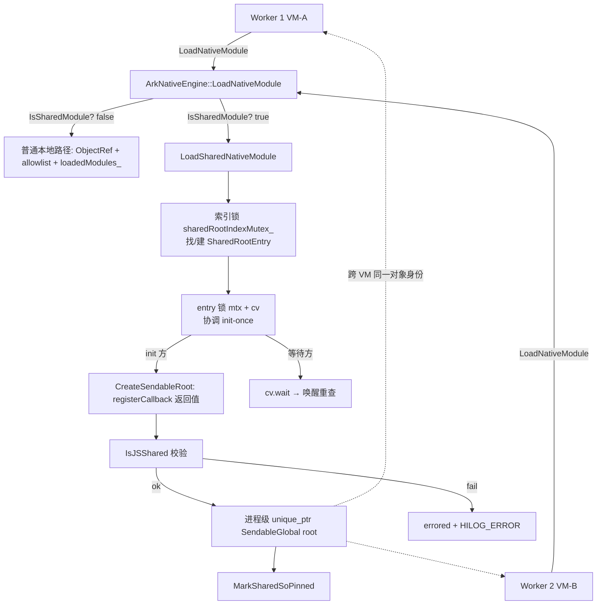
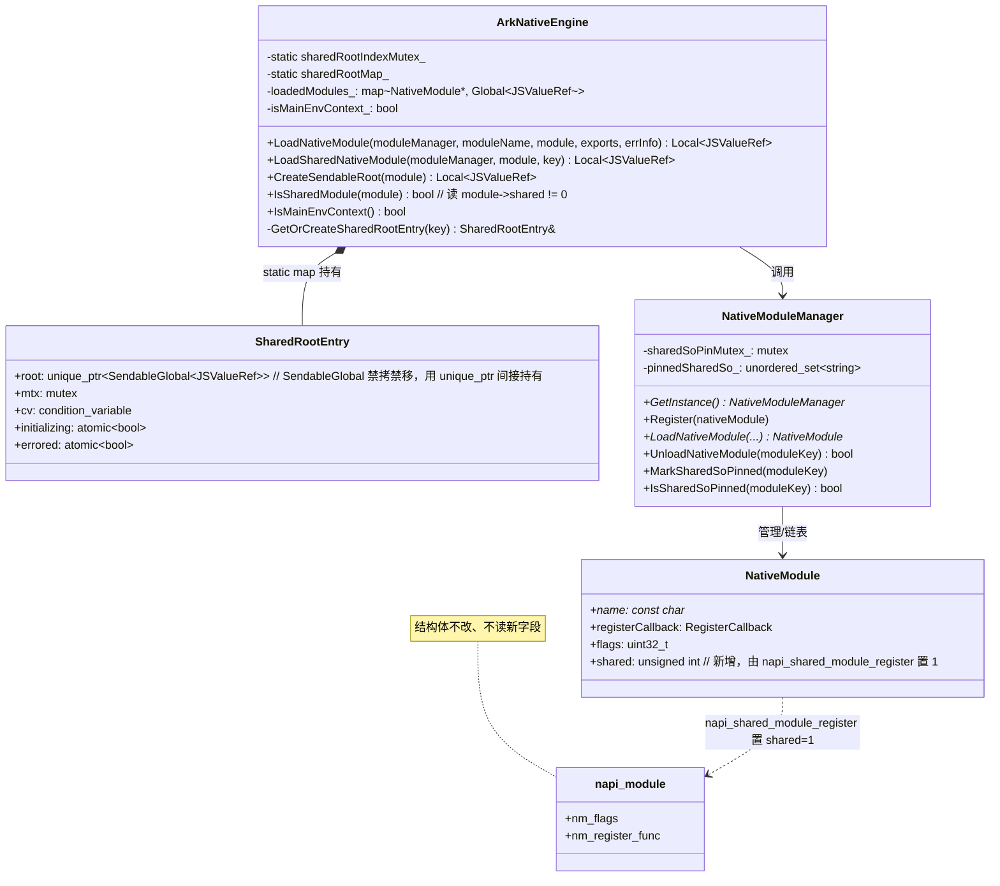
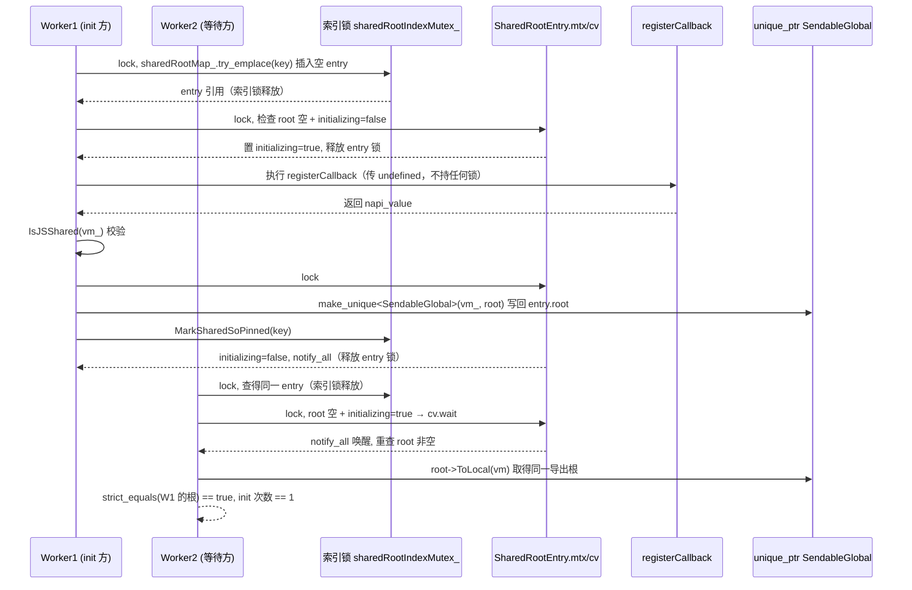

# Design

## 需求基线摘要

> 需求基线详见 proposal.md。以下为设计阶段需额外强调的要点。

- 实现 NAPI 模块**共享导出根**机制：native init 回调进程内只执行一次、返回完整 Sendable Root、进程级缓存，不同 VM 获得同一导出根对象身份（AC-1.1/1.2）。
- 接受 Namespace/模块记录仍为每 VM 本地（不完整对齐 ArkTS 共享模块语义），**不改造 `ets_runtime`**（AC-L2，模块记录保持 `UNSENDABLE_MODULE`）。
- 共享分支由 `IsSharedModule(module)` 谓词门控；谓词读 `module->shared != 0`。`shared` 由新增公共 API 函数 `napi_shared_module_register`（`native_api.h`）在注册时置 `1`；老 `napi_module_register` 不读 `napi_module` 任何新字段、`shared` 保持 `0`。opt-in 已激活（AC-1.9/EX-9/AC-BC1）。
- `.so` 固定驻留、两段锁并发协调、allowlist 旁路、普通模块行为不变（AC-1.6/1.8/1.9）。

## 代码事实基线

| 事实项 | 代码引用（文件:行） | 对设计的约束 |
|--------|-------------------|-------------|
| `LoadNativeModule` 当前行为 | ark_native_engine.cpp:838-907 | `:849` 查 `loadedModules_`；`:884` `ObjectRef::New(vm_)` 本地堆导出；`:889-890` 调 `registerCallback` **忽略返回值**；`:894-896` `CheckArkApiAllowList` 拷到本地堆 `exportCopy`；`:900` 写 `loadedModules_`（VM-local）。共享分支须在 `MoudleNameLocker` 后 early return 并跳过 `:884-900` |
| `loadedModules_` 类型 | ark_native_engine.h:556 | `std::map<NativeModule*, panda::Global<panda::JSValueRef>>`，VM-local，绑死创建 VM。共享根不能用此载体，须进程级 `SendableGlobal` |
| `RegisterCallback` 签名 | native_module_manager.h:51 | `napi_value (*RegisterCallback)(napi_env, napi_value)`——返回 `napi_value`，当前被忽略。共享契约改为消费返回值 |
| `NativeModule` 结构体 | native_module_manager.h:57-75 | 无 `shared` 字段；新增 `unsigned int shared = 0`，由 `napi_shared_module_register` 置 `1` |
| `napi_module_register` | native_node_api.cpp:35-52 | 复制 version/fileName/name/flags/registerCallback，**不读 `nm_shared`**；`shared` 保持 `0`。新增 `napi_shared_module_register`（同体+`shared=1`），不改 `napi_module` 结构体 |
| `napi_module_with_js_register` | native_node_api.cpp:54-72 | `napi_module_with_js` 结构体无共享声明路径；**不改**（首版不支持混合模块共享声明） |
| `Register` head/tail 复制 | native_module_manager.cpp:315, 344-376 | 复制 version/fileName/name/refCount/registerCallback/getJSCode/getABCCode 等，**不复制 flags、不复制 shared**；须在 `:344-376` 补 `shared` 复制 |
| `IS_APP_MODULE_FLAGS=100` | native_module_manager.cpp:45, :327 | `flags == 100` 整数判等。opt-in 走新 `shared` 字段而非 flags，避免与历史值冲突（DD-1） |
| `UnloadNativeModule` → `UnloadModuleLibrary` | native_module_manager.cpp:252, :266, :1329 | `.so` pin 在 `:252` 开头加 `IsSharedSoPinned` 跳过 `dlclose` |
| Sendable function env 切换 | ark_native_engine.cpp:1222-1223 | `if (info->isSendable) env = reinterpret_cast<napi_env>(JSNApi::GetEnv(vm))`——跨 VM env 已由运行时处理，模块作者无需缓存 env（BR-6） |
| `isMainEnvContext_` 语义 | ark_native_engine.h:571, :452；ark_native_engine.cpp:686 | Worker 的 `IsMainEnvContext()` 返回 true（非"主线程 vs Worker"标记）。任意 Worker 可成为 init 方 |
| `SendableGlobal` 不可拷贝/移动 | ets_runtime jsnapi_expo.h:557-558, :563, :600 | `ECMA_DISALLOW_COPY/MOVE`，`~SendableGlobal()=default`（不自动释放句柄）。`SharedRootEntry.root` 须用 `std::unique_ptr<SendableGlobal<JSValueRef>>` 间接持有，靠 `make_unique` 原地构造绕开 deleted move（DD-7） |
| Sendable API 签名 | native_api.h:169-187 | `napi_create_sendable_object_with_properties(env, property_count, properties, *result) → napi_status`；`napi_is_sendable(env, value, *result)`。构造侧已校验属性 sendable（AC-L1 既有行为） |

## 设计约束

1. 新增公共 API 函数 `napi_shared_module_register`（`native_api.h`）；不改 `napi_module` 结构体、不读其新字段；`ace_napi.versionscript` 为 `global: *` 通配导出新符号，无需改。
2. Ark VM 非线程安全：init 必须在所属 VM 线程执行；不跨 VM 调用 VM 接口（共享的是对象身份，非 VM 调用）。
3. 不改造 `ets_runtime`：模块记录保持本地 `UNSENDABLE_MODULE`，不触发 `StoreModuleValue` 共享校验。
4. 普通（调 `napi_module_register`、`shared==0`）模块加载路径完全不变。
5. `.so` 不绕过 `napi_module_register`/`napi_shared_module_register` 加载；不在 `nm_register_func` 做阻塞/重初始化（init 不持锁）。
6. 老 `.so` 二进制兼容：老 `.so` 只调 `napi_module_register`（不读 `napi_module` 新字段、不调 `napi_shared_module_register`），自然走普通路径，无需版本门控（DD-9/AC-BC1）。

## 非目标

- 不实现完整 ArkTS 共享模块语义（共享模块记录/Namespace/进程级模块状态）。
- 不改 `napi_module_with_js_register`（`napi_module_with_js` 无 `nm_shared`，首版不支持混合模块共享声明）。
- 不动 `ace_napi.versionscript`（`global: *` 通配导出新符号 `napi_shared_module_register`）。
- 不加固 canonical key（首版仅 moduleName）。
- 不改 `CheckArkApiAllowList` 自身（共享分支 early return 天然绕过）。
- 不实现引用计数式 `.so` 卸载（首版固定驻留）。

## 方案概述

采用**共享导出根 + 本地模块记录 + 先到先得 init** 路线。首个到达的 VM 在 entry 自身锁下置 `initializing`，**释放 entry 锁后**执行 `registerCallback`（不持任何锁，避免进 VM 触发 GC/重入 `RequireNapi` 死锁），返回值经 `IsJSShared(vm_)` 校验后写入进程级 `SendableGlobal` 句柄；其余 VM 在 entry `condition_variable` 上等待，唤醒后重查 root/errored。共享根由 `static std::map<std::string, SharedRootEntry>` 持有，索引查找/插入用独立的 `sharedRootIndexMutex_`（短临界区），init 协调用 entry 内嵌锁。`.so` 在 root 创建成功时 pin，永不 unpin。`LoadNativeModule` 在 `loadedModules_` 查询、`MoudleNameLocker` 之后插入 `IsSharedModule` 分支 early return，天然绕过本地堆导出/allowlist/VM-local 缓存。

opt-in 经**新增公共 API 函数** `napi_shared_module_register`（`interfaces/kits/napi/native_api.h`）激活：模块作者在 `.so` constructor 调 `napi_shared_module_register(&mod)`，内部置 `NativeModule.shared = 1` 并 `Register`；`IsSharedModule` 读 `module->shared != 0`。老 `napi_module_register` 不读 `napi_module` 任何新字段、`shared` 保持 `0`→普通路径。二进制兼容由"调哪个注册函数"决定（老 `.so` 只调 `napi_module_register`），无需版本门控，不改 `napi_module` 结构体（DD-1/DD-9/AC-BC1）。该方向依托现有 `SendableGlobal` 进程级存储与 sendable function env 切换，不依赖 `ets_runtime` 改造。

## 架构图

## 类图

## 模块影响

| 子系统 | 仓库 | 模块/路径 | 影响类型 | 相关设计决策 |
|--------|------|-----------|---------|-------------|
| ArkRuntime/NAPI 引擎 | foundation/arkui/napi | `native_engine/impl/ark/ark_native_engine.{h,cpp}` | 新增 `SharedRootEntry`（`unique_ptr<SendableGlobal>`）+ 静态 map + 四方法 + 分支接入 | DD-2/3/4/7/9（AC-1.1~1.9） |
| ArkRuntime/NAPI 引擎 | foundation/arkui/napi | `module_manager/native_module_manager.{h,cpp}` | 新增 `NativeModule.shared` 字段 + `.so` pin 机制 + Register 复制 | DD-1/5/9（AC-1.8, BR-1/9） |
| ArkRuntime/NAPI 引擎 | foundation/arkui/napi | `native_engine/native_node_api.cpp` | 新增 `napi_shared_module_register`（置 `shared=1`）；`napi_module_register` 不读 `nm_shared` | BR-9, AC-BC1 |
| ArkRuntime/NAPI 引擎 | foundation/arkui/napi | `interfaces/kits/napi/native_api.h` | 声明公共 API `napi_shared_module_register` | BR-9 |
| ets_runtime | arkcompiler/ets_runtime | — | **不改动** | DD-6（AC-L2） |

## 实现入口

| Entry Point | 代码引用（文件:行） | 当前职责 | 调用方 | 被调用方 | 预期变更 |
|-------------|-------------------|----------|--------|----------|----------|
| `ArkNativeEngine::LoadNativeModule` | ark_native_engine.cpp:838 | 模块加载入口 | `RequireNapi`/`NapiLoadNativeModule` | `loadedModules_`/`registerCallback`/`CheckArkApiAllowList` | `MoudleNameLocker` 后插入 `IsSharedModule` 分支 early return 至 `LoadSharedNativeModule` |
| `ArkNativeEngine::LoadSharedNativeModule` | 新增（ark_native_engine.cpp） | 共享根两段锁协调 | `LoadNativeModule` | `GetOrCreateSharedRootEntry`/`CreateSendableRoot`/`MarkSharedSoPinned` | 新增方法 |
| `ArkNativeEngine::CreateSendableRoot` | 新增 | 执行 `registerCallback`（传 undefined）+ 校验返回值 | `LoadSharedNativeModule` | `registerCallback`/`IsJSShared` | 新增方法（AC-1.3/L1） |
| `ArkNativeEngine::IsSharedModule` | 新增 | opt-in 谓词 | `LoadNativeModule` | 读 `module->shared != 0` | 新增方法 |
| `ArkNativeEngine::GetOrCreateSharedRootEntry` | 新增 | 索引锁下找/建 entry | `LoadSharedNativeModule` | `sharedRootMap_.try_emplace` | 新增方法 |
| `napi_module_register` | native_node_api.cpp:35 | 模块注册 | constructor | `NativeModuleManager::Register` | 不读 `nm_shared`，`shared` 保持 `0`；普通模块路径不变 |
| `napi_shared_module_register` | 新增（native_node_api.cpp:54；声明 native_api.h） | 共享模块注册 | constructor | `NativeModuleManager::Register` | 新增函数：同 `napi_module_register` 体 + `module.shared = 1` |
| `NativeModuleManager::Register` | native_module_manager.cpp:315 | 链表注册 | `napi_module_register`/`napi_shared_module_register` | head/tail 节点复制 | `:344-376` head/tail 复制补 `shared` |
| `NativeModuleManager::UnloadNativeModule` | native_module_manager.cpp:252 | 模块卸载 | — | `UnloadModuleLibrary`→`dlclose` | `:252` 开头加 `IsSharedSoPinned` 跳过 |
| 测试入口 | test/unittest/test_sendable_napi.cpp | Sendable UT | — | — | 新增 shared module 用例（经 `napi_shared_module_register` 注册） |

## 既有模式复用

| Pattern | 参考代码（文件:行） | 复用方式 | 适用 Task |
|---------|-------------------|----------|-----------|
| Sendable Object 构造 | native_api.h:169；native_sendable.cpp | 模块作者用 `napi_create_sendable_object_with_properties` 构造共享根；loader 侧 `IsJSShared` 校验 | CreateSendableRoot |
| Sendable function env 切换 | ark_native_engine.cpp:1222-1223 | 复用 `JSNApi::GetEnv(vm)` 跨 VM env，模块作者不缓存 | 模块作者契约（BR-6） |
| 进程级句柄存储 | ets_runtime `SendableGlobal`/`Runtime::sendableGlobalStorage_` | 共享根用 `std::unique_ptr<SendableGlobal<JSValueRef>>` 持有，跨 VM 存活；`make_unique` 原地构造绕开 deleted move | SharedRootEntry.root |
| 模块链表注册 + 节点复制 | native_module_manager.cpp:315-376 | 复制 `shared` 与既有字段同模式（按值拷贝） | Register 复制 |
| HILOG 错误记录 | 仓内既有 HILOG 模式 | init 失败/同名模块/canonical key 风险保留 HILOG_ERROR | 错误路径 |

## 关键设计决策

| 决策 ID | 问题 | 推荐方案 | 备选方案 | 选择理由 |
|---------|------|----------|----------|---------|
| DD-1 | opt-in 标记形式 | 新增公共 API 函数 `napi_shared_module_register`（`native_api.h`），内部置 `NativeModule.shared = 1`；`IsSharedModule` 读 `module->shared != 0` | 复用 `nm_flags` 位 / 读 `nm_shared` 字段 + 版本门控 / 存 `napi_module*` 指针延迟读 | opt-in 由"调哪个注册函数"决定，不改 `napi_module` 结构体、不读新字段；老 `.so` 只调 `napi_module_register`→普通路径，二进制兼容由 API 选择保证（DD-9）；不与历史 `flags==100` 冲突；`versionscript` `global: *` 通配导出新符号 |
| DD-2 | 共享载体 + 并发模型 | 进程级 `static std::map<string, SharedRootEntry>` + 两段锁（索引锁找/建 entry → entry 锁协调 init），init 不持锁 | 单全局锁 / 进程级 RW 锁 | 索引锁短（仅查找/插入），entry 锁仅 init 协调期竞争，不同模块互不影响；init 不持锁避免进 VM 触发 GC/重入死锁（AC-1.6） |
| DD-3 | callback 契约 | 消费 `registerCallback` 返回值，模块作者须返回完整 Sendable Root；loader 校验 `IsJSShared(vm_)`；第二个参数传 `undefined`（占位符未用，返回值是唯一权威） | 沿用"loader 建空对象 + callback 逐项赋值" | sendable root 须一次构造完成（属性 method/getter/setter 须为 sendable function）；逐项赋值无法保证整体 sendable 身份；传 undefined 让"忘记构造 root"的 bug 在 IsJSShared 校验暴露（AC-1.3/L1） |
| DD-4 | allowlist 处理 | 共享分支 early return 天然跳过 `CheckArkApiAllowList`/`CopyPropertyApiFilter` | 改造 allowlist 支持 sendable | allowlist 拷贝产物为本地堆，破坏 sendable；事后过滤与 sendable 语义不兼容。系统 module 的 API 控制改"构造前过滤 descriptor"属后续 |
| DD-5 | `.so` 生命周期 | root 创建成功时 `MarkSharedSoPinned`，永不 unpin 直至最后 VM 销毁/进程结束 | 引用计数卸载 | 共享根内 native callback 地址须防 `dlclose` 悬空；固定驻留换取简单且无悬空风险（AC-1.8）；代价是 `.so` 常驻 |
| DD-6 | ets_runtime 改动面 | 不改动；模块记录保持本地 `UNSENDABLE_MODULE` | 改 `module_data_extractor` 用 `NewSSourceTextModule` + 接入 `SharedModuleManager` | 本设计不依赖共享模块记录路径，`StoreModuleValue` 共享校验仅对 `IsSharedModule(module)` 为真者生效，本设计不触发；显著降低改动面与风险（AC-L2） |
| DD-7 | SharedRootEntry.root 类型 | `std::unique_ptr<panda::SendableGlobal<JSValueRef>>`（`make_unique` 原地构造 + unique_ptr 可移动赋值） | 直接 `SendableGlobal` 成员 / `std::optional<SendableGlobal>` | `SendableGlobal` `ECMA_DISALLOW_COPY/MOVE`（jsnapi_expo.h:557-558），直接成员无法"先空后填"；`unique_ptr` 间接持有借其可移动赋值达成延迟赋值，构造时原地构造绕开 deleted move；`optional` 亦可，但 `unique_ptr` 与仓内 `ApiAllowListChecker`/`ModuleLoadChecker` 同模式（AC-1.7/G1） |
| DD-8 | canonical key | 首版 `strModuleName` | bundle id + namespace + 加载域 | 首版简化；跨 bundle 同名误共享为已知风险（EX-8），后续加固 |
| DD-9 | 老 .so 二进制兼容 | opt-in 经新函数 `napi_shared_module_register`（公共 API）；老 `napi_module_register` 不读 `napi_module` 新字段 | 读 `nm_shared` 字段 + `IsSharedModuleApiVersion` 版本门控 / 无条件读 | 老 `.so` 只调 `napi_module_register`（不读新字段、不调新函数）→ `shared=0` → 普通路径；二进制兼容由 API 选择保证，无需版本门控、不改 `napi_module` 结构体（AC-BC1）。新共享模块调 `napi_shared_module_register`（按新头编译，符号存在） |

## 状态归属与不变量

**Ownership（sharedRootMap_）**
- owner：`ArkNativeEngine` 静态成员 `sharedRootMap_`（进程级），key=`strModuleName`（首版）。
- 创建时机：首个 VM `LoadSharedNativeModule` 命中 `sharedRootMap_.try_emplace(key)` 插入空 entry。
- 清理触发：最后 VM 销毁/进程结束（首版不主动清理，无界风险见 Capacity）。
- 只读消费者：任意 VM 经 `SharedRootEntry.root->ToLocal(vm)` 取 `Local<T>`。
- 不变量：entry 一旦插入，`std::map` 节点地址稳定（不因其他插入/删除而失效），内嵌不可拷贝 `mutex`/`condition_variable` 合法；`try_emplace` 原地构造不要求 entry 可移动。
- 验证：AC-1.1/1.2/1.7；Task 见 execution-plan。
- 关联 AC：AC-1.1, AC-1.7, AC-G1。

**Lifecycle（SharedRootEntry 状态机）**
- 状态：未初始化（root 空, initializing=false, errored=false）→ 初始化中（initializing=true）→ 就绪（root 非空, initializing=false）/ 错误（errored=true, initializing=false）。
- 创建：init 方置 `initializing=true` 后释放 entry 锁执行 `CreateSendableRoot`。
- 清理/回滚：init 失败置 `errored=true`、root 保持空（`unique_ptr` 仍 null）；`notify_all` 唤醒等待方重查。
- 异常恢复：callback 抛异常 → `TryCatch` 捕获 → `errored=true`（AC-1.5）；错误状态对所有 VM 一致可见。
- 不变量：root 非空 ⇔ 就绪；`errored` 一旦 true 不重试（首版，失败即固定错误态，避免抖动）。
- 验证：AC-1.3/1.4/1.5；关联 Task 见 execution-plan。

**Concurrency（两段锁）**
- 同步模型：`sharedRootIndexMutex_`（索引锁，仅 map 查找/插入）+ `entry.mtx`（entry 锁，init 协调）+ `entry.cv`（等待方阻塞）+ `initializing`/`errored` atomic。
- 不变量：init **不持任何锁**（释放 entry 锁后执行 `registerCallback`）；等待方在 `entry.mtx` 下 `cv.wait`，被 `notify_all` 唤醒后重查 root/errored；不同模块 entry 互不影响。
- 死锁防护：init 不持锁 → 进 VM 触发 GC / 重入 `RequireNapi` 不阻塞其他模块的 entry 锁；同线程递归 import 自身返回空 + HILOG_ERROR（EX-6，首版不深度处理）。
- 不变量：无固定超时（设计决策，notify 驱动）；registerCallback 挂起 → 等待方无限阻塞为已知风险。
- 验证：AC-1.6；关联 Task 见 execution-plan。

**Compatibility**
- 状态格式：`NativeModule` 新增 `shared`（`unsigned int`，默认 0），不破坏既有字段布局；`napi_module` 结构体不改。
- API：新增公共 API 函数 `napi_shared_module_register`（`native_api.h`）；`ace_napi.versionscript` 为 `global: *` 通配导出新符号，无需改。
- 默认行为：调 `napi_module_register`（`shared==0`）→ `IsSharedModule` false → 普通 `nm_flags==0`/`==100` 模块走原路径，allowlist/exports/`loadedModules_` 不变。
- 老 .so 兼容：老 `.so` 只调 `napi_module_register`（不读 `napi_module` 新字段、不调 `napi_shared_module_register`）→ `shared=0` → 普通路径；二进制兼容由 API 选择保证，无需版本门控（DD-9/AC-BC1）。
- 不变量：调 `napi_module_register` 的模块不进入共享分支（EX-9）。
- 验证：AC-1.9/AC-BC1；关联 Task 见 execution-plan。

**Performance（热路径）**
- 索引锁持有：仅 `sharedRootMap_.try_emplace(key)` 查找/插入（O(log n)，短）。
- entry 锁竞争：仅 init 协调期；稳态（root 就绪后）等待方不阻塞，`cv.wait` 立即返回。
- 稳态命中：后续 Worker import → 索引锁找 entry → root 已就绪 → `ToLocal(vm)`，接近零成本。
- GC 影响：`SendableGlobal` 由共享/CMC GC 标记遍历，跨 VM 存活；须确认共享堆标记遍历不退化 GC 停顿（见 GC 策略设计）。
- 不变量：init 不持索引锁/entry 锁，避免长临界区。
- 验证：AC-1.2/1.6, AC-G1；关联 Task 见 execution-plan。

**Capacity / Migration**
- 容量边界：`sharedRootMap_` 首版**无上界**（每个共享模块一个 entry + 一个 `unique_ptr<SendableGlobal>` + 一个 pin 的 `.so`）。
- 限制行为：无主动驱逐；依赖共享模块数量有限。
- 不变量：共享模块数量须可观测（HILOG 统计），后续设边界。
- 风险：无界进程级缓存 + `.so` 常驻 → RSS 增长（AC-G2 长稳观测）。
- 验证：AC-G2（板侧长稳）；关联 Task 见 execution-plan。

## 安全基础检查

> 触发：proposal.md `安全/权限` = 「是」（依据：跨 Worker 共享导出根跨信任边界、`.so` 生命周期安全、allowlist 旁路致 API 暴露面变更、canonical key 同名模块跨应用误共享风险）。

### 信任边界交叉分析

| 交互类型 | 边界描述 | 通信双方 | 权限管控机制 | 关联 AC |
|---------|----------|----------|-------------|---------|
| 跨 Worker（进程内 VM/线程） | 同进程不同 VM 间共享导出根对象身份与 native callback 调用 | Worker-A ↔ Worker-B（共享堆） | 无显式权限管控（同进程同信任域）；依赖 canonical key 隔离不同 bundle/HSP | AC-1.1, AC-1.7 |
| 跨 bundle/HSP（canonical key） | 不同应用/共享包同名模块的 key 冲突 | 应用 X 的共享模块 ↔ 应用 Y 的同名模块 | 首版仅 moduleName 作 key，**无 bundle/namespace 维度隔离** → 误共享风险 | AC-1.1（边界）, EX-8 |
| API 暴露面（allowlist 旁路） | 共享分支跳过 `CheckArkApiAllowList` | 模块导出 → 宿主 gating | 共享模块 API 暴露面由模块作者构造时自决；事后过滤被旁路 | AC-1.9, BR-7 |

### 基础安全要求检查

| 检查项 | 检查结果 | 说明/措施 |
|--------|----------|-----------|
| 加密算法合规 | N/A | 本变更不涉及加密 |
| 密钥管理安全 | N/A | 不涉及密钥 |
| 随机数安全 | N/A | 不涉及随机数 |
| 输入验证完备 | ✅ | loader 校验 callback 返回值非空 + `IsJSShared(vm_)`；构造侧 `napi_create_sendable_object_with_properties` 校验属性 sendable（AC-1.3/L1） |
| 错误处理安全 | ✅ | 失败统一 errored + HILOG_ERROR；不打印敏感数据（模块名属公开信息）；不静默成功 |
| 配置安全 | ✅ | opt-in 默认调 `napi_module_register`（`shared=0`，最小暴露） |

### 敏感数据处理（如适用）

本次变更不涉及敏感数据（PII/密钥/凭证/生物特征）。导出根为模块功能对象，非敏感数据载体。

### 深度威胁分析（如需）

> 命中高风险判据（跨信任边界 + 关键安全组件生命周期 + API 暴露面变更），建议运行 `odk-security-threat-model` 生成独立 `threat-model.md`。以下为摘要：

- **TH-1（P0）**：canonical key 仅 moduleName → 跨 bundle/HSP 同名模块误共享，可能致跨应用对象/状态泄漏或权限越界。缓解：首版限定系统模块 + 后续加固 key 维度（bundle/namespace）。关联 EX-8/AC-1.1。
- **TH-2（P1）**：allowlist 旁路 → 共享系统 module 的 API 暴露面不受宿主 gating。缓解：共享分支 early return 跳过；系统 module 的 API 控制改"构造前过滤 descriptor"（后续 follow-up）。关联 BR-7/AC-1.9。
- **TH-3（P1）**：`.so` 固定驻留 + 无界 `sharedRootMap_` → 资源占用/DoS。缓解：HILOG 统计数量 + 后续设容量边界 + 最后 VM 销毁统一释放。关联 AC-G2/DD-5。
- **TH-4（P1）**：registerCallback 挂起 → 等待方无限阻塞（无超时）。缓解：模块作者契约禁止阻塞；后续可加防御性 max-wait。关联 EX-1。

## GC 策略设计

> arkruntime profile 追加章节。本变更不引入新 GC 路径，但共享根由 `SendableGlobal` 持有，须确认不退化 GC 停顿。

- 共享根 `SendableGlobal<JSValueRef>`（经 `unique_ptr` 间接持有）注册到进程级 `Runtime::sendableGlobalStorage_`，由共享/CMC GC 标记遍历跨 VM 存活。
- 不变量：root 非空时不被回收（GC 标记遍历可达）；源 VM 销毁后仍可被其他 VM `ToLocal` 访问（AC-G1）。
- 停顿约束：须观测共享堆标记遍历在共享根数量增长下不退化（停顿 ≤ 10ms P95，arkruntime 基线）。本变更不新增 GC 触发点，仅增加存活引用，预期停顿影响可观测但不引入新停顿源。
- 错误态 root 保持空（`unique_ptr` null），不占共享堆句柄，无 GC 负担。
- 验证：AC-G1/G2。

## JIT/AOT 编译策略

> arkruntime profile 追加章节。本变更**不适用**：不涉 JIT/AOT 编译、字节码格式或 AOT 产物。模块记录保持本地 `UNSENDABLE_MODULE`，无字节码/AOT 格式变更；sendable function 的编译边界由既有 sendable 机制处理，本设计不复管。

## FFI 接口设计

> arkruntime profile 追加章节。本变更涉及 NAPI（C ABI）↔ Ark VM 的 FFI 边界，但沿既有 sendable FFI 机制，不新增 FFI 类型映射。

- 内存所有权：`SendableGlobal` 句柄由 `ArkNativeEngine` 静态 map（`unique_ptr`）持有（owner），`Local<T>` 经 `ToLocal(vm)` 取出为栈短期引用，不跨作用域持有。
- callback env 所有权：sendable function 回调的 `env` 由运行时 `JSNApi::GetEnv(vm)` 动态取（ark_native_engine.cpp:1222），模块作者不持有 env 所有权（BR-6）。
- 类型安全：`registerCallback` 返回值经 `IsJSShared(vm_)` 校验；非 sendable 即 errored，不向共享堆写入非法类型（AC-1.3/L1）。
- 异常恢复：callback 抛异常 → `TryCatch` 捕获 → `errored=true`，异常不跨 FFI 边界传播为未捕获（AC-1.5）。
- 验证：AC-1.3/1.5/1.7, AC-L1。

## 时序设计

## 风险与缓解

| 风险 | 可能性 | 影响 | 缓解措施 |
|------|--------|------|----------|
| canonical key 仅 moduleName 致跨应用同名误共享 | 中 | 高（信息泄漏/权限越界） | 首版限定系统模块；后续 key 加 bundle/namespace（TH-1, EX-8） |
| registerCallback 挂起致等待方无限阻塞 | 低 | 高（Worker 挂起） | 模块作者契约禁止阻塞；后续防御性 max-wait（TH-4, EX-1） |
| allowlist 旁路致共享系统 module API 暴露面失控 | 中 | 中 | 改"构造前过滤 descriptor"（后续 follow-up）（TH-2, BR-7） |
| 无界 sharedRootMap_ + .so 常驻致 RSS 增长 | 中 | 中 | HILOG 统计 + 后续设容量边界 + 最后 VM 销毁统一释放（TH-3, AC-G2） |
| init 失败后固定错误态不重试 | 低 | 中 | 首版接受（避免抖动）；后续可加重试或进程级清理 |
| 同线程递归 import 自身 | 低 | 中 | 首版返回空 + HILOG_ERROR（EX-6） |
| 老 .so 在新平台（apiVersion>=26）加载仍越界 | 低 | 高（越界读） | 依赖版本相关性（新平台 .so 按新头编译有该字段）；首版接受此前向兼容缺口（DD-9） |

## 验证思路

| 验证场景 | 方法 | 通过标准 |
|----------|------|----------|
| 多 Worker 同一共享模块 | UT（经 `napi_shared_module_register` 注册）+ 板侧 | strict_equals true + init == 1（AC-1.1/1.2） |
| 并发首次 import | UT 并发用例 + 板侧 | 无挂起 + init == 1 + 结果一致（AC-1.6） |
| callback 返回非 sendable/null/抛异常 | UT | errored + 空导出 + HILOG_ERROR + 多 VM 一致（AC-1.3/1.4/1.5） |
| 源 VM 销毁后调用 | UT + 板侧 | 不崩溃 + 正确返回（AC-1.7, AC-G1） |
| .so pin | UT | dlclose 跳过 + 不崩溃（AC-1.8） |
| 普通模块行为不变 | 回归套件（test_napi/test_ark_api_allowlist） | 行为不变（AC-1.9） |
| 老 .so 不越界 | UT（老 .so 只调 `napi_module_register`） | 不读新字段；`shared=0`；走普通路径（AC-BC1） |
| 1h 长稳 | 板侧 | 共享堆无持续增长（AC-G2） |
| 不触发 ets_runtime 共享校验 | UT + 标准套件 | 通过率 ≥ 基线（AC-L2） |

> 兼容性验证详见 spec.md 兼容性声明章节。多 Worker / 长稳 / 源 VM 销毁场景须补充板侧证据。
