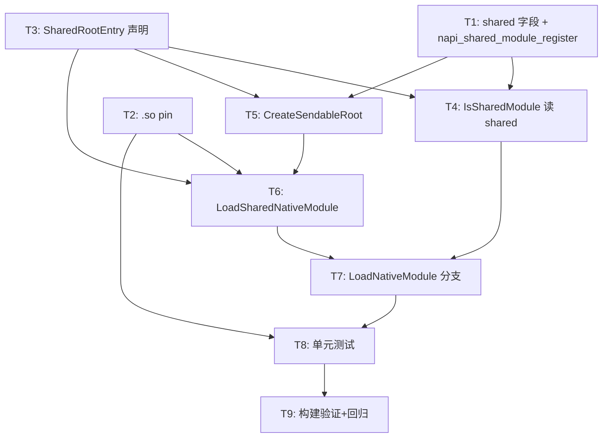

# Execution Plan

## 输入状态

| 输入 | 路径 | 要求状态 |
|------|------|----------|
| Proposal | proposal.md | Approved |
| Spec | spec.md | Approved |
| Design | design.md | Approved |

> **实现进度说明**：T1–T7、T9（构建）已实现并通过 arm64 ace_napi 构建（commit `ae149b48` feat + `c7aa4660` 版本门控移除/napi_shared_module_register；working tree 含 `napi_shared_module_register` 公共 API 化）。T8（UT）尚未编写，AC 追溯表中 UT 相关验证状态为 Pending/Fail。下文 Task 详情已对齐最终代码逻辑（`napi_shared_module_register` 公共 API + `shared` 按值字段，无版本门控）。

## 执行原则

- **Spec 权威：** 若实现细节与 `spec.md` 的 AC、错误码或兼容性声明冲突，先更新 spec/design，再继续实现。
- **测试/证据先行：** 每个 Task 先写失败测试；无法单测的集成行为必须先写明可复现证据缺口。
- **任务小型化：** 一个 Task 只覆盖一个独立闭环。
- **文件边界：** Task 只能修改 `Files` 表列出的文件；若构建暴露额外声明或 fixture 需求，先更新本计划。
- **状态所有权唯一：** 新增状态必须明确 owner、key/index、创建时机、清理触发和只读消费者。
- **证据回填：** Task 完成后必须回填「AC 到 Task 追溯」验证状态、「代码范围映射」实际文件、per-task `Actual Result`。
- **反伪完成：** 只补声明、只写存储结构、只覆盖 happy path、只跑非相关测试，都不能替代 AC 闭环。
- **可交接执行：** 本计划须能被新 Agent 在无历史对话上下文下逐 Task 执行。

## AC 到 Task 追溯

| AC | 来源 | Task | 验证方式 | 验证状态（Pass/Fail/Blocked） |
|----|------|------|----------|----------------------------------|
| AC-1.1 | spec US-1 | T6, T8 | UT（经 `napi_shared_module_register` 注册）：两 VM import 后 strict_equals true + init 计数 == 1 | Code Done；UT Pending（T8） |
| AC-1.2 | spec US-1 | T6, T8 | UT：VM-A init 后 VM-B import，strict_equals true + init 保持 1 | Code Done；UT Pending（T8） |
| AC-1.3 | spec US-1 | T5, T6, T8 | UT：callback 返回普通 Object → 导出 undefined + HILOG_ERROR + 多 VM 一致 | Code Done；UT Pending（T8） |
| AC-1.4 | spec US-1 | T5, T8 | UT：callback 返回 null → 导出 undefined + HILOG_ERROR | Code Done；UT Pending（T8） |
| AC-1.5 | spec US-1 | T5, T6, T8 | UT：callback 内 napi_throw_error → 导出 undefined + 无未捕获传播 | Code Done；UT Pending（T8） |
| AC-1.6 | spec US-1 | T6, T8 | UT 并发用例 + 板侧：无挂起 + init == 1 + 结果一致 | Code Done；UT Pending（T8）；板侧 Blocked |
| AC-1.7 | spec US-1 | T6, T8 | UT + 板侧：源 VM 销毁后其他 VM 调用导出方法不崩溃 | Code Done；UT Pending（T8）；板侧 Blocked |
| AC-1.8 | spec US-1 | T2, T8 | UT：共享根存活时 UnloadNativeModule → dlclose 跳过 + 调用不崩溃 | Code Done；UT Pending（T8） |
| AC-1.9 | spec US-1 | T4, T7, T9 | 回归：普通模块（调 `napi_module_register`）多 Worker import → 各 VM 独立导出 + 行为不变 | Pass（构建 + 既有回归：`IsSharedModule` 默认 false，普通模块不进分支） |
| AC-BC1 | spec 二进制兼容 | T1, T8 | UT：老 .so（只调 `napi_module_register`）→ 不读新字段、`shared=0`、走普通路径 | Code Done；UT Pending（T8） |
| AC-G1 | spec GC | T3, T6, T8 | UT + 板侧：触发 GC 后导出根可访问；源 VM 销毁后可访问 | Code Done；UT Pending（T8）；板侧 Blocked |
| AC-G2 | spec GC | T8（板侧） | 板侧长稳：多 Worker 1h 并发调用，共享堆无持续增长 | Blocked（板侧） |
| AC-L1 | spec 语言标准 | T5, T8 | UT：构造含 LocalHeap 值属性 → 返回非 napi_ok + 导出根未创建 | Code Done；UT Pending（T8） |
| AC-L2 | spec 语言标准 | T9 | UT + 标准套件：不触发 ets_runtime 共享校验；通过率 ≥ 基线 | Pass（不改动 ets_runtime；模块记录本地 UNSENDABLE_MODULE 不触发校验） |

## 实现边界

**已实现：** T1（`NativeModule.shared` 字段 + `napi_shared_module_register` 公共 API + `napi_module_register` 不读 `nm_shared` + `Register` 复制 `shared`）、T2（`.so` pin）、T3（`SharedRootEntry` + 静态成员 + 方法声明）、T4（`IsSharedModule` 读 `module->shared != 0`）、T5（`CreateSendableRoot`）、T6（`LoadSharedNativeModule` 两段锁）、T7（`LoadNativeModule` 分支接入）、T9（arm64 构建通过）。

**未实现：** T8（UT，经 `napi_shared_module_register` 注册共享模块用例、AC-BC1 老 .so 用例）。

**可后置：** canonical key 加 bundle/namespace 维度；allowlist "构造前过滤 descriptor"；引用计数式 .so 卸载；板侧长稳（AC-G2）与多 Worker 板侧证据（AC-1.6/1.7）。

## 禁止项

- 每个 AC 必须有明确的验证方式。
- Agent 不得自行寻找未列出的上下文文件作为修改依据；需要新增上下文时先更新 Task。
- 不得修改 Task 列出范围外的文件。
- 不得在未通过验证时标记 Task 完成。
- 不得使用 `TBD`、`TODO`、`适当处理`、`补充测试`、`参考上文` 等不可执行占位描述。
- **arkruntime profile 追加禁止项：** GC 停顿不得退化（需基准数据）；不得破坏 ETS/ArkTS 标准兼容；字节码/AOT 格式变更需版本号（本变更不涉字节码/AOT，相关项 N/A）。
- 不得修改 `ets_runtime`（arkcompiler/ets_runtime）。
- 不得修改 `napi_module` 结构体（不读 `nm_shared` 等新字段；opt-in 由新函数 `napi_shared_module_register` 决定）；不动 `ace_napi.versionscript`（`global: *` 通配导出）。
- 不得改 `napi_module_with_js_register`（`napi_module_with_js` 无 `nm_shared`，首版不支持混合模块共享声明）。
- 不得为通过测试删除 HILOG/错误码/DFX 信息。

## Task 依赖



## Task 列表

| TASK ID | 目标 | 文件范围 | AC 映射 | 前置依赖 | 完成判据 | 验证命令 | 状态 |
|---------|------|----------|---------|----------|----------|----------|------|
| T1 | `NativeModule.shared` 字段 + `napi_shared_module_register` + `Register` 复制 | native_module_manager.h/.cpp、native_node_api.cpp、native_api.h | BR-1/BR-9, AC-BC1 | 无 | `napi_shared_module_register` 置 `shared=1`；`napi_module_register` 不读 `nm_shared` | 编译 + 断言用例 | Done |
| T2 | .so pin 机制 | native_module_manager.h/.cpp | AC-1.8 | 无 | pin 后 UnloadNativeModule 跳过 dlclose | UT | Done（Code）；UT Pending（T8） |
| T3 | SharedRootEntry + 静态成员 + 方法声明 | ark_native_engine.h | AC-1.1~1.7/G1（声明） | 无 | 头文件编译通过 | 编译 | Done |
| T4 | IsSharedModule 谓词（读 `module->shared != 0`） | ark_native_engine.cpp | AC-1.9, EX-9 | T1, T3 | 调 `napi_shared_module_register`→true；调 `napi_module_register`→false | UT | Done（Code）；UT Pending（T8） |
| T5 | CreateSendableRoot（消费 callback 返回值 + 校验） | ark_native_engine.cpp | AC-1.3, AC-1.4, AC-L1 | T1, T3 | 非 sendable/null → 返回空 + HILOG_ERROR | UT | Done（Code）；UT Pending（T8） |
| T6 | LoadSharedNativeModule 两段锁 + GetOrCreate | ark_native_engine.cpp | AC-1.1~1.7, AC-G1 | T2, T3, T5 | init 不持锁；并发只 init 一次；等待方唤醒重查 | UT 并发 | Done（Code）；UT Pending（T8） |
| T7 | LoadNativeModule 分支接入（early return） | ark_native_engine.cpp | AC-1.9, AC-1.1~1.7 | T4, T6 | 普通模块不进分支；分支跳过本地堆/allowlist/loadedModules_ | UT | Done（Code）；UT Pending（T8） |
| T8 | 单元测试（经 `napi_shared_module_register` 注册共享模块 + AC-BC1 老 .so 用例） | test/unittest/test_sendable_napi.cpp 等 | AC-1.1~1.9, AC-BC1, AC-G1, AC-L1 | T2, T6, T7 | 全部 UT Pass（含 Red 条件反转） | UT 套件 | Todo |
| T9 | arm64 构建验证 + 回归套件 | 构建 + 回归测试 | AC-1.9, AC-L2 | 全部 | ace_napi arm64 编译通过；回归不变 | hb build / UT | Done（构建 Pass）；回归 UT Pending（T8） |

## Task 详情

### TASK-1: NativeModule.shared 字段 + napi_shared_module_register + Register 复制

**目标：** 在 `NativeModule` 新增 `unsigned int shared = 0` 字段；新增公共 API 函数 `napi_shared_module_register`（`native_api.h` 声明、`native_node_api.cpp` 实现），内部置 `module.shared = 1` 并 `Register`；`napi_module_register` 不读 `nm_shared`、`shared` 保持 `0`；`Register` head/tail 复制 `shared`。不改 `napi_module` 结构体、不加版本门控。

**AC 映射：** BR-1/BR-9, AC-BC1

**前置依赖：** 无

**非目标：** 不改 `napi_module_with_js_register`；不改 `napi_module` 结构体（不读 `nm_shared`）；不动 `ace_napi.versionscript`（`global: *` 通配导出新符号）；不改 `flags` 复制逻辑；不改 IS_APP_MODULE_FLAGS 判等。

**状态所有权：** `NativeModule.shared`（`unsigned int`，默认 0）由 `napi_shared_module_register` 写入（置 `1`），由 `Register` 复制到 head/tail 节点；只读消费者为 `IsSharedModule`（T4）；生命周期随 `NativeModule`（链表节点，进程级）。

**任务间接口：**
- Produces：`NativeModule.shared`（`unsigned int shared = 0`，native_module_manager.h）；公共 API `napi_shared_module_register(napi_module* mod)`（native_api.h 声明、native_node_api.cpp 实现）。调 `napi_shared_module_register` 的模块 `module.shared == 1`；调 `napi_module_register` 的模块 `module.shared == 0`。
- Consumes：`napi_module`（公共头 `node_api.h`，只读既有字段 version/fileName/name/flags/register_func，不读 `nm_shared`）。

**只读上下文**

| 路径 | 读取目的 |
|------|----------|
| module_manager/native_module_manager.h:57-75 | NativeModule 结构体现状 |
| native_engine/native_node_api.cpp:35-52 | napi_module_register 现状 |
| module_manager/native_module_manager.cpp:315-376 | Register head/tail 复制现状 |
| interfaces/kits/napi/native_api.h | 公共 API 头（含 sendable 段，新函数放置点） |

**Files**

| 操作 | 文件 | 说明 |
|------|------|------|
| Edit | module_manager/native_module_manager.h | NativeModule 加 `unsigned int shared = 0;` |
| Edit | module_manager/native_module_manager.cpp | Register head/tail 复制块各加 `shared = nativeModule->shared;` |
| Edit | native_engine/native_node_api.cpp | 新增 `napi_shared_module_register(mod)`（同 `napi_module_register` 体 + `module.shared = 1`）；`napi_module_register` 不读 `nm_shared` |
| Edit | interfaces/kits/napi/native_api.h | 声明 `NAPI_EXTERN void napi_shared_module_register(napi_module* mod);`（sendable 段末尾） |

**禁止修改文件**

| 文件/路径 | 原因 |
|-----------|------|
| `napi_module` 结构体（`node_api.h`） | 不改、不读新字段（opt-in 由新函数决定） |
| `napi_module_with_js_register` | 首版不支持混合模块共享声明 |
| `ace_napi.versionscript` | `global: *` 通配导出新符号 |
| `native_engine.h/.cpp` | 无版本门控，不改 |

**Steps**

- [x] Step 1: 实现 `shared` 字段 + `napi_shared_module_register` + `Register` 复制 + `native_api.h` 声明。
- [x] Step 2: arm64 构建通过。
- [ ] Step 3: UT（T8）：经 `napi_shared_module_register` 注册后断言 `module.shared == 1`；调 `napi_module_register` 断言 `module.shared == 0`。
- [ ] 回填 Actual Result。

**Anti-Fake Completion**

| Check | Required Evidence |
|-------|-------------------|
| AC closed | BR-1/BR-9/AC-BC1：`napi_shared_module_register` 断言通过（T8） |
| Scope respected | 仅 4 文件 |
| State lifecycle complete | `shared` 写入（`napi_shared_module_register` 置 1）/读（`IsSharedModule`） |

**Verification**

| Command / Evidence | Expected Result | Actual Result |
|--------------------|-----------------|---------------|
| arm64 ace_napi 构建 | 编译通过 | Pass（commit ae149b48/41474428） |
| module_manager UT | `napi_shared_module_register` 断言 Pass | Pending（T8） |

**Review Handoff**

| Reviewer | Input |
|----------|-------|
| Spec Compliance | BR-1/BR-9 数据按值拷贝 + 版本门控；不改公共 API；不改 with_js_register |
| Code Quality | 5 文件 diff；老 .so 兼容（`IsSharedModuleApiVersion` 门控，老平台不读 `nm_shared`）；用 `realApiVersion_`（非复合 `apiVersion_`） |

### TASK-2: .so pin 机制

**目标：** 在 NativeModuleManager 增加 `MarkSharedSoPinned`/`IsSharedSoPinned` 与 `pinnedSharedSo_` 集合，`UnloadNativeModule` 开头命中即跳过 `dlclose`。

**AC 映射：** AC-1.8, EX-7

**前置依赖：** 无

**非目标：** 不实现引用计数卸载（首版固定驻留）；不主动 unpin。

**状态所有权：** `pinnedSharedSo_`（`std::unordered_set<std::string>`，owner=NativeModuleManager 单例，key=moduleKey）；创建=MarkSharedSoPinned；清理=进程结束（首版不主动清理）；只读消费者=UnloadNativeModule；互斥=`sharedSoPinMutex_`。

**任务间接口：**
- Produces：`void NativeModuleManager::MarkSharedSoPinned(const std::string& moduleKey)`；`bool NativeModuleManager::IsSharedSoPinned(const std::string& moduleKey)`。
- Consumes：无。

**只读上下文**

| 路径 | 读取目的 |
|------|----------|
| module_manager/native_module_manager.cpp:252-267 | UnloadNativeModule → UnloadModuleLibrary 现状 |
| module_manager/native_module_manager.cpp:1329 | UnloadModuleLibrary 实现 |

**Files**

| 操作 | 文件 | 说明 |
|------|------|------|
| Edit | module_manager/native_module_manager.h | 加 `MarkSharedSoPinned`/`IsSharedSoPinned` 公开声明 + `sharedSoPinMutex_`/`pinnedSharedSo_` 私有成员 |
| Edit | module_manager/native_module_manager.cpp | 实现两方法；`UnloadNativeModule`（:252）开头 `if (IsSharedSoPinned(moduleKey)) { MODULEMNG_HILOG_INFO(...); return true; }` |

**禁止修改文件**

| 文件/路径 | 原因 |
|-----------|------|
| UnloadModuleLibrary（:1329） | 保持原 dlclose 逻辑不变 |

**Steps**

- [ ] Step 1: 写失败测试：MarkSharedSoPinned(key) 后 UnloadNativeModule(key) 不触发 dlclose。
- [ ] Step 2: 运行确认 RED。
- [x] Step 3: 实现——加集合/互斥/两方法/UnloadNativeModule 跳过。
- [x] Step 4: arm64 构建通过。
- [ ] Step 5: UT GREEN（T8）。
- [ ] 回填 Actual Result。

**Anti-Fake Completion**

| Check | Required Evidence |
|-------|-------------------|
| AC closed | AC-1.8：pin 后 dlclose 被跳过（T8） |
| Scope respected | 仅 native_module_manager.h/.cpp |
| State lifecycle complete | pinnedSharedSo_ 创建（Mark）/读（IsSharedSoPinned）；清理=进程结束 |

**Verification**

| Command / Evidence | Expected Result | Actual Result |
|--------------------|-----------------|---------------|
| arm64 构建 | 编译通过 | Pass |
| module_manager UT | pin 后 Unload 跳过 dlclose | Pending（T8） |

**Review Handoff**

| Reviewer | Input |
|----------|-------|
| Spec Compliance | AC-1.8/EX-7；固定驻留语义 |
| Code Quality | 2 文件 diff；互斥保护集合 |

### TASK-3: SharedRootEntry + 静态成员 + 方法声明

**目标：** 在 ark_native_engine.h 定义 `SharedRootEntry` 结构体（`root` 为 `std::unique_ptr<panda::SendableGlobal<JSValueRef>>`）、静态 `sharedRootMap_`/`sharedRootIndexMutex_`、`LoadSharedNativeModule`/`CreateSendableRoot`/`IsSharedModule`/`GetOrCreateSharedRootEntry` 声明。

**AC 映射：** AC-1.1~1.7/G1（声明承载，不直接闭合）

**前置依赖：** 无

**非目标：** 不实现方法体（T4/T5/T6）；不加 SendableGlobal 依赖以外的 ets_runtime 改动。

**状态所有权：** 声明静态 owner（ArkNativeEngine 静态成员），实际状态生命周期由 T6 管理。

**任务间接口：**
- Produces：
  - `struct SharedRootEntry { std::unique_ptr<panda::SendableGlobal<JSValueRef>> root; std::mutex mtx; std::condition_variable cv; std::atomic<bool> initializing{false}; std::atomic<bool> errored{false}; };`（`root` 用 `unique_ptr` 因 `SendableGlobal` `ECMA_DISALLOW_COPY/MOVE`，直接成员无法"先空后填"）
  - 静态 `std::mutex sharedRootIndexMutex_;`、`static std::map<std::string, SharedRootEntry> sharedRootMap_;`
  - 方法签名：`Local<JSValueRef> LoadSharedNativeModule(NativeModuleManager*, NativeModule*, const std::string& key);`、`Local<JSValueRef> CreateSendableRoot(NativeModule*);`、`bool IsSharedModule(NativeModule*) const;`、`SharedRootEntry& GetOrCreateSharedRootEntry(const std::string& key);`
- Consumes：无。

**只读上下文**

| 路径 | 读取目的 |
|------|----------|
| native_engine/impl/ark/ark_native_engine.h:556 | loadedModules_ 类型（对比 SendableGlobal 载体） |
| ets_runtime jsnapi_expo.h:557-563 | SendableGlobal 禁拷禁移、默认析构不释放句柄 |
| design.md DD-7/状态归属 | entry 字段与不变量 |

**Files**

| 操作 | 文件 | 说明 |
|------|------|------|
| Edit | native_engine/impl/ark/ark_native_engine.h | 加 `#include <memory>/<atomic>/<condition_variable>`；SharedRootEntry 结构体（`unique_ptr<SendableGlobal>` root）；静态成员；方法声明 |

**禁止修改文件**

| 文件/路径 | 原因 |
|-----------|------|
| ets_runtime 头（jsnapi_expo.h 等） | 不改 ets_runtime；SendableGlobal 仅引用 |

**Steps**

- [x] Step 1: 头文件声明编译验证。
- [x] Step 2: arm64 构建通过。
- [x] Step 3: 实现——加结构体/静态成员/声明/includes。
- [ ] 回填 Actual Result（UT 在 T8）。

**Anti-Fake Completion**

| Check | Required Evidence |
|-------|-------------------|
| AC closed | N/A（声明 Task，AC 闭合在 T4/T5/T6） |
| Scope respected | 仅 ark_native_engine.h |
| State lifecycle complete | N/A（声明承载） |

**Verification**

| Command / Evidence | Expected Result | Actual Result |
|--------------------|-----------------|---------------|
| arm64 构建 | 头文件编译通过 | Pass |

**Review Handoff**

| Reviewer | Input |
|----------|-------|
| Spec Compliance | SharedRootEntry 字段（`unique_ptr<SendableGlobal>` root）与 design DD-7 一致 |
| Code Quality | 命名/签名对齐 design 类图；includes 完备 |

### TASK-4: IsSharedModule 谓词

**目标：** 实现 `IsSharedModule(module)` 返回 `module != nullptr && module->shared != 0`（读 T1 `napi_shared_module_register` 置的按值字段），激活 sendable 分支。

**AC 映射：** AC-1.9, EX-9, AC-BC1

**前置依赖：** T1（`shared` 字段 + `napi_shared_module_register`）、T3（声明）

**非目标：** 不读 `napi_module*` 指针（用按值 `shared`）；不重复版本门控（门控在 T1 注册拷贝点）。

**状态所有权：** 无（纯查询谓词）。

**任务间接口：**
- Produces：`bool ArkNativeEngine::IsSharedModule(NativeModule* module) const`（实现，读 `module->shared != 0`）。
- Consumes：T1 `NativeModule.shared`；T3 声明。

**只读上下文**

| 路径 | 读取目的 |
|------|----------|
| design.md DD-1/DD-9 | opt-in 经 `napi_shared_module_register` 公共 API |
| native_module_manager.h:57-75 | NativeModule.shared 字段 |

**Files**

| 操作 | 文件 | 说明 |
|------|------|------|
| Edit | native_engine/impl/ark/ark_native_engine.cpp | 实现 IsSharedModule：`return module != nullptr && module->shared != 0;` |

**禁止修改文件**

| 文件/路径 | 原因 |
|-----------|------|
| napi_module 结构体 | 不改、不读新字段（T1） |

**Steps**

- [ ] Step 1: 写失败测试：调 `napi_shared_module_register` → `IsSharedModule` true；调 `napi_module_register` → false。
- [ ] Step 2: 运行确认 RED。
- [x] Step 3: 实现——读 `module->shared != 0`。
- [x] Step 4: arm64 构建通过。
- [ ] Step 5: UT GREEN（T8）。
- [ ] 回填 Actual Result。

**Anti-Fake Completion**

| Check | Required Evidence |
|-------|-------------------|
| AC closed | AC-1.9/EX-9/AC-BC1：谓词按 `shared` 判定（T8） |
| Scope respected | 仅 ark_native_engine.cpp |
| State lifecycle complete | N/A |

**Verification**

| Command / Evidence | Expected Result | Actual Result |
|--------------------|-----------------|---------------|
| UT IsSharedModule | `shared!=0`→true；`shared==0`→false | Pending（T8） |

**Review Handoff**

| Reviewer | Input |
|----------|-------|
| Spec Compliance | AC-1.9/EX-9/AC-BC1 |
| Code Quality | 读按值 `shared`，不读指针；无重复版本门控 |

### TASK-5: CreateSendableRoot

**目标：** 实现 `CreateSendableRoot(module)`：传 `undefined` 给 `registerCallback`，校验返回值非空 + `IsJSShared(vm_)`，失败返回空 + HILOG_ERROR。

**AC 映射：** AC-1.3, AC-1.4, AC-L1

**前置依赖：** T1、T3（声明）

**非目标：** 不写回 entry（T6 负责）；不处理并发协调（T6）。

**状态所有权：** 无（纯构造 + 校验，结果由 T6 写回 entry）。

**任务间接口：**
- Produces：`Local<JSValueRef> ArkNativeEngine::CreateSendableRoot(NativeModule* module)`（返回 sendable root 或空 Local）。
- Consumes：`RegisterCallback`（`napi_value(*)(napi_env, napi_value)`，native_module_manager.h:51）；Sendable API（native_api.h:169）。

**只读上下文**

| 路径 | 读取目的 |
|------|----------|
| native_engine/impl/ark/ark_native_engine.cpp:889-890 | registerCallback 调用现状（返回值被忽略） |
| design.md DD-3 | callback 契约（传 undefined，消费返回值） |
| native_api.h:169-187 | napi_create_sendable_object_with_properties / napi_is_sendable |

**Files**

| 操作 | 文件 | 说明 |
|------|------|------|
| Edit | native_engine/impl/ark/ark_native_engine.cpp | 实现 CreateSendableRoot：传 undefined 给 callback，取返回值，`cbResult==nullptr||!root->IsJSShared(vm_)` → 空 + HILOG_ERROR |

**禁止修改文件**

| 文件/路径 | 原因 |
|-----------|------|
| napi_create_sendable_object_with_properties 实现 | 复用既有 sendable 构造 |

**Steps**

- [ ] Step 1: 写失败测试：callback 返回普通 Object → CreateSendableRoot 返回空；返回 null → 返回空。
- [ ] Step 2: 运行确认 RED。
- [x] Step 3: 实现——传 undefined + 调 registerCallback + IsJSShared 校验。
- [x] Step 4: arm64 构建通过。
- [ ] Step 5: UT GREEN（T8）。
- [ ] 回填 Actual Result。

**Anti-Fake Completion**

| Check | Required Evidence |
|-------|-------------------|
| AC closed | AC-1.3/1.4 非 sendable/null → 空；AC-L1 构造侧拒 LocalHeap（既有行为回归）（T8） |
| Scope respected | 仅 ark_native_engine.cpp |
| State lifecycle complete | N/A |

**Verification**

| Command / Evidence | Expected Result | Actual Result |
|--------------------|-----------------|---------------|
| UT CreateSendableRoot | 非 sendable/null 返回空 | Pending（T8） |

**Review Handoff**

| Reviewer | Input |
|----------|-------|
| Spec Compliance | AC-1.3/1.4/L1 |
| Code Quality | HILOG_ERROR 保留；传 undefined 让"忘记构造 root"暴露；不静默成功 |

### TASK-6: LoadSharedNativeModule 两段锁 + GetOrCreateSharedRootEntry

**目标：** 实现两段锁算法：索引锁找/建 entry → entry 锁协调 init-once（init 不持锁）→ CreateSendableRoot → 写回 `unique_ptr<SendableGlobal>` root + MarkSharedSoPinned 或 errored → notify_all。等待方 cv.wait 唤醒重查。

**AC 映射：** AC-1.1, AC-1.2, AC-1.3（errored 写回）, AC-1.5（TryCatch 异常 → errored）, AC-1.6, AC-1.7, AC-G1

**前置依赖：** T2（MarkSharedSoPinned）、T3（SharedRootEntry）、T5（CreateSendableRoot）

**非目标：** 不接入 LoadNativeModule 分支（T7）；不处理同线程递归 import 深度（首版空+HILOG_ERROR，EX-6）。

**状态所有权：**
- Owner：ArkNativeEngine 静态 `sharedRootMap_`（进程级，key=strModuleName）。
- 创建时机：首个 VM 命中 `sharedRootMap_.try_emplace(key)` 插入空 entry。
- 清理触发：进程结束（首版不主动清理）。
- 只读消费者：任意 VM 经 `entry.root->ToLocal(vm)`。
- 状态机：未初始化→初始化中（initializing=true）→就绪（root 非空）/错误（errored=true）。
- 不变量：init 不持任何锁；root 非空 ⇔ 就绪；errored 一旦 true 不重试。
- 互斥：`sharedRootIndexMutex_`（索引锁，短）+ `entry.mtx`（entry 锁）+ `entry.cv`。

**任务间接口：**
- Produces：`Local<JSValueRef> ArkNativeEngine::LoadSharedNativeModule(NativeModuleManager*, NativeModule*, const std::string& key)`；`SharedRootEntry& GetOrCreateSharedRootEntry(const std::string& key)`。
- Consumes：T2 `MarkSharedSoPinned`；T3 `SharedRootEntry`/静态成员；T5 `CreateSendableRoot`。

**只读上下文**

| 路径 | 读取目的 |
|------|----------|
| design.md 状态归属/Concurrency + 时序设计 | 两段锁算法与不变量 |
| ark_native_engine.cpp:848 | EscapeLocalScope 作用域模式 |

**Files**

| 操作 | 文件 | 说明 |
|------|------|------|
| Edit | native_engine/impl/ark/ark_native_engine.cpp | 实现 LoadSharedNativeModule + GetOrCreateSharedRootEntry；init 用 TryCatch 包裹 callback 异常 → errored |

**禁止修改文件**

| 文件/路径 | 原因 |
|-----------|------|
| ets_runtime | 不改 |

**Steps**

- [ ] Step 1: 写失败测试：两 VM 并发首次 import → 断言 strict_equals true + init == 1（经 `napi_shared_module_register` 注册）；并发不死锁。
- [ ] Step 2: 运行确认 RED。
- [x] Step 3: 实现——索引锁 try_emplace 找/建 entry → entry 锁检查 root/initializing → 置 initializing、释放锁、CreateSendableRoot → 写回 `make_unique<SendableGlobal>` root+pin 或 errored → notify_all；等待方 cv.wait 重查。
- [x] Step 4: arm64 构建通过。
- [ ] Step 5: UT GREEN（T8）。
- [ ] 回填 Actual Result。

**Anti-Fake Completion**

| Check | Required Evidence |
|-------|-------------------|
| AC closed | AC-1.1/1.2/1.6 init 一次+同根+并发不死锁；AC-1.3/1.5 errored 写回+多 VM 一致；AC-1.7/G1 SendableGlobal 跨 VM（T8） |
| Scope respected | 仅 ark_native_engine.cpp |
| State lifecycle complete | entry 创建/读/写/错误态全覆盖；init 不持锁验证 |

**Verification**

| Command / Evidence | Expected Result | Actual Result |
|--------------------|-----------------|---------------|
| arm64 构建 | 编译通过 | Pass |
| UT 并发首次 import | init==1 + strict_equals true + 无挂起 | Pending（T8） |
| UT errored 一致 | 多 VM 一致错误态 | Pending（T8） |

**Review Handoff**

| Reviewer | Input |
|----------|-------|
| Spec Compliance | AC-1.1/1.2/1.3/1.5/1.6/1.7/G1 |
| Code Quality | 两段锁死锁防护；init 不持锁；TryCatch 异常恢复；`unique_ptr<SendableGlobal>` 写回 |

### TASK-7: LoadNativeModule 分支接入

**目标：** 在 `LoadNativeModule`（`MoudleNameLocker` 后）插入 `if (IsSharedModule(module)) return scope.Escape(LoadSharedNativeModule(...));` early return，跳过本地堆导出/allowlist/loadedModules_。

**AC 映射：** AC-1.9, AC-1.1~1.7（经此分支）

**前置依赖：** T4（IsSharedModule）、T6（LoadSharedNativeModule）

**非目标：** 不改本地路径（jsABCCode/registerCallback/allowlist/loadedModules_）；不改 CheckArkApiAllowList 自身。

**状态所有权：** 无（分支路由）。

**任务间接口：**
- Produces：LoadNativeModule 的 sendable 分支（early return）。
- Consumes：T4 `IsSharedModule`；T6 `LoadSharedNativeModule`。

**只读上下文**

| 路径 | 读取目的 |
|------|----------|
| native_engine/impl/ark/ark_native_engine.cpp:838-907 | LoadNativeModule 现状与接入点 |
| design.md DD-4 | allowlist 旁路（early return 天然绕过） |

**Files**

| 操作 | 文件 | 说明 |
|------|------|------|
| Edit | native_engine/impl/ark/ark_native_engine.cpp | `MoudleNameLocker nameLocker(strModuleName);` 后插入 `if (IsSharedModule(module)) { return scope.Escape(LoadSharedNativeModule(moduleManager, module, strModuleName)); }` |

**禁止修改文件**

| 文件/路径 | 原因 |
|-----------|------|
| CheckArkApiAllowList / CopyPropertyApiFilter | 保持自身逻辑不变（DD-4 天然绕过） |

**Steps**

- [ ] Step 1: 写失败测试：普通模块（调 `napi_module_register`）import → 断言走原路径；共享模块（调 `napi_shared_module_register`）import → 断言走 LoadSharedNativeModule。
- [ ] Step 2: 运行确认 RED。
- [x] Step 3: 实现——插入分支 early return。
- [x] Step 4: arm64 构建通过。
- [ ] Step 5: UT GREEN（T8）。
- [ ] 回填 Actual Result。

**Anti-Fake Completion**

| Check | Required Evidence |
|-------|-------------------|
| AC closed | AC-1.9 + 分支路由（T8） |
| Scope respected | 仅 ark_native_engine.cpp |
| State lifecycle complete | N/A |

**Verification**

| Command / Evidence | Expected Result | Actual Result |
|--------------------|-----------------|---------------|
| arm64 构建 | 编译通过 | Pass |
| UT 分支路由 | 普通→原路径；共享→分支 | Pending（T8） |

**Review Handoff**

| Reviewer | Input |
|----------|-------|
| Spec Compliance | AC-1.9；DD-4 allowlist 旁路 |
| Code Quality | early return 跳过本地堆/allowlist/loadedModules_ |

### TASK-8: 单元测试（经 `napi_shared_module_register` 注册共享模块 + AC-BC1 老 .so 用例）

**目标：** 在 test_sendable_napi.cpp / test_napi.cpp / test_napi_context.cpp / module_manager UT 补全共享模块用例（在 `.so` constructor 调 `napi_shared_module_register(&mod)` 注册共享模块），覆盖 AC-1.1~1.9/BC1/G1/L1。

**AC 映射：** AC-1.1~1.9, AC-BC1, AC-G1, AC-L1

**前置依赖：** T2, T6, T7

**非目标：** 不验证板侧场景（AC-1.6/1.7 板侧、AC-G2 长稳，标 Blocked）。

**状态所有权：** 无（测试）。

**任务间接口：**
- Produces：UT 用例集（SharedModule_InitOnce_SameRoot 等，见 spec 测试设计提示；OldSo_LowApiVersion_NoOobRead for AC-BC1）。
- Consumes：T2/T6/T7 机制；spec 测试设计提示表。

**只读上下文**

| 路径 | 读取目的 |
|------|----------|
| test/unittest/test_sendable_napi.cpp | 既有 sendable 测试风格 |
| spec.md 测试设计提示 | 用例名/输入/期望/Red 条件 |

**Files**

| 操作 | 文件 | 说明 |
|------|------|------|
| Edit | test/unittest/test_sendable_napi.cpp | 加 SharedModule_InitOnce_SameRoot / _SecondVMAfterInit / _NonSendableRoot_errored / _NullRoot_errored / _ThrownException_errored / _ConcurrentInit_NoDeadlock / _SurviveSourceVM / _SoNotUnloaded / SendableObject_NonSendableProp_Rejected |
| Edit | test/unittest/test_napi_context.cpp | SharedModule_SurviveSourceVM（VM 销毁后调用） |
| Edit | module_manager/test/unittest/module_manager_test/ | SharedModule_SoNotUnloaded（pin 后不 dlclose）+ OldSo_LowApiVersion_NoOobRead（AC-BC1：`apiVersion<26` 不读 `nm_shared`） |
| Edit | test/unittest/test_napi.cpp / test_ark_api_allowlist.cpp | NormalModule_BehaviorUnchanged（回归） |

**禁止修改文件**

| 文件/路径 | 原因 |
|-----------|------|
| 产品源码 | 测试 Task 不改产品代码 |

**Steps**

- [ ] Step 1: 写失败测试（按 spec 测试设计提示逐条），含 Red 条件说明。
- [ ] Step 2: 运行确认 RED（T6/T7 已实现，但缺 `napi_shared_module_register` setup 时共享用例失败；普通模块回归应通过）。
- [ ] Step 3: 补 setup（注册时调 `napi_shared_module_register` 注册共享模块）使共享用例可验证机制。
- [ ] Step 4: 运行确认 GREEN。
```bash
env -C //test/testfwk/developer_test/src PATH="//prebuilts/ohos-sdk/linux/23/toolchains:$PATH" //prebuilts/python/linux-x86/current/bin/python3 -m main run -t UT -p rk3568 -ss napi
```
Expected: 全部共享模块用例 Pass；普通模块回归 Pass。
- [ ] Step 5: 重构（如需）。
- [ ] 回填 Actual Result。

**Anti-Fake Completion**

| Check | Required Evidence |
|-------|-------------------|
| AC closed | AC-1.1~1.9/BC1/G1/L1 UT Pass；Red 条件反转证据 |
| Scope respected | 仅测试文件 |
| State lifecycle complete | N/A |

**Verification**

| Command / Evidence | Expected Result | Actual Result |
|--------------------|-----------------|---------------|
| napi UT 套件 | 共享模块用例 + 回归全 Pass | Todo（未实现） |

**Review Handoff**

| Reviewer | Input |
|----------|-------|
| Spec Compliance | AC-1.1~1.9/BC1/G1/L1 覆盖；Red 条件 |
| Code Quality | setup 用 `napi_shared_module_register`（贴生产路径，非 test seam）；不污染产品代码 |

### TASK-9: arm64 构建验证 + 回归套件

**目标：** arm64 构建 ace_napi 通过；回归套件（test_napi/test_ark_api_allowlist/module_manager_test）不变；确认不触发 ets_runtime 共享校验。

**AC 映射：** AC-1.9, AC-L2

**前置依赖：** 全部

**非目标：** 不跑板侧长稳（AC-G2 Blocked）。

**状态所有权：** 无。

**任务间接口：**
- Produces：arm64 构建产物 + 回归通过证据。
- Consumes：全部 Task。

**只读上下文**

| 路径 | 读取目的 |
|------|----------|
| AGENTS.md §2 | 构建/测试命令 |
| docs/knowledge/napi-differences.md | napi_status / versionscript 规则 |

**Files**

| 操作 | 文件 | 说明 |
|------|------|------|
| 无产品代码改动 | 仅构建/测试运行 | — |

**禁止修改文件**

| 文件/路径 | 原因 |
|-----------|------|
| 产品源码 | 验证 Task |

**Steps**

- [x] Step 1: arm64 构建验证。
- [x] Step 2: 运行 arm64 构建。
```bash
./build.sh --product-name rk3568 --target-cpu arm64 --build-target ace_napi
```
Expected: ace_napi arm64 编译通过。
- [ ] Step 3: 运行回归套件确认 GREEN（依赖 T8 UT 编写）。
```bash
env -C //test/testfwk/developer_test/src PATH="//prebuilts/ohos-sdk/linux/23/toolchains:$PATH" //prebuilts/python/linux-x86/current/bin/python3 -m main run -t UT -p rk3568 -ss napi
```
Expected: 回归不变；ArkTS 标准套件通过率 ≥ 基线（AC-L2）；普通模块行为不变（AC-1.9）。
- [ ] Step 4: 标注板侧缺口（AC-1.6/1.7/G2）。
- [ ] 回填 Actual Result。

**Anti-Fake Completion**

| Check | Required Evidence |
|-------|-------------------|
| AC closed | AC-1.9 回归不变（构建 Pass；回归 UT Pending T8）；AC-L2 标准套件 ≥ 基线（不改动 ets_runtime）；arm64 编译通过 |
| Scope respected | 无产品代码改动 |
| State lifecycle complete | N/A |

**Verification**

| Command / Evidence | Expected Result | Actual Result |
|--------------------|-----------------|---------------|
| `./build.sh --product-name rk3568 --target-cpu arm64 --build-target ace_napi` | arm64 编译通过 | Pass |
| napi UT 回归 | 不变 + 标准套件 ≥ 基线 | Pending（T8） |

**Review Handoff**

| Reviewer | Input |
|----------|-------|
| Spec Compliance | AC-1.9/L2；板侧缺口已标注 |
| Code Quality | Base/Head SHA；构建日志 |

## Review Gates

| Gate | When | Required Evidence | Blocks Next Step |
|------|------|-------------------|------------------|
| Gate-1 | T1/T3（数据模型/声明）完成 | 命名一致性、状态 owner、不破坏公共 API | T4/T5/T6 |
| Gate-2 | T6/T7（核心逻辑/分支）完成 | AC-1.1~1.7 覆盖、异常路径、兼容性、回归 | T8 |
| Gate-Final | T9 完成 | 端到端证据、AC 到 Task 追溯全部回填、代码范围映射、Actual Result | 归档 |

## 代码范围映射

| TASK ID | 文件 | 操作 |
|--------|------|------|
| T1 | module_manager/native_module_manager.h | Edit（NativeModule 加 `shared` 字段） |
| T1 | module_manager/native_module_manager.cpp | Edit（Register head/tail 复制 `shared`） |
| T1 | native_engine/native_node_api.cpp | Edit（新增 `napi_shared_module_register`；`napi_module_register` 不读 `nm_shared`） |
| T1 | interfaces/kits/napi/native_api.h | Edit（声明 `napi_shared_module_register`，公共 API） |
| T2 | module_manager/native_module_manager.h | Edit（pin 方法 + 集合/互斥成员） |
| T2 | module_manager/native_module_manager.cpp | Edit（实现 + UnloadNativeModule 跳过） |
| T3 | native_engine/impl/ark/ark_native_engine.h | Edit（SharedRootEntry（`unique_ptr<SendableGlobal>` root）+ 静态成员 + 声明 + includes） |
| T4 | native_engine/impl/ark/ark_native_engine.cpp | Edit（IsSharedModule 实现，读 `module->shared != 0`） |
| T5 | native_engine/impl/ark/ark_native_engine.cpp | Edit（CreateSendableRoot 实现） |
| T6 | native_engine/impl/ark/ark_native_engine.cpp | Edit（LoadSharedNativeModule + GetOrCreate） |
| T7 | native_engine/impl/ark/ark_native_engine.cpp | Edit（LoadNativeModule 分支接入） |
| T8 | test/unittest/test_sendable_napi.cpp 等 | Edit（共享模块用例 + AC-BC1 老 .so 用例） |
| T9 | （无产品代码） | 构建验证 + 回归 |
