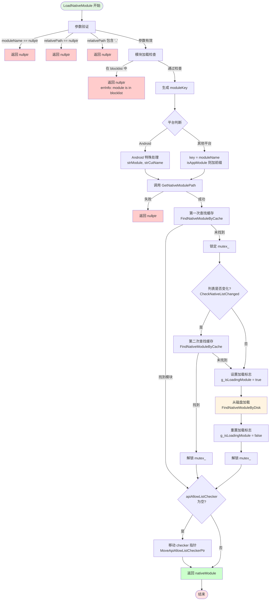

# NativeModuleManager::LoadNativeModule 流程图

## 1. 函数概述

### 1.1 函数签名

```cpp
NativeModule* NativeModuleManager::LoadNativeModule(
    const char* moduleName,      // [输入] 模块名称
    const char* path,            // [输入] 路径前缀（用于 app module）
    bool isAppModule,            // [输入] 是否为应用模块
    std::string& errInfo,        // [输出] 错误信息
    bool internal = false,       // [输入] 是否内部模块
    const char* relativePath = "" // [输入] 相对路径
)
```

### 1.2 返回值

- **成功**：返回 `NativeModule*` 指针
- **失败**：返回 `nullptr`，`errInfo` 包含错误详情

### 1.3 主要功能

加载原生模块，支持从缓存查找或从磁盘加载，处理 `.so` 动态库和 `.abc` 字节码文件。

---

## 2. 整体流程图（Mermaid）



---

## 3. FindNativeModuleByDisk 详细流程图

```mermaid
flowchart TD
    StartDisk([FindNativeModuleByDisk 开始]) --> CheckBlocklist[再次检查 blocklist]
    CheckBlocklist -->|禁止加载| ReturnNullD1[返回 nullptr]
    CheckBlocklist -->|允许| BuildKey[构建 moduleKey<br/>isAppModule 则 path + moduleName]

    BuildKey --> SetLoadingName[设置 loadingModuleName_]
    SetLoadingName --> LoadLib1[尝试加载主要路径<br/>nativeModulePath[0]]

    LoadLib1 --> CallLoadLib1[调用 LoadModuleLibrary]
    CallLoadLib1 -->|成功| HaveSO{lib != nullptr?}
    CallLoadLib1 -->|失败| LoadLib2[尝试次要路径<br/>nativeModulePath[1]]

    LoadLib2 --> CallLoadLib2[调用 LoadModuleLibrary]
    CallLoadLib2 -->|成功| HaveSO
    CallLoadLib2 -->|失败| CheckCache{cacheNativeModule<br/>!= nullptr?}

    CheckCache -->|是| ReturnCacheD[返回 cacheNativeModule<br/>兼容性处理]
    CheckCache -->|否| LoadABC[加载 ABC 文件<br/>nativeModulePath[2]]

    LoadABC --> CallGetBuffer[调用 GetFileBuffer]
    CallGetBuffer -->|失败| ReturnNullD2[返回 nullptr]
    CallGetBuffer -->|成功| HaveABC{abcBuffer != nullptr?}

    HaveSO -->|有 .so| DlopenTrigger[dlopen 触发 so 构造函数<br/>__attribute__((constructor))]
    DlopenTrigger --> CallModuleReg[调用 napi_module_register]
    CallModuleReg --> CallRegister[调用 NativeModuleManager::Register<br/>创建 tailNativeModule_]
    CallRegister --> SetModuleNameInReg[设置 tailNativeModule_.name = moduleName<br/>⚠️ moduleName 字段 = nullptr]
    SetModuleNameInReg --> CallOnLoad[Napi_onLoadCallback<br/>触发 napi_onLoad]
    CallOnLoad --> FindOnLoadSym[LIBSYM 查找 "napi_onLoad" 符号]
    FindOnLoadSym -->|符号存在| CallOnLoadFunc[调用 napi_onLoad 函数]
    CallOnLoadFunc --> CheckRegInOnLoad{napi_onLoad 可能<br/>再次调用<br/>napi_module_register?}
    CheckRegInOnLoad -->|是| CallRegAgain[再次调用 Register<br/>⚠️ 可能创建新的 NativeModule]
    CheckRegInOnLoad -->|否| LockList
    CallRegAgain --> LockList
    FindOnLoadSym -->|符号不存在| LockList

    HaveABC -->|有 .abc| LockList[锁定 nativeModuleListMutex_]

    LockList --> CheckTail{tailNativeModule_<br/>存在且不是 ABC?}
    CheckTail -->|是| SetModuleName[strdup moduleKey<br/>设置 moduleName]
    CheckTail -->|否| CheckInternal{internal == false?}

    SetModuleName --> SetFilePath[strdup loadPath<br/>设置 systemFilePath]
    SetFilePath --> CheckName{moduleName 与 name<br/>一致?}

    CheckName -->|否| WarnMismatch[警告：Name mismatch]
    CheckName -->|是| CheckInternal
    WarnMismatch --> CheckInternal

    CheckInternal -->|是| BuildSymbol[构建符号名<br/>NAPI_moduleKey_GetABCCode]
    CheckInternal -->|否| SetLoadedFlag[设置 moduleLoaded = true]

    BuildSymbol --> ReplaceSymbol[替换 '.' 和 '/' 为 '_']
    ReplaceSymbol --> CheckSO2{lib != nullptr?}

    CheckSO2 -->|有 .so| DlsymSymbol[LIBSYM 查找符号<br/>GetJSCodeCallback]
    CheckSO2 -->|无 .so| RegisterABC[RegisterByBuffer<br/>注册 ABC 模块]

    DlsymSymbol -->|符号不存在| ReturnTailD[返回 tailNativeModule_]
    DlsymSymbol -->|符号存在| CallGetJSCode[调用 getJSCode<br/>获取 JS 代码]

    CallGetJSCode --> SetJSCode[设置 jsCode 和 jsCodeLen]
    SetJSCode --> ReturnTailD

    RegisterABC --> SetFilePathABC[strdup loadPath]
    SetFilePathABC --> SetLoadedFlag

    SetLoadedFlag --> MoveCheckerD[MoveApiAllowListCheckerPtr]
    MoveCheckerD --> ReturnTailD
    ReturnTailD --> EndDisk([结束])

    style StartDisk fill:#e1f5e1
    style EndDisk fill:#ffe1e1
    style ReturnNullD1 fill:#ffcccc
    style ReturnNullD2 fill:#ffcccc
    style ReturnCacheD fill:#fff4e1
    style ReturnTailD fill:#ccffcc
    style CallOnLoad fill:#ffe1ff
    style RegisterABC fill:#e1ffff
```

---

## 4. LoadModuleLibrary 详细流程图

```mermaid
flowchart TD
    StartLoad([LoadModuleLibrary 开始]) --> CheckPath{path 长度 == 0?}
    CheckPath -->|是| SetErrInfo[设置 errInfo<br/>返回 nullptr]
    CheckPath -->|否| Platform{平台判断}

    Platform -->|Windows| CheckExistWin[CheckModuleExist]
    Platform -->|macOS/Linux/Bionic| CheckExistUnix[CheckModuleExist]
    Platform -->|iOS| ReturnNullI[返回 nullptr<br/>iOS 不支持 dlopen]
    Platform -->|OHOS| CheckAccess{isAppModule &&<br/>IsExistedPath pathKey?}

    CheckExistWin -->|不存在| SetErrReason[errReason = MODULE_NOT_EXIST]
    CheckExistWin -->|存在| LoadLibraryWin[LoadLibrary path]
    CheckExistUnix -->|不存在| SetErrReason
    CheckExistUnix -->|存在| DlopenUnix[dlopen path, RTLD_LAZY]

    LoadLibraryWin --> CheckLibWin{lib == nullptr?}
    DlopenUnix --> CheckLibUnix{lib == nullptr?}

    CheckLibWin -->|失败| GetErrorWin[GetLastError<br/>追加到 errInfo]
    CheckLibWin -->|成功| EmplaceLib[EmplaceModuleLib<br/>存入 moduleLibMap_]

    CheckLibUnix -->|失败| DlerrorUnix[dlerror<br/>追加到 errInfo]
    CheckLibUnix -->|成功| EmplaceLib

    GetErrorWin --> ReturnFail[返回 nullptr]
    DlerrorUnix --> ReturnFail

    CheckAccess -->|是| GetNamespace[获取 nsMap_[pathKey]<br/>Dl_namespace]
    CheckAccess -->|否| CheckFileExist{access path<br/>F_OK == 0?}

    GetNamespace --> DlopenNS[dlopen_ns &ns, path,<br/>RTLD_LAZY]
    DlopenNS --> CheckLibNS{lib == nullptr?}

    CheckLibNS -->|失败| DlerrorNS[dlerror<br/>追加到 errInfo]
    CheckLibNS -->|成功| EmplaceLib

    DlerrorNS --> ReturnFail

    CheckFileExist -->|不存在| DlerrorFile[设置 path not exist<br/>追加到 errInfo]
    CheckFileExist -->|存在| DlopenFile[dlopen path, RTLD_LAZY]

    DlopenFile --> CheckLibFile{lib == nullptr?}
    CheckLibFile -->|失败| DlerrorFile
    CheckLibFile -->|成功| EmplaceLib

    DlerrorFile --> ReturnFail

    EmplaceLib --> ReturnLib[返回 lib 句柄]
    ReturnLib --> EndLoad([结束])
    ReturnFail --> EndLoad

    style StartLoad fill:#e1f5e1
    style EndLoad fill:#ffe1e1
    style ReturnNullI fill:#ffcccc
    style SetErrReason fill:#ffcccc
    style ReturnFail fill:#ffcccc
    style ReturnLib fill:#ccffcc
    style DlopenNS fill:#ffe1ff
    style EmplaceLib fill:#e1f5e1
```

---

## 5. 关键数据结构

### 5.1 NativeModule 结构

```cpp
struct NativeModule {
    const char* name;              // .nm_modname (C++ 注册信息)
    const char* moduleName;        // 模块名 (导入时使用)
    const char* fileName;
    const char* systemFilePath;    // 系统文件路径
    RegisterCallback registerCallback;
    GetJSCodeCallback getABCCode;
    GetJSCodeCallback getJSCode;
    int32_t version;
    uint32_t flags;
    uint32_t refCount;
    NativeModule* next;            // 链表下一个节点
    const char* jsCode;            // JS 代码
    const uint8_t* jsABCCode;      // ABC 字节码
    int32_t jsCodeLen;
    bool moduleLoaded;             // 模块是否已加载
    bool isAppModule;              // 是否为应用模块
    std::unique_ptr<ApiAllowListChecker> apiAllowListChecker;
};
```

### 5.2 NativeModuleHeadTailStruct 结构

```cpp
struct NativeModuleHeadTailStruct {
    NativeModule* headNativeModule;      // 缓存快照：链表头
    NativeModule* tailNativeModule;      // 缓存快照：链表尾
    NativeModule* matchLoadingNativeModule; // 匹配到正在加载的模块
};
```

### 5.3 主要成员变量

| 变量名 | 类型 | 作用 |
|--------|------|------|
| `headNativeModule_` | `NativeModule*` | 模块链表头指针 |
| `tailNativeModule_` | `NativeModule*` | 模块链表尾指针 |
| `loadingModuleName_` | `std::string` | 当前正在加载的模块名 |
| `g_isLoadingModule` | `thread_local bool` | 线程局部变量：是否正在加载 |
| `moduleLibMap_` | `std::map<std::string, LIBHANDLE>` | 模块句柄映射 |
| `moduleBufMap_` | `std::map<std::string, const uint8_t*>` | ABC 缓冲区映射 |
| `appLibPathMap_` | `std::map<std::string, char*>` | 应用库路径映射 |
| `nsMap_` | `std::map<std::string, Dl_namespace>` | 命名空间映射（OHOS） |

---

## 6. 流程详解

### 6.1 参数验证阶段

**代码位置：** Line 637-653

```cpp
// 1. moduleName 验证
if (moduleName == nullptr) {
    errInfo = "nullptr";
    return nullptr;
}

// 2. relativePath 验证
if (relativePath == nullptr) {
    errInfo = "nullptr";
    return nullptr;
}

// 3. 路径遍历攻击防护
if (relativePathStr.find("..") != std::string::npos) {
    return nullptr;
}
```

### 6.2 模块加载检查（Blocklist）

**代码位置：** Line 658-664

```cpp
std::unique_ptr<ApiAllowListChecker> apiAllowListChecker = nullptr;
if (moduleLoadChecker_ &&
    !moduleLoadChecker_->DiskCheckOnly() &&
    !moduleLoadChecker_->CheckModuleLoadable(moduleName, apiAllowListChecker, isAppModule)) {
    errInfo = "module " + std::string(moduleName) + " is in blocklist";
    return nullptr;
}
```

**作用：** 防止加载被禁止的模块（安全机制）

### 6.3 生成 moduleKey

**Android 平台特殊处理：** Line 666-683

```cpp
// Android: 点号替换为下划线
if (strModule.find(".") != std::string::npos) {
    char* temp = const_cast<char*>(strCutName.c_str());
    for (char* p = strchr(temp, '.'); p != nullptr; p = strchr(p + 1, '.')) {
        *p = '_';
    }
}

// 构建 moduleKey
strModule = prefixTmp + '/' + moduleName;  // "default/moduleName"
```

**其他平台：** Line 705-712

```cpp
std::string key(moduleName);
if (isAppModule) {
    prefixTmp = "default";
    if (path && IsExistedPath(path)) {
        prefixTmp = path;
    }
    key = prefixTmp + '/' + moduleName;
}
```

### 6.4 调用 GetNativeModulePath

**代码位置：** Line 714-718

```cpp
if (!GetNativeModulePath(moduleName, prefixTmp.c_str(), relativePath,
                         isAppModule, nativeModulePath, NAPI_PATH_MAX)) {
    return nullptr;
}
```

**输出：**
- `nativeModulePath[0]`: 主要 .so 路径
- `nativeModulePath[1]`: 次要 .so 路径（NAPI 变体）
- `nativeModulePath[2]`: .abc 文件路径

### 6.5 缓存查找（第一次）

**代码位置：** Line 723-724

```cpp
NativeModule* nativeModule =
    FindNativeModuleByCache(key.c_str(), nativeModulePath, cacheNativeModule,
                           cacheHeadTailNativeModule, true);
```

**查找逻辑：** 遍历 `headNativeModule_` 链表，匹配 `moduleName` 或 `name` 和 `systemFilePath`

### 6.6 缓存未命中 → 锁定并检查变化

**代码位置：** Line 726-742

```cpp
if (nativeModule == nullptr) {
    pthread_mutex_lock(&mutex_);

    // 检查链表是否变化（其他线程可能已加载）
    if (CheckNativeListChanged(...)) {
        nativeModule = FindNativeModuleByCache(...); // 第二次查找
    }

    if (nativeModule == nullptr) {
        // 从磁盘加载
    }

    pthread_mutex_unlock(&mutex_);
}
```

**竞态条件处理：**
1. 线程 A 正在加载模块 X
2. 线程 B 也要加载模块 X
3. 线程 B 获取锁后，检查链表是否变化
4. 如果变化，重新查找（可能线程 A 已加载完成）

### 6.7 从磁盘加载

**代码位置：** Line 745-766

```cpp
prefix_ = prefixTmp;
isAppModule_ = isAppModule;
g_isLoadingModule = true;  // 设置线程局部标志

nativeModule = FindNativeModuleByDisk(moduleName, prefix_.c_str(),
                                      relativePath, internal, isAppModule,
                                      errInfo, nativeModulePath, cacheNativeModule);

g_isLoadingModule = false;
```

---

## 7. FindNativeModuleByDisk 详细流程

### 7.1 尝试加载 .so 文件

**代码位置：** Line 1173-1189

```cpp
// 尝试主要路径
LIBHANDLE lib = LoadModuleLibrary(moduleKey, nativeModulePath[0], path, ...);
if (lib == nullptr) {
    // 尝试次要路径
    lib = LoadModuleLibrary(moduleKey, nativeModulePath[1], path, ...);
}
```

**LoadModuleLibrary 返回失败的可能原因：**
1. 文件不存在（`MODULE_NOT_EXIST`）
2. dlopen 失败（依赖缺失、符号冲突等）

### 7.2 兼容性处理

**代码位置：** Line 1192-1195

```cpp
if (lib == nullptr && cacheNativeModule != nullptr) {
    MODULEMNG_HILOG_DEBUG("Maintain compatibility.");
    return cacheNativeModule;
}
```

**作用：** 如果加载失败但缓存中有旧模块，返回缓存版本（降级兼容）

### 7.3 尝试加载 .abc 文件

**代码位置：** Line 1197-1208

```cpp
const uint8_t* abcBuffer = nullptr;
size_t len = 0;
if (lib == nullptr) {
    abcBuffer = GetFileBuffer(nativeModulePath[2], moduleKey, len);
    if (!abcBuffer) {
        return nullptr;  // .so 和 .abc 都加载失败
    }
}
```

**GetFileBuffer 流程：**
1. 检查 `moduleBufMap_` 缓存
2. 如果未缓存，读取文件到内存
3. 存入 `moduleBufMap_` 避免重复读取

### 7.4 触发 napi_onLoad 回调

**代码位置：** Line 1211-1213

```cpp
if (lib != nullptr) {
    Napi_onLoadCallback(lib, moduleName);
}
```

**Napi_onLoadCallback 实现：** Line 1146-1153

```cpp
void NativeModuleManager::Napi_onLoadCallback(LIBHANDLE lib, const char* moduleName)
{
    auto onLoadFunc = reinterpret_cast<NapiOnLoadCallback>(LIBSYM(lib, "napi_onLoad"));
    if (onLoadFunc != nullptr) {
        onLoadFunc();  // 调用模块的 napi_onLoad 函数
    }
}
```

**⚠️ 重要：** `dlopen` 触发 so 的构造函数（`__attribute__((constructor))`），构造函数中调用 `napi_module_register` → `Register`，此时 `tailNativeModule_` 已被创建！

### 7.5 设置 moduleName 和 systemFilePath

**代码位置：** Line 1216-1230

```cpp
if (tailNativeModule_ && !abcBuffer) {
    tailNativeModule_->moduleName = strdup(moduleKey);
    tailNativeModule_->systemFilePath = strdup(loadPath);

    // 检查 name 和 moduleName 是否一致
    if (strcmp(tailNativeModule_->moduleName, tailNativeModule_->name) != 0) {
        MODULEMNG_HILOG_WARN("Name mismatch: ...");
    }
}
```

### 7.6 查找 GetJSCode 符号（非 internal 模块）

**代码位置：** Line 1233-1243

```cpp
if (!internal) {
    char symbol[NAPI_PATH_MAX] = { 0 };
    sprintf_s(symbol, sizeof(symbol), "NAPI_%s_GetABCCode", moduleKey.c_str());

    // 替换 '.' 和 '/' 为 '_'
    for (char* p = strchr(symbol, '.'); p != nullptr; p = strchr(p + 1, '.')) {
        *p = '_';
    }
    for (char* p = strchr(symbol, '/'); p != nullptr; p = strchr(p + 1, '/')) {
        *p = '_';
    }

    // 符号名示例：NAPI_default_multimedia_GetABCCode
}
```

### 7.7 获取 JS 代码（如果存在）

**代码位置：** Line 1253-1268

```cpp
if (lib != nullptr) {
    auto getJSCode = reinterpret_cast<GetJSCodeCallback>(LIBSYM(lib, symbol));
    if (getJSCode == nullptr) {
        // 符号不存在，直接返回（某些模块没有 GetABCCode）
        return tailNativeModule_;
    }

    const char* buf = nullptr;
    int bufLen = 0;
    getJSCode(&buf, &bufLen);  // 调用模块提供的函数
    tailNativeModule_->jsCode = buf;
    tailNativeModule_->jsCodeLen = bufLen;
}
```

### 7.8 注册 ABC 模块

**代码位置：** Line 1269-1272

```cpp
else {
    RegisterByBuffer(moduleKey, abcBuffer, len);
    tailNativeModule_->systemFilePath = strdup(loadPath);
}
```

**RegisterByBuffer 实现：** Line 1286-1312

```cpp
void NativeModuleManager::RegisterByBuffer(const std::string& moduleKey,
                                          const uint8_t* abcBuffer, size_t len)
{
    CreateTailNativeModule();
    tailNativeModule_->moduleName = strdup(moduleKey.c_str());
    tailNativeModule_->name = strdup(moduleKey.c_str());
    tailNativeModule_->jsABCCode = abcBuffer;
    tailNativeModule_->jsCodeLen = len;
    tailNativeModule_->moduleLoaded = true;
}
```

---

## 8. dlopen 与构造函数的调用关系

### 8.1 dlopen 触发构造函数的机制

**关键原理：** `dlopen` 在加载共享库（.so）时，会自动执行所有标记为 `__attribute__((constructor))` 的全局构造函数。

#### 8.1.1 典型的 NAPI 模块代码结构

```cpp
// ===== 模块代码：my_module.cpp =====

// 1. 定义模块导出函数
static napi_value MyExport(napi_env env, napi_value exports) {
    // 导出 JS 接口
    return exports;
}

// 2. 定义 napi_module 描述符
static napi_module myModule = {
    .nm_version = 1,
    .nm_flags = 0,
    .nm_filename = nullptr,
    .nm_register_func = MyExport,
    .nm_modname = "myModule",
    .nm_priv = nullptr,
    .reserved = {0},
};

// 3. 定义构造函数（关键！）
extern "C" __attribute__((constructor)) void MyModuleRegister() {
    // 这个函数会在 dlopen 时自动被调用！
    napi_module_register(&myModule);
}
```

#### 8.1.2 调用时序图（完整版，含 napi_onLoad）

```
线程：LoadNativeModule 执行流程
─────────────────────────────────────

1. LoadModuleLibrary(..., "libmyModule.so", ...)
   ↓
2. dlopen("libmyModule.so", RTLD_LAZY)
   │
   ├─ [dlopen 内部操作]
   │  ├─ 加载 .so 文件到内存
   │  ├─ 解析符号表
   │  ├─ 重定位
   │  └─ ⚠️ 执行所有 constructor 函数
   │     │
   │     └─ MyModuleRegister()  ← 自动调用！
   │        │
   │        └─ napi_module_register(&myModule)
   │           │
   │           └─ NativeModuleManager::Register(nativeModule)
   │              │
   │              ├─ CreateTailNativeModule()
   │              │  └─ tailNativeModule_ = new NativeModule()
   │              │
   │              ├─ tailNativeModule_->name = "myModule"
   │              └─ tailNativeModule_->moduleName = nullptr  ← ⚠️ 第一次为空！
   │
   └─ 返回 lib 句柄
   ↓
3. [dlopen 已返回，但 tailNativeModule_->moduleName 仍为 nullptr]
   ↓
4. Napi_onLoadCallback(lib, "myModule")
   │
   └─ LIBSYM(lib, "napi_onLoad")  ← 查找 napi_onLoad 符号
      │
      ├─ 如果符号存在：
      │  │
      │  └─ 调用 napi_onLoad()
      │     │
      │     ├─ 可能执行模块初始化逻辑
      │     │
      │     └─ ⚠️ 可能再次调用 napi_module_register(&module)
      │        │
      │        └─ NativeModuleManager::Register(nativeModule)
      │           │
      │           ├─ 可能创建新的 tailNativeModule_ 或追加到链表
      │           ├─ tailNativeModule_->name = "myModule"
      │           └─ tailNativeModule_->moduleName = nullptr  ← ⚠️ 再次为空！
      │
      └─ 返回
   ↓
5. [napi_onLoad 可能已返回，但 moduleName 仍可能为 nullptr]
   ↓
6. [回到 LoadNativeModule，继续执行]
   ↓
7. Line 1215：std::lock_guard<std::mutex> lock(nativeModuleListMutex_)
   ↓
8. Line 1224：tailNativeModule_->moduleName = strdup(moduleKey)  ← ✅ 最终赋值！
   ↓
9. 返回 tailNativeModule_
```

**关键观察：**
- T2 和 T4 都可能调用 `napi_module_register`
- T2 的调用来自构造函数（自动）
- T4 的调用来自 `napi_onLoad`（手动）
- T8 是真正设置 `moduleName` 的时刻（FindNativeModuleByDisk 中）
- 竞态窗口从 T2 延续到 T8

### 8.2 napi_module_register 函数

**定义位置：** `interfaces/kits/napi/native_api.h` 或 `interfaces/inner_api/napi/`

```cpp
// napi_module_register 的典型实现
void napi_module_register(const napi_module* mod) {
    if (mod == nullptr) {
        return;
    }

    // 创建 NativeModule 对象
    NativeModule* nativeModule = new NativeModule();
    nativeModule->version = mod->nm_version;
    nativeModule->fileName = mod->nm_filename;
    nativeModule->registerCallback = mod->nm_register_func;
    nativeModule->name = mod->nm_modname;
    nativeModule->refCount = mod->nm_refcount;

    // 调用 NativeModuleManager::Register
    NativeModuleManager::GetInstance()->Register(nativeModule);
}
```

### 8.3 napi_onLoad 中的二次注册

#### 8.3.1 napi_onLoad 的作用

**Napi_onLoadCallback 实现：** Line 1146-1153

```cpp
void NativeModuleManager::Napi_onLoadCallback(LIBHANDLE lib, const char* moduleName)
{
    auto onLoadFunc = reinterpret_cast<NapiOnLoadCallback>(LIBSYM(lib, "napi_onLoad"));
    if (onLoadFunc != nullptr) {
        onLoadFunc();  // 调用模块的 napi_onLoad 函数
        MODULEMNG_HILOG_INFO("napi_onLoad call, module:%{public}s", moduleName);
    }
}
```

**典型模块的 napi_onLoad 实现：**

```cpp
// ===== 模块代码：my_module.cpp =====

// 方式 1：仅在构造函数中注册（简单模块）
extern "C" __attribute__((constructor)) void MyModuleRegister() {
    napi_module_register(&myModule);
}

// 方式 2：在 napi_onLoad 中注册（复杂模块）
extern "C" __attribute__((constructor)) void MyModuleRegister() {
    // 构造函数中可能不注册
}

extern "C" void napi_onLoad() {
    // 在 napi_onLoad 中调用注册
    napi_module_register(&myModule);

    // 其他初始化逻辑
    // ...
}
```

#### 8.3.2 二次注册的时序

```
时间线    线程 A（加载模块）
────────────────────────────────
T1       LoadModuleLibrary("libA.so")
T2       dlopen("libA.so")
           ├─ 执行构造函数 → MyModuleRegister()
           │   └─ 可能注册或什么都不做
           └─ 返回 lib 句柄
T3       Napi_onLoadCallback(lib, "A")
           └─ LIBSYM(lib, "napi_onLoad")
               └─ 找到符号
T4       调用 napi_onLoad()
           └─ napi_module_register(&module)
               └─ NativeModuleManager::Register(nativeModule)
                   ├─ CreateTailNativeModule()
                   ├─ tailNativeModule_->name = "A"
                   └─ tailNativeModule_->moduleName = nullptr ⚠️
T5       [napi_onLoad 返回]
T6       Line 1224: tail_->moduleName = "A" ✅
```

#### 8.3.3 二次注册的影响

**情况 1：构造函数和 napi_onLoad 都注册**
```
构造函数：Register(mod1) → tailNativeModule_ = mod1
napi_onLoad：Register(mod2) → tailNativeModule_ = mod2（覆盖或链表追加）
```
- 结果：可能有多个 NativeModule 对象
- 风险：mod1 的 `moduleName` 永远为 nullptr

**情况 2：仅在 napi_onLoad 中注册**
```
构造函数：不注册
napi_onLoad：Register(mod) → tailNativeModule_ = mod
```
- 结果：正常，但注册时机更晚

**情况 3：构造函数注册，napi_onLoad 不注册**
```
构造函数：Register(mod) → tailNativeModule_ = mod
napi_onLoad：不注册，执行其他初始化
```
- 结果：正常，最常见的模式

#### 8.3.4 关键问题点总结

| 时间点 | tailNativeModule_->name | tailNativeModule_->moduleName | 说明 |
|--------|-------------------------|------------------------------|------|
| T1: dlopen 前 | `nullptr` | `nullptr` | 模块未加载 |
| T2: 构造函数执行 | `"myModule"` | `nullptr` | ⚠️ Register 中设为空 |
| T3: dlopen 返回 | `"myModule"` | `nullptr` | ⚠️ 仍为空 |
| T4: Napi_onLoadCallback | `"myModule"` | `nullptr` | ⚠️ 仍为空 |
| T5: Line 1224 赋值 | `"myModule"` | `"default/myModule"` | ✅ 此时才赋值 |

**影响：**
- 在 T2 到 T5 的时间窗口内，如果其他线程调用 `FindNativeModuleByCache`，会找到 `tailNativeModule_`
- 但 `moduleName` 字段为 `nullptr`，可能导致后续代码崩溃

#### 问题 2：Register 与 FindNativeModuleByDisk 的分离

**Register 的职责：**
- 创建 `tailNativeModule_` 对象
- 设置从 `napi_module` 继承的字段（name, registerCallback, version 等）
- **不设置** `moduleName` 和 `systemFilePath`（由 FindNativeModuleByDisk 设置）

**FindNativeModuleByDisk 的职责：**
- 加载 .so 文件（触发 Register）
- 设置 `moduleName` 和 `systemFilePath`
- 查找并调用 `GetJSCode` 符号

**问题：** 这两个步骤的职责分离，导致 `moduleName` 字段存在空值窗口期。

#### 问题 4：竞态条件示例（含 napi_onLoad）

```
时间线    线程 A（加载模块）                    线程 B（同时加载同一模块）
────────────────────────────────────────────────────────────────────
T1       dlopen("libA.so")
T2       ├─ 构造函数执行
         │   ├─ Register → tail_->name = "A"
         │   └─ tail_->moduleName = nullptr
T3       [dlopen 返回]
T4       Napi_onLoadCallback
T5       ├─ 查找 "napi_onLoad" 符号
T6                                            FindNativeModuleByCache("A")
T7       ├─ 调用 napi_onLoad()               ├─ 找到 tailNativeModule_
T8       │   └─ ⚠️ 可能再次调用 Register       └─ ❌ tail_->moduleName == nullptr
T9       │   └─ 如果再次注册：
T10      │       └─ tail_->moduleName = nullptr（再次为空）
T11      Line 1224: tail_->moduleName = "A"
T12      返回 tailNativeModule_              ❌ 崩溃或错误
```

**关键点：**
- 如果 `napi_onLoad` 中调用 `napi_module_register`，会再次将 `moduleName` 设为 `nullptr`
- Line 1224 的赋值必须**在 `napi_onLoad` 返回后**才能生效
- 时间窗口从 T2 延长到 T11，增加了竞态条件的风险

```
时间线    线程 A（加载模块）                    线程 B（同时加载同一模块）
────────────────────────────────────────────────────────────────────
T1       dlopen("libA.so")
T2       ├─ 构造函数执行
         ├─ Register → tail_->name = "A"
         └─ tail_->moduleName = nullptr
T3                                            FindNativeModuleByCache("A")
T4                                            ├─ 找到 tailNativeModule_
T5                                            └─ ❌ tail_->moduleName == nullptr
T6       Napi_onLoadCallback
T7       Line 1224: tail_->moduleName = "A"
T8       返回 tailNativeModule_              ❌ 崩溃或错误
```

### 8.4 解决方案建议

#### 方案 1：在 Register 中设置 moduleName（推荐）

```cpp
void NativeModuleManager::Register(NativeModule* nativeModule) {
    // ...
    tailNativeModule_->name = moduleName;
    tailNativeModule_->moduleName = strdup(moduleName);  // ✅ 同时设置
    // ...
}

// FindNativeModuleByDisk 中更新逻辑（Line 1224）
if (tailNativeModule_ && tailNativeModule_->moduleName != nullptr) {
    // 如果 napi_onLoad 中已设置，更新为完整的 moduleKey
    free(const_cast<char*>(tailNativeModule_->moduleName));
    tailNativeModule_->moduleName = strdup(moduleKey);
} else if (tailNativeModule_) {
    // 如果仍未设置，首次赋值
    tailNativeModule_->moduleName = strdup(moduleKey);
}
```

**优点：**
- 消除空值窗口期
- 允许 napi_onLoad 中的二次注册
- moduleName 始终有值

#### 方案 2：延迟返回 tailNativeModule_

```cpp
NativeModule* NativeModuleManager::FindNativeModuleByDisk(...) {
    // ...
    if (lib != nullptr) {
        Napi_onLoadCallback(lib, moduleName);
    }

    // ✅ 在返回前验证完整性
    if (tailNativeModule_ && tailNativeModule_->moduleName == nullptr) {
        // 等待或返回错误
        MODULEMNG_HILOG_ERROR("Module not fully initialized: moduleName is nullptr");
        return nullptr;
    }

    return tailNativeModule_;
}
```

**优点：**
- 防止返回不完整的模块
- 强制模块正确初始化

**缺点：**
- 如果 napi_onLoad 中忘记设置 moduleName，会加载失败
- 需要模块开发者遵守规范

#### 方案 3：使用加载状态标志

```cpp
// 在 NativeModule 中添加字段
struct NativeModule {
    // ...
    bool moduleFullyInitialized = false;  // 新增
};

// Register 中
tailNativeModule_->name = moduleName;
tailNativeModule_->moduleName = strdup(moduleName);  // ✅ 立即设置
tailNativeModule_->moduleFullyInitialized = true;

// FindNativeModuleByCache 中
if (temp->moduleName && !temp->moduleFullyInitialized) {
    continue;  // ✅ 跳过未完全初始化的模块
}

// FindNativeModuleByDisk 中（napi_onLoad 后）
// moduleFullyInitialized 已经由 Register 设置，无需额外操作
```

**优点：**
- 明确的初始化状态
- 允许缓存查找时过滤未完成模块

#### 方案 4：防止 napi_onLoad 中的重复注册

```cpp
void NativeModuleManager::Register(NativeModule* nativeModule) {
    // ...
    tailNativeModule_->name = moduleName;
    tailNativeModule_->moduleName = strdup(moduleName);

    // ✅ 设置标志，防止重复注册
    tailNativeModule_->moduleLoaded = true;

    MODULEMNG_HILOG_DEBUG("Module registered: %{public}s", moduleName);
}

// 如果 napi_onLoad 中尝试再次注册
// 检测 moduleLoaded 标志，避免创建新对象
if (tailNativeModule_ &&
    tailNativeModule_->moduleLoaded &&
    strcmp(tailNativeModule_->name, nativeModule->name) == 0) {
    MODULEMNG_HILOG_WARN("Module already registered: %{public}s", moduleName);
    return;  // 或更新现有对象，不创建新的
}
```

---

## 9. 并发控制机制

### 9.1 缓存机制

- **一级缓存**：`FindNativeModuleByCache` 从 `headNativeModule_` 链表查找
- **二级缓存**：`moduleLibMap_` 缓存已加载的 so 句柄
- **三级缓存**：`moduleBufMap_` 缓存已加载的 ABC 缓冲区

### 9.2 双重检查锁定（Double-Checked Locking）

```cpp
if (nativeModule == nullptr) {  // 第一次检查（无锁）
    pthread_mutex_lock(&mutex_);
    if (CheckNativeListChanged(...)) {  // 第二次检查（有锁）
        nativeModule = FindNativeModuleByCache(...);
    }
    // ...
    pthread_mutex_unlock(&mutex_);
}
```

**目的：** 避免重复加载同一模块

### 9.3 线程安全保证

```
线程 A：LoadNativeModule("modA")
  ├─ FindNativeModuleByCache → 未找到
  ├─ pthread_mutex_lock(&mutex_)
  ├─ CheckNativeListChanged → false
  ├─ g_isLoadingModule = true
  ├─ FindNativeModuleByDisk
  │   ├─ LoadModuleLibrary → dlopen
  │   ├─ dlopen 触发构造函数 → Register
  │   │   ├─ tailNativeModule_.name = "modA"
  │   │   └─ tailNativeModule_.moduleName = nullptr ⚠️
  │   ├─ Napi_onLoadCallback
  │   │   └─ 可能再次调用 Register ⚠️
  │   └─ 未到达 Line 1224
  └─ 等待解锁...

线程 B：LoadNativeModule("modA")（同时）
  ├─ FindNativeModuleByCache → 找到 tailNativeModule_
  └─ ❌ 返回 tailNativeModule_（但 moduleName = nullptr！）
```

---

## 10. 性能优化点

### 10.1 模块路径优先级

```
nativeModulePath[0] (主要 .so)
    ↓ 失败
nativeModulePath[1] (NAPI 变体 .so)
    ↓ 失败
nativeModulePath[2] (.abc 字节码)
    ↓ 失败
cacheNativeModule (兼容性回退)
    ↓ 失败
返回 nullptr
```

---

## 11. 错误处理

### 11.1 错误信息传递

| 阶段 | 错误信息 | 返回值 |
|------|---------|--------|
| 参数验证 | `"nullptr"` | `nullptr` |
| Blocklist 检查 | `"module xxx is in blocklist"` | `nullptr` |
| GetNativeModulePath | `"failed moduleName"` | `nullptr` |
| LoadModuleLibrary | `"First: ...Second: ...load xxx failed"` | `nullptr` 或继续 |
| GetFileBuffer | `"...load xxx.abc failed"` | `nullptr` |
| 符号查找失败 | `"sprintf symbol ... failed"` | `nullptr` |

### 11.2 错误恢复策略

1. **路径回退**：主路径失败 → 次要路径 → ABC 文件
2. **缓存回退**：磁盘加载失败 → 尝试使用缓存的旧模块
3. **部分成功**：GetJSCode 不存在时，仍返回模块（只是没有 jsCode）

---

## 12. 代码位置索引

| 函数/方法 | 起始行 | 结束行 | 说明 |
|----------|--------|--------|------|
| `LoadNativeModule` | 634 | 778 | 主流程 |
| `FindNativeModuleByDisk` | 1155 | 1284 | 磁盘加载 |
| `LoadModuleLibrary` | 1027 | 1088 | 动态库加载 |
| `GetFileBuffer` | 1090 | 1115 | ABC 文件读取 |
| `FindNativeModuleByCache` | 1371 | 1418 | 缓存查找 |
| `CheckNativeListChanged` | 879 | 893 | 链表变化检查 |
| `Register` | 280 | 344 | 模块注册（构造函数调用） |
| `RegisterByBuffer` | 1286 | 1312 | ABC 模块注册 |
| `Napi_onLoadCallback` | 1146 | 1153 | napi_onLoad 触发 |
| `GetNativeModulePath` | 894 | 1124 | 路径生成 |

---

## 13. 附录：完整调用链

```
LoadNativeModule (入口)
  │
  ├─ GetNativeModulePath [生成候选路径]
  │   ├─ appLibPathMap_[path] [获取前缀]
  │   └─ sysPrefix + relativePath [系统路径]
  │
  ├─ FindNativeModuleByCache [第一次查找]
  │   └─ 遍历 headNativeModule_ 链表
  │
  ├─ pthread_mutex_lock [加锁]
  │
  ├─ CheckNativeListChanged [检查变化]
  │   └─ 对比缓存快照
  │
  ├─ FindNativeModuleByCache [第二次查找]
  │
  ├─ FindNativeModuleByDisk [磁盘加载]
  │   │
  │   ├─ LoadModuleLibrary [加载 .so]
  │   │   ├─ dlopen / LoadLibrary
  │   │   │   └─ ⚠️ 触发 so 的全局构造函数
  │   │   │       └─ __attribute__((constructor)) void ModuleRegister()
  │   │   │           └─ napi_module_register(&module)
  │   │   │               └─ NativeModuleManager::Register(nativeModule)
  │   │   │                   └─ CreateTailNativeModule() [创建 tailNativeModule_]
  │   │   │                   └─ tailNativeModule_->name = moduleName [设置]
  │   │   │                   └─ tailNativeModule_->moduleName = nullptr [⚠️ 空值]
  │   │   ├─ EmplaceModuleLib [缓存句柄]
  │   │   └─ Napi_onLoadCallback [dlopen 返回后调用]
  │   │       └─ LIBSYM(lib, "napi_onLoad") [查找符号]
  │   │
  │   ├─ GetFileBuffer [加载 .abc]
  │   │   ├─ 读取文件
  │   │   └─ EmplaceModuleBuffer [缓存缓冲区]
  │   │
  │   ├─ RegisterByBuffer [注册 ABC 模块]
  │   │   └─ CreateTailNativeModule
  │   │
  │   └─ LIBSYM(lib, "NAPI_xxx_GetABCCode") [查找 JS 代码]
  │       └─ 调用 getJSCode 回调
  │
  ├─ MoveApiAllowListCheckerPtr [设置 checker]
  │
  └─ pthread_mutex_unlock [解锁]
      │
      └─ 返回 NativeModule*
```

---

**文档版本：** 1.0
**最后更新：** 2025-01-23
**适用代码版本：** OpenHarmony arkui_napi
**作者：** 代码分析自动生成
