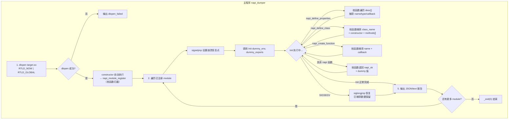
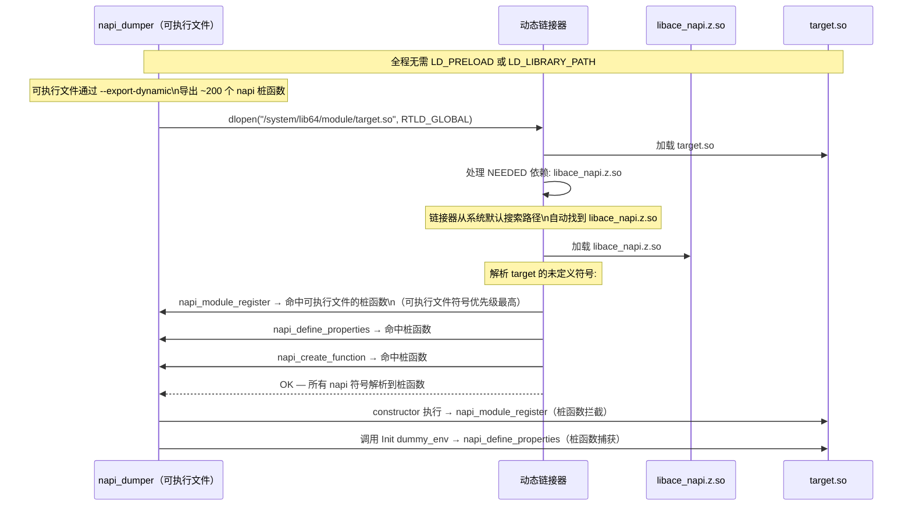
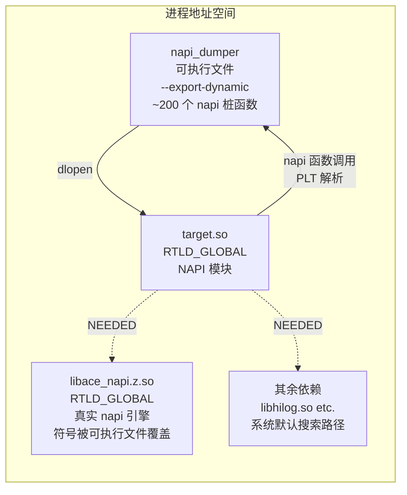

<!--
 * Copyright (c) 2026 Huawei Device Co., Ltd.
 * Licensed under the Apache License, Version 2.0 (the "License");
 * you may not use this file except in compliance with the License.
 * You may obtain a copy of the License at
 *
 *     http://www.apache.org/licenses/LICENSE-2.0
 *
 * Unless required by applicable law or agreed to in writing, software
 * distributed under the License is distributed on an "AS IS" BASIS,
 * WITHOUT WARRANTIES OR CONDITIONS OF ANY KIND, either express or implied.
 * See the License for the specific language governing permissions and
 * limitations under the License.
-->

# NAPI Runtime Dumper — 设计文档

> 工具名称：**napi-dumper**
> 版本：v2.0（单二进制 + 零环境变量 + 零崩溃）
> 日期：2026-11-10

---

## 1. 背景与动机

### 1.1 静态分析工具的瓶颈

前期实现的 `napi-so-inspector`（基于 pyelftools + capstone 的纯静态 ELF 反汇编方案）在全量扫描 731 个 `.so` 后暴露出根本性瓶颈：

| 指标 | 静态分析结果 | 根因 |
|------|-------------|------|
| 接口名称覆盖率 | 40% | 60% 的接口通过栈上逐条 `mov` 指令构造描述符数组，反汇编无法追踪 |
| 源码行号覆盖率 | 10% | 大部分 .so 使用 DWARF v5 `DW_FORM_addrx`，.debug_info 中缺函数定义 DIE |
| 接口类型准确率 | ~60% | napi_property_descriptor 的 `symbol` 字段缺失导致偏移错位 |

### 1.2 运行时方案

通过 `dlopen` 加载目标 `.so`，触发 `__attribute__((constructor))` 自动执行 `napi_module_register`。可执行文件自身通过 `-Wl,--export-dynamic` 导出全部 napi 桩函数，目标 .so 的 napi 符号引用自动解析到可执行文件的桩函数。随后主动调用模块的 Init 函数，在 Init 执行过程中通过桩函数捕获 `napi_define_properties`、`napi_define_class`、`napi_create_function` 等调用的参数。

**全程无需任何环境变量**（无 `LD_PRELOAD`、无 `LD_LIBRARY_PATH`），无需单独的 hook .so。

### 1.3 最终验证结果（731 个 .so 全量扫描）

| 指标 | 静态分析 | 运行时方案 |
|------|----------|------------|
| NAPI .so 检出数 | 516 | **598** |
| 接口总数 | 5,446 | **6,538** |
| 类总数 | 389 | **880** |
| 模块总数 | — | **599** |
| 接口名称覆盖率 | 40% | **99%** |
| 崩溃数 | N/A | **0** |
| 单文件平均耗时 | 1–30s | **143ms** |

---

## 2. 架构设计

### 2.1 组件总览

```
foundation/arkui/napi/dumper/
├── napi_dumper.cpp          # 主程序：dlopen + Init 调用 + 数据捕获 + SIGSEGV 恢复 + 输出
├── napi_dumper_stubs.cpp    # ~200 个 napi 桩函数（无全局引用，避免 ThinLTO 溢出）
├── napi_tool.py              # 合并工具：scan 批量扫描 + report HTML/JSON 生成
├── BUILD.gn                  # 构建配置（ohos_executable，install_enable=false）
├── README.md                 # 工具使用指南
├── DESIGN.md                 # 本文档
└── analysis/                 # 分析报告（独立维护，不随本工具提交）
```

### 2.2 运行时数据流



### 2.3 符号覆盖机制（单二进制，零环境变量）



**原理**：

1. **NEEDED 依赖自动解析**：target .so 的 ELF 头中有 `NEEDED libace_napi.z.so`。动态链接器处理 NEEDED 时从系统默认搜索路径自动找到并加载该文件。无需手动预加载。

2. **符号覆盖**：可执行文件通过 `-Wl,--export-dynamic` 导出全部符号到全局符号表。可执行文件的符号优先级高于任何后续 dlopen 的共享库。target .so 中的 napi 函数调用通过 PLT 解析时命中可执行文件的桩函数，而非 `libace_napi.z.so` 的真实实现。

3. **为什么不需要单独的 hook .so**：早期方案使用单独编译的 `libnapi_hook.z.so`，通过 `dlopen(RTLD_GLOBAL)` 加载。当前方案将桩函数直接编译进可执行文件，利用 `--export-dynamic` 使符号全局可见。这简化了部署（只需推送一个文件）和构建配置（只需一个 `ohos_executable` target）。

### 2.4 进程内组件关系



---

## 3. SIGSEGV 崩溃恢复方案

### 3.1 目标与工作原理

**目标**：本工具用 dummy env 调用各模块的 Init 函数。部分 Init 会因访问系统服务（如 AbilityRuntime、IPC、GPU）或调用未被桩函数覆盖的函数而触发 SIGSEGV。崩溃恢复的目标是：**在 Init 崩溃时，保留崩溃前已捕获的 NAPI 信息（模块名、Init 地址、已注册的接口和类），标记该模块存在异常，然后继续处理后续模块，不中断整个扫描流程。**

**工作原理**：

Init 执行过程中，桩函数（`napi_define_properties`、`napi_define_class` 等）会将捕获的接口数据写入堆上分配的 `CapturedModule` 结构体。这些数据不在栈上，因此即使崩溃导致栈被丢弃，已捕获的数据仍然有效。

恢复机制利用 `sigsetjmp` 在调用 Init 前保存当前执行上下文（寄存器、栈指针、信号掩码）。若 Init 执行中触发 SIGSEGV，信号处理函数检测到 `g_inInit == 1`，调用 `siglongjmp` 跳回保存点。此时：

- 栈指针恢复到 sigsetjmp 调用时的位置（Init 的栈帧被丢弃）
- 堆上的 `CapturedModule` 数据完好保留（崩溃前的 `napi_define_properties` 调用已写入的接口数据不受影响）
- 程序继续执行后续 module 或输出报告，报告中包含 `"crashed":true` 标记

### 3.2 零崩溃的关键设计

当前版本在全量扫描 731 个 .so 中实现**零崩溃**，关键设计：

1. **calloc 零内存 env**：dummy env 使用 `calloc(1, 8192)` 分配全零内存，而非 `(napi_env)0x1`。NativeEngine 成员访问读取零值（false）而非解引用无效指针。零值 `jsThreadType_` = MAIN_THREAD，使 `IsMainThread()` 返回 true，`IsAlive()` 返回 false（短路）。

2. **`_exit(0)` 跳过析构**：Init 完成并输出报告后，使用 `_exit(0)` 直接终止进程，跳过 C++ 全局析构函数。部分 .so（如 libscene.z.so）的析构函数会清理未初始化的引擎资源导致崩溃，`_exit(0)` 完全规避此问题。

3. **每个 .so 独立进程**：`napi_tool.py scan` 为每个 .so 启动独立的 `napi_dumper` 进程。即使某个进程异常终止，其他 .so 的扫描不受影响。

### 3.3 崩溃恢复的限制

崩溃恢复机制确保了「不丢数据、不中断流程」，但存在以下限制：

**1. 接口数据可能不完整**

Init 函数通常按顺序注册接口：先 `napi_define_properties` 注册一批，再 `napi_create_function` 注册几个，最后可能还有子函数注册更多。如果崩溃发生在第 2 步，第 3 步的接口就丢失了。报告会显示 `"crashed":true` 提示数据不完整。

实际影响：当前版本零崩溃，此限制不影响实际使用。

**2. 构造函数阶段的崩溃无法恢复**

`sigsetjmp` 在调用 Init 前设置。但如果 .so 的 `__attribute__((constructor))` 本身就崩溃了（在 `napi_module_register` 之前），此时 `g_inInit == 0`，信号处理函数直接 `_exit(1)` 终止进程。

实际影响：极低。constructor 通常只做 `napi_module_register(&_module)` 一行操作，由桩函数安全处理。实测 731 个 .so 中无构造函数崩溃。

---

## 4. 组件详细设计

### 4.1 源码拆分策略

将代码拆分为两个文件：

| 文件 | 内容 | 引用全局变量 |
|------|------|-------------|
| `napi_dumper.cpp` | 主程序 + 全局状态 + 数据捕获函数 + SIGSEGV 恢复 + 输出 + 参数解析 | **是**（g_modules, g_current 等） |
| `napi_dumper_stubs.cpp` | ~200 个 napi 桩函数（仅返回 napi_ok / dummy 值） | **否** |

**为什么拆分**：OpenHarmony 构建系统强制使用 `-flto=thin`（ThinLTO）。当单个 .cpp 文件同时包含大量代码（~200 个函数）和全局变量引用时，ThinLTO 优化器可能将 .text 和 .bss 段放置在距离超过 2GB 的位置，导致 `R_X86_64_PC32` 重定位溢出。

拆分后，`napi_dumper_stubs.cpp` 中的桩函数不引用任何全局变量，不会产生远距离的 PC 相对引用。

### 4.2 数据捕获函数（在 napi_dumper.cpp 中）

| 函数 | 行为 | 捕获数据 |
|------|------|----------|
| `napi_module_register(mod)` | calloc CapturedModule，存入数组 | moduleName, registerFuncAddr |
| `napi_module_with_js_register(mod)` | 同上 + JS/ABC 标志 | + hasJsCode, hasAbcCode |
| `napi_define_properties(env,obj,count,desc)` | 遍历 desc[] | name, type, callbackAddr |
| `napi_define_class(env,name,ctor,desc)` | 记录类名+方法 | className, ctor, methods[] |
| `napi_create_function(env,name,cb)` | 记录函数名+回调 | name, callbackAddr |

### 4.3 C++ 编译与符号覆盖

可执行文件以 C++ 编译，napi 函数的 C++ name mangling 与 `libace_napi.z.so` 中的符号名自动一致。无需 `__asm__` 别名。

构建配置关键点：

```gn
ohos_executable("napi_dumper") {
  sources = [ "napi_dumper.cpp", "napi_dumper_stubs.cpp" ]
  deps = [ "//foundation/arkui/napi:ace_napi" ]   # 获取真实 napi 头文件
  external_deps = [ "bounds_checking_function:libsec_shared" ]  # 安全函数
  install_enable = false    # 开发工具，不安装到系统镜像
  ldflags = [ "-Wl,--export-dynamic", "-Wl,--no-as-needed" ]
}
```

- `deps = ace_napi`：同一 part 内依赖，获取真实 napi 头文件和 `ace_napi_config`，类型签名一致性有保障
- `--export-dynamic`：导出全部符号到全局符号表，dlopen 的目标 .so 的 napi 调用解析到桩函数
- `--no-as-needed`：保持 `libace_napi.z.so` 在 NEEDED 列表中
- `install_enable = false`：开发工具不安装到正式镜像

### 4.4 napi_tool.py — 批量扫描与报告工具

合并工具，提供三个子命令：

- `scan`：批量扫描设备 .so，为每个 .so 启动独立 napi_dumper 进程，收集 JSON 结果
- `report`：从扫描结果生成自包含 HTML 报告 + 模块映射 JSON
- `all`：扫描 + 报告一步完成

无黑名单逻辑——当前版本零崩溃，所有 .so 均参与扫描。

---

## 5. 使用方法

### 5.1 编译

```bash
./build.sh --product-name x86_64_virt --ccache --jobs 16 --build-target napi_dumper
```

产物路径：`out/x86_64_virt/exe.unstripped/arkui/napi/napi_dumper`

### 5.2 部署到设备

```bash
hdc -t 127.0.0.1:5555 file send out/x86_64_virt/exe.unstripped/arkui/napi/napi_dumper /data/local/tmp/
hdc -t 127.0.0.1:5555 shell "chmod 755 /data/local/tmp/napi_dumper"
```

### 5.3 单个 .so 分析

```bash
hdc -t 127.0.0.1:5555 shell \
  "/data/local/tmp/napi_dumper -f json /system/lib64/module/libdeviceinfo.z.so"
```

### 5.4 批量扫描

```bash
python3 napi_tool.py scan -t 127.0.0.1:5555
python3 napi_tool.py report -i report/ -o napi_report.html
```

---

## 6. 数据结构定义

### 6.1 CapturedIface / CapturedClass / CapturedModule

```cpp
enum IfaceType {
    IFACE_FUNCTION = 0,
    IFACE_GETTER = 1,
    IFACE_SETTER = 2,
    IFACE_PROPERTY = 3,
    IFACE_GETTER_SETTER = 4,
};

enum RegType {
    REG_NAPI_MODULE_REGISTER = 0,
    REG_NAPI_MODULE_WITH_JS_REGISTER = 1,
};

struct CapturedIface {
    char name[MAX_NAME];          // 接口名
    IfaceType type;               // 接口类型
    void* callbackAddr;           // 回调函数地址
    char callbackName[MAX_NAME];  // dladdr 符号名
    char soPath[MAX_SO_PATH];     // dladdr .so 路径
};

struct CapturedClass {
    char className[MAX_NAME];
    void* ctorAddr;
    char ctorName[MAX_NAME];
    CapturedIface* methods;       // calloc 分配
    int methodCount;
};

struct CapturedModule {
    char moduleName[MAX_NAME];
    int nmVersion;
    unsigned int nmFlags;
    const char* nmFilename;
    void* registerFuncAddr;
    char registerFuncName[MAX_NAME];
    char registerSoPath[MAX_SO_PATH];
    RegType registrationType;
    bool hasJsCode;
    bool hasAbcCode;
    CapturedIface* interfaces;    // calloc 分配
    int ifaceCount;
    CapturedClass* classes;       // calloc 分配
    int classCount;
};
```

---

## 7. 可靠性评估

### 7.1 全量扫描结果

| 指标 | 数值 |
|------|------|
| 扫描 .so 总数 | 731 |
| NAPI .so | 598 (82%) |
| 非 NAPI .so | 133 (18%) |
| 崩溃 | **0** |
| 超时 | 0 |
| 接口总数 | 6,538 |
| 类总数 | 880 |
| 模块总数 | 599 |
| 平均耗时 | 143ms/文件 |

---

## 8. JSON 输出 Schema

```json
{
  "so_path": "/system/lib64/module/libdeviceinfo.z.so",
  "modules": [{
    "module_name": "deviceInfo",
    "registration_type": "napi_module_register",
    "nm_version": 1,
    "nm_flags": 0,
    "init_func": null,
    "init_addr": "0x7f22505580",
    "init_so": "/system/lib64/module/libdeviceinfo.z.so",
    "interfaces": [
      {"name": "deviceType", "type": "getter", "callback": null, "callback_addr": "0x7f225059f0"}
    ],
    "classes": [
      {"class_name": "PerformanceClassLevel", "constructor": null,
       "methods": [{"name": "CLASS_LEVEL_HIGH", "type": "property", "callback": null}]}
    ]
  }]
}
```
