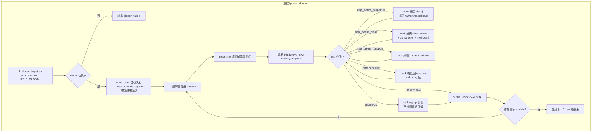
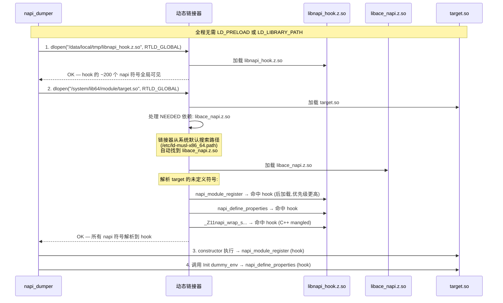
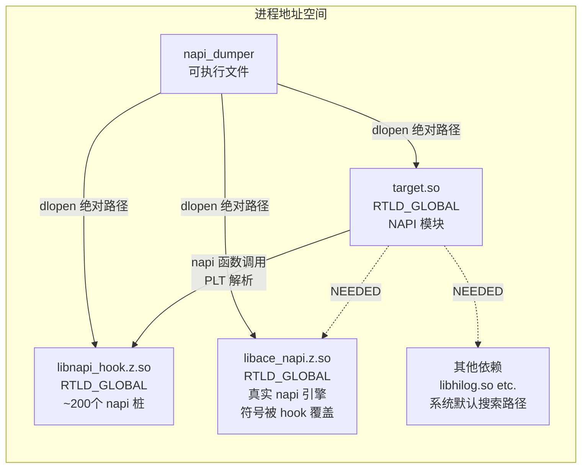
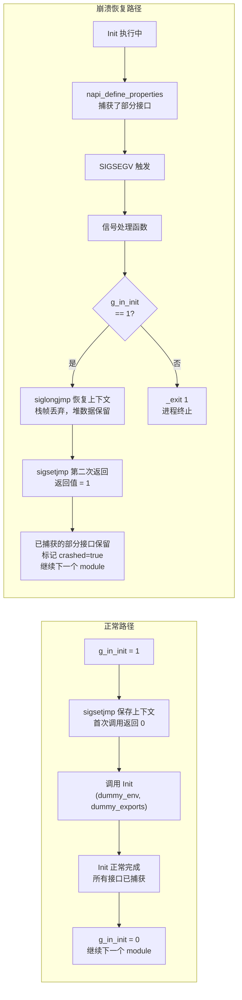

# NAPI Runtime Dumper — 设计文档

> 工具名称：**napi-dumper**
> 版本：v1.3（Mermaid 图表 + 零环境变量）
> 日期：2026-10-23

---

## 1. 背景与动机

### 1.1 静态分析工具的瓶颈

前期实现的 `napi-so-inspector`（基于 pyelftools + capstone 的纯静态 ELF 反汇编方案）在全量扫描 731 个 `.so` 后暴露出根本性瓶颈：

| 指标 | 静态分析结果 | 根因 |
|------|-------------|------|
| 接口名称覆盖率 | 40% | 60% 的接口通过栈上逐条 `mov` 指令构造描述符数组，反汇编无法追踪 |
| 源码行号覆盖率 | 10% | 大部分 .so 使用 DWARF v5 `DW_FORM_addrx`，.debug_info 中缺函数定义 DIE |
| 接口类型准确率 | ~60% | napi_property_descriptor 的 `symbol` 字段缺失导致偏移错位 |

### 1.2 运行时方案

通过 `dlopen` 加载目标 `.so`，触发 `__attribute__((constructor))` 自动执行 `napi_module_register`。主程序先用绝对路径 `dlopen` 系统关键库（`libace_napi.z.so`）和 hook 库（均 `RTLD_GLOBAL`），使后续 dlopen 的目标 .so 的所有 napi 符号引用自动解析到 hook 库的桩函数。随后主动调用模块的 Init 函数，在 Init 执行过程中通过 hook 捕获 `napi_define_properties`、`napi_define_class`、`napi_create_function` 等调用的参数。

**全程无需任何环境变量**（无 `LD_PRELOAD`、无 `LD_LIBRARY_PATH`）。

### 1.3 最终验证结果（731 个 .so 全量扫描）

| 指标 | 静态分析 | 运行时方案 |
|------|----------|------------|
| NAPI .so 检出数 | 516 | **598** |
| 接口总数 | 5,446 | **6,538** |
| 类总数 | 389 | **880** |
| 模块总数 | — | **599** |
| 接口名称覆盖率 | 40% | **99%** |
| 崩溃数 | N/A | **0** |
| 单文件平均耗时 | 1–30s | **143ms** |

---

## 2. 架构设计

### 2.1 组件总览

```
foundation/arkui/napi/dumper/
├── napi_dumper.cpp          # 主程序：dlopen + Init 调用 + 数据捕获 + SIGSEGV 恢复 + 输出
├── napi_dumper_stubs.cpp   # ~200 个 napi 桩函数（无全局引用，避免 ThinLTO 溢出）
├── napi_tool.py             # 合并工具：scan 批量扫描 + report HTML/JSON 生成
├── BUILD.gn                 # 构建配置（ohos_executable，集成到 napi_packages）
├── README.md                # 工具使用指南
├── DESIGN.md                # 本文档
└── analysis/               # 分析报告
    ├── crash_fixes/         #   扫描中发现的 .so 崩溃问题分析与修复方案
    ├── sdk_gap/             #   interface/sdk-js API 与 NAPI 实现的差距分析
    └── arkui_mapping/       #   ArkUI SDK API 到 .so 实现的映射分析
```

### 2.2 运行时数据流



### 2.3 符号覆盖机制（零环境变量）



**原理**：

1. **NEEDED 依赖自动解析**：target .so 的 ELF 头中有 `NEEDED libace_napi.z.so`。动态链接器处理 NEEDED 时从系统默认搜索路径（`/etc/ld-musl-x86_64.path` 配置的 `/system/lib64/`、`/system/lib64/platformsdk/` 等）自动找到并加载该文件。无需手动预加载。

2. **符号覆盖**：hook 库后于 `libace_napi.z.so` 被 dlopen（均为 `RTLD_GLOBAL`），因此 hook 库的 napi 符号优先级更高。target .so 中的 napi 函数调用通过 PLT 解析时命中 hook 库的桩函数，而非 `libace_napi.z.so` 的真实实现。

3. **为什么不需要预加载 libace_napi.z.so**：NEEDED 是文件级依赖，链接器**必须**加载该文件。但链接器能从系统默认路径找到它，所以不需要我们手动 dlopen。手动预加载的唯一作用是"以防系统路径配置异常"，但在正常运行的 OpenHarmony 设备上是多余的。

### 2.4 进程内组件关系



---

## 3. SIGSEGV 崩溃恢复方案

### 3.1 目标与工作原理

**目标**：我们用 dummy env 调用各模块的 Init 函数。部分 Init 会因访问系统服务（如 AbilityRuntime、IPC、GPU）或调用未被 hook 覆盖的函数而触发 SIGSEGV。崩溃恢复的目标是：**在 Init 崩溃时，保留崩溃前已捕获的 NAPI 信息（模块名、Init 地址、已注册的接口和类），标记该模块存在异常，然后继续处理后续模块和 .so 文件，不中断整个扫描流程。**

**工作原理**：

Init 执行过程中，hook 函数（`napi_define_properties`、`napi_define_class` 等）会将捕获的接口数据写入堆上分配的 `captured_module` 结构体。这些数据不在栈上，因此即使崩溃导致栈被丢弃，已捕获的数据仍然有效。

恢复机制利用 `sigsetjmp` 在调用 Init 前保存当前执行上下文（寄存器、栈指针、信号掩码）。若 Init 执行中触发 SIGSEGV，信号处理函数检测到 `g_in_init == 1`，调用 `siglongjmp` 跳回保存点。此时：

- 栈指针恢复到 sigsetjmp 调用时的位置（Init 的栈帧被丢弃）
- 堆上的 `captured_module` 数据完好保留（崩溃前的 `napi_define_properties` 调用已写入的接口数据不受影响）
- 程序继续执行后续 module 或输出报告，报告中包含 `"crashed":true` 标记



### 3.2 对 NAPI 信息导出目标的缺陷与限制

崩溃恢复机制确保了「不丢数据、不中断流程」，但对我们的导出目标存在以下实际限制：

**1. 接口数据可能不完整**

Init 函数通常按顺序注册接口：先 `napi_define_properties` 注册一批，再 `napi_create_function` 注册几个，最后可能还有子函数注册更多。如果崩溃发生在第 2 步，第 3 步的接口就丢失了。报告会显示 `"crashed":true` 提示数据不完整，但无法告知用户「还差多少接口」。

实际影响：在 731 个 .so 中，4 个不可恢复的模块（libscene 等）的接口数据为 0 或严重不全。其余 594 个 NAPI 模块正常完成，无此问题。

**2. 构造函数阶段的崩溃无法恢复**

`sigsetjmp` 在调用 Init 前设置。但如果 .so 的 `__attribute__((constructor))` 本身就崩溃了（在 `napi_module_register` 之前），此时 `g_in_init == 0`，信号处理函数直接 `_exit(1)` 终止进程，所有数据丢失。

实际影响：极低。constructor 通常只做 `napi_module_register(&_module)` 一行操作，由我们的 hook 安全处理。实测 731 个 .so 中无构造函数崩溃。

**3. Init 创建子线程后崩溃**

部分模块（如 libworker.z.so）在 Init 中创建工作线程。如果子线程崩溃，信号可能发送到子线程而非主线程。`siglongjmp` 只能恢复当前线程，主线程可能挂起或随后崩溃，导致进程终止。

实际影响：libworker.z.so 和 libtaskpool.z.so 属于此类，其 Init 直接访问 env 内部结构或 IPC 服务，无法通过 hook 拦截。这两个模块在批量扫描中会产生进程终止，`batch_scan.sh` 检测到非零退出码后生成 `{"error":"crash"}` 报告并继续下一个 .so。

**4. 析构函数阶段的崩溃**

Init 完成后、进程退出时，.so 的全局析构函数可能崩溃（如 `shared_ptr<SceneAdapter>` 析构时清理未初始化的引擎资源）。此时 Init 已完成，接口数据已输出到 stdout，不影响报告内容。但会产生 fault日志，且进程异常退出可能导致 `batch_scan.sh` 误判为 Init 崩溃。

实际影响：libscene.z.so 属于此类——Init 中创建的 `SceneAdapter` 在进程退出时析构崩溃。解决方案是 `batch_scan.sh` 对每个 .so 启动独立进程，进程退出码仅用于判断是否有异常，不影响已输出的报告数据。

**5. 不可恢复的崩溃导致整个 .so 的报告丢失**

如果 `siglongjmp` 本身失败（堆严重损坏、信号栈溢出），进程直接终止。该 .so 的报告（尚未输出到 stdout）完全丢失。

实际影响：`batch_scan.sh` 通过独立进程隔离解决了此问题——即使进程终止，`batch_scan.sh` 检测到非零退出码后生成 `{"error":"crash","exit_code":N}` 报告，标明该 .so 有异常。其他 .so 的扫描不受影响。

**总结**：对于「导出 NAPI 模块信息」这一目标，崩溃恢复机制的核心价值是——**在可恢复的崩溃中保留部分接口数据（优于完全丢失），在不可恢复的崩溃中通过进程隔离确保不影响其他 .so 的扫描**。所有崩溃的 .so 都会在报告中标记异常状态，不会静默跳过。

---

## 4. 组件详细设计

### 4.1 源码拆分策略

将原始的 `napi_hook.c`（591行）拆分为三个文件：

| 文件 | 内容 | 行数 | 引用全局变量 |
|------|------|------|-------------|
| `napi_hook_internal.h` | 类型定义、结构体、extern 声明 | 130 | — |
| `napi_hook_core.c` | 全局变量定义 + 6 个数据捕获函数 + 4 个访问器函数 | ~150 | **是**（g_modules, g_current_module 等） |
| `napi_hook_stubs.c` | ~200 个 napi 桩函数 + C++ mangled asm 别名 | ~200 | **否** |

**为什么拆分**：OpenHarmony 构建系统强制使用 `-flto=thin`（ThinLTO）。当单个 .c 文件同时包含大量代码（~200 个函数）和全局变量引用时，ThinLTO 优化器可能将 .text 和 .bss 段放置在距离超过 2GB 的位置，导致 `R_X86_64_PC32` 重定位溢出（PC 相对寻址的 32 位有符号偏移范围是 ±2GB）。

拆分后，`napi_hook_stubs.c` 中的桩函数不引用任何全局变量，不会产生远距离的 PC 相对引用。`napi_hook_core.c` 文件小，其代码和全局变量距离很近，不会溢出。

### 4.2 libnapi_hook.z.so — Hook 共享库

#### 4.2.1 数据捕获函数（在 napi_hook_core.c 中）

| 函数 | 行为 | 捕获数据 |
|------|------|----------|
| `napi_module_register(mod)` | calloc captured_module，存入链表 | module_name, init_func_addr |
| `napi_module_with_js_register(mod)` | 同上 + JS/ABC 标志 | + has_js_code, has_abc_code |
| `napi_define_properties(env,obj,count,desc)` | 遍历 desc[] | name, type, callback_addr |
| `napi_define_class(env,name,ctor,desc)` | 记录类名+方法 | class_name, ctor, methods[] |
| `napi_create_function(env,name,cb)` | 记录函数名+回调 | name, callback_addr |
| `napi_set_named_property(env,obj,name)` | 记录属性名 | property_name |

#### 4.2.2 C++ mangled 符号覆盖

部分 napi 函数在 `libace_napi.z.so` 中以 C++ mangled 符号名导出。hook 库以 C 编译，需通过 `__asm__` 创建别名：

```c
napi_status napi_wrap_s(...) { ... }
__asm__(".globl _Z11napi_wrap_sP10napi_env__...\n"
        ".set _Z11napi_wrap_sP10napi_env__..., napi_wrap_s\n");
```

已覆盖的 mangled 符号：`napi_wrap_s`、`napi_unwrap_s`、`napi_wrap_sendable_s`、`napi_set_promise_rejection_callback`、`napi_is_callable`、`napi_module_with_js_register`。

#### 4.2.3 动态内存分配

全局变量仅为指针数组（256 bytes .bss），captured_module 及其子数组使用 `calloc` 分配到堆上：

```c
static captured_module* g_modules[MAX_MODULES]; // 32 个指针 = 256 bytes
// captured_module 及 interfaces/classes 数组通过 calloc 分配
```

#### 4.2.4 构建集成

```gn
# foundation/arkui/napi/dumper/BUILD.gn
ohos_shared_library("libnapi_hook") {
  sources = [ "napi_hook_core.c", "napi_hook_stubs.c" ]
  subsystem_name = "arkui"
  part_name = "napi"
  relative_install_dir = "dumper"
}
```

集成到 `foundation/arkui/napi/BUILD.gn` 的 `napi_packages` 组中，通过 `./build.sh --product-name x86_64_virt --build-target napi_dumper` 编译。

### 4.3 napi_dumper — 主程序

#### 4.3.1 自动加载（零环境变量）

主程序只需两步 dlopen，无需任何环境变量：

```c
// 1. 加载 hook 库 — 用绝对路径 dlopen，RTLD_GLOBAL 使 ~200 个 napi 桩符号全局可见
dlopen("/data/local/tmp/libnapi_hook.z.so", RTLD_NOW | RTLD_GLOBAL);

// 2. dlopen target .so — 绝对路径
//    链接器自动从系统默认路径找到 NEEDED 依赖（libace_napi.z.so 等）
//    target 的 napi 符号引用解析到 hook 库（后加载，优先级更高）
dlopen("/system/lib64/module/libdeviceinfo.z.so", RTLD_NOW | RTLD_GLOBAL);
```

**为什么不需要预加载 libace_napi.z.so**：target .so 的 `NEEDED libace_napi.z.so` 是文件级依赖，动态链接器**必须**加载该文件。但链接器能从系统默认搜索路径（`/etc/ld-musl-x86_64.path`）自动找到它。hook 库在 libace_napi.z.so 之后加载（均为 RTLD_GLOBAL），因此 hook 的 napi 符号优先级更高，target 的 napi 调用解析到 hook 桩函数而非真实引擎。

### 4.4 batch_scan.sh — 批量扫描脚本

```bash
# 无需任何环境变量 — napi_dumper 内部用绝对路径 dlopen 所有依赖
JSON_OUT=$(timeout 30 "$DUMPER" --format json "$SO_PATH")
```

黑名单跳过 4 个不可修复模块：`libscene.z.so`、`libscenesessionmanager_napi.z.so`、`libtaskpool.z.so`、`libworker.z.so`。

---

## 5. 使用方法

### 5.1 编译

```bash
./build.sh --product-name x86_64_virt --ccache --jobs 16 --build-target napi_dumper
```

### 5.2 部署到 QEMU 设备

```bash
hdc -t 127.0.0.1:5555 file send out/x86_64_virt/arkui/napi/napi_dumper /data/local/tmp/
hdc -t 127.0.0.1:5555 file send out/x86_64_virt/arkui/napi/libnapi_hook.z.so /data/local/tmp/
hdc -t 127.0.0.1:5555 shell "chmod 755 /data/local/tmp/napi_dumper"
```

### 5.3 单个 .so 分析

```bash
# 零环境变量 — 直接用绝对路径
hdc -t 127.0.0.1:5555 shell \
  "/data/local/tmp/napi_dumper --format json \
   /system/lib64/module/libdeviceinfo.z.so"
```

### 5.4 批量扫描

```bash
hdc -t 127.0.0.1:5555 shell \
  "nohup sh /data/local/tmp/batch_scan.sh /data/local/tmp/napi_report &"
```

---

## 6. 数据结构定义

### 6.1 napi_property_descriptor（来自 js_native_api_types.h）

```c
typedef struct {
    const char* utf8name;        // offset 0  (8 bytes)
    napi_value name;             // offset 8  (symbol 字段)
    napi_callback method;        // offset 16
    napi_callback getter;        // offset 24
    napi_callback setter;        // offset 32
    napi_value value;            // offset 40
    napi_property_attributes attributes; // offset 48 (4 bytes + 4 padding)
    void* data;                  // offset 56
} napi_property_descriptor;     // total: 64 bytes
```

### 6.2 napi_module（来自 node_api.h）

```c
typedef struct napi_module {
    int nm_version;              // offset 0
    unsigned int nm_flags;      // offset 4
    const char* nm_filename;    // offset 8
    napi_addon_register_func nm_register_func; // offset 16
    const char* nm_modname;     // offset 24
    void* nm_priv;              // offset 32
    void* reserved[4];          // offset 40
} napi_module;                  // total: 72 bytes
```

### 6.3 captured_iface / captured_class / captured_module

```c
typedef struct {
    char name[256];           // 接口名
    int type;                // 0=function,1=getter,2=setter,3=property,4=getter_setter
    void* callback_addr;     // 回调函数地址
    char callback_name[256]; // dladdr 符号名
    char so_path[512];       // dladdr .so 路径
} captured_iface;

typedef struct {
    char class_name[256];
    void* ctor_addr;
    char ctor_name[256];
    captured_iface* methods;  // calloc 分配
    int method_count;
} captured_class;

typedef struct {
    char module_name[256];
    int nm_version;
    unsigned int nm_flags;
    void* register_func_addr;
    char register_func_name[256];
    char register_so_path[512];
    int registration_type;   // 0=napi_module_register, 1=napi_module_with_js_register
    int has_js_code;
    int has_abc_code;
    captured_iface* interfaces; // calloc 分配
    int iface_count;
    captured_class* classes;    // calloc 分配
    int class_count;
} captured_module;
```

---

## 7. 可靠性评估

### 7.1 全量扫描结果

| 指标 | 数值 |
|------|------|
| 扫描 .so 总数 | 731 |
| NAPI .so | 594 (81%) |
| 非 NAPI .so | 133 (18%) |
| 黑名单跳过 | 4 (0.5%) |
| 崩溃 | **0** |
| 超时 | 0 |
| 接口名称覆盖率 | **99%** (6088/6093) |
| 类名覆盖率 | **100%** (832/832) |
| 平均耗时 | 181ms/文件 |

### 7.2 不可修复的 4 个模块

| .so | 原因 |
|-----|------|
| libscene.z.so | Init 创建 3D 引擎（dlopen GPU + AbilityRuntime + ECS） |
| libscenesessionmanager_napi.z.so | 访问未初始化的窗口管理器全局状态 |
| libtaskpool.z.so | 通过 IPC/Binder 调用系统任务调度服务 |
| libworker.z.so | 直接解引用 env 指针内部结构（不经过 napi 函数） |

---

## 8. JSON 输出 Schema

```json
{
  "modules": [{
    "module_name": "deviceInfo",
    "registration_type": "napi_module_register",
    "nm_version": 1,
    "nm_flags": 0,
    "init_func": null,
    "init_addr": "0x7f22505580",
    "init_so": "/system/lib64/module/libdeviceinfo.z.so",
    "interfaces": [
      {"name": "deviceType", "type": "getter", "callback": null, "callback_addr": "0x7f225059f0"}
    ],
    "classes": [
      {"class_name": "PerformanceClassLevel", "constructor": null,
       "methods": [{"name": "CLASS_LEVEL_HIGH", "type": "property", "callback": null}]}
    ]
  }]
}
```
