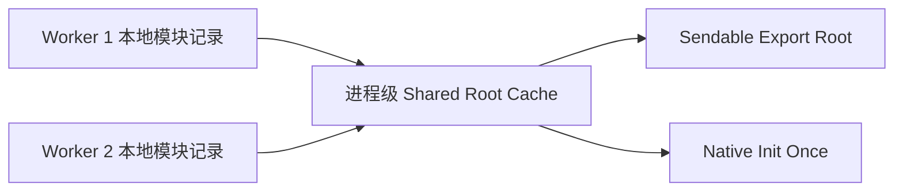

# NAPI 模块导出 Sendable 共享模块可行性与实现设计

> 分析范围：`foundation/arkui/napi`、`arkcompiler/ets_runtime`
> 分析日期：2026-08-04
> 文档性质：源码级技术可行性分析与实现设计规格
> 设计方向：**共享导出根对象，每个 VM 的模块记录保持本地，先到先得 init**

## 1. 背景与结论

ArkTS 已经支持通过 `"use shared"` 声明共享模块：模块记录、模块命名空间以及导出值可以进入共享堆，并由进程级共享模块管理器统一管理。

现有运行时也已经具备从 NAPI 创建 Sendable Class、Object、Array、Map、TypedArray 等共享对象，以及在不同 VM 中调用 Sendable Native Function 的基础。但是，NAPI 模块本身仍按普通本地模块加载：每个 `ArkNativeEngine` 独立初始化模块、创建普通导出对象，并在本 VM 内缓存。

因此，需要区分两个目标：

1. **NAPI 导出的值可 Sendable**：Worker 之间可以传递导出对象，但模块可能仍在每个 VM 中分别初始化。
2. **NAPI 模块本身是共享模块**：模块只初始化一次，不同 VM 获取同一个模块记录、Namespace 和导出对象，语义与 ArkTS `"use shared"` 模块一致。

前一种能力可以基于现有 Sendable API 扩展；后一种能力（完整对齐 ArkTS 共享模块语义）需要同时改造 `foundation/arkui/napi` 的注册和加载协议，以及 `ets_runtime` 的模块记录、进程级缓存、并发初始化和生命周期管理。仅把当前 `exports` 对象替换为 Sendable Object，不能完整实现 ArkTS 共享模块语义。

**结论**：采用共享导出根对象、模块记录保持本地的方向——介于上述两个目标之间。该方向能在不改动 `ets_runtime` 的前提下实现"native init 一次 + 跨 VM 同一导出根"，接受 Namespace/模块状态仍为每 VM 本地（即不完整对齐 ArkTS 共享模块语义）。§2–§4 为可行性与现状分析，§5 起为锁定设计与实现规格。

## 2. 当前实现分析

### 2.1 ArkTS 共享模块现状

ArkTS 共享模块的主要链路如下：

1. 编译产物携带共享模块标记。
2. 模块解析时创建 SharedHeap 中的 `SourceTextModule`。
3. 将模块标记为 `SharedTypes::SHARED_MODULE`。
4. 模块暂存到当前 VM，完成解析后转移到进程级 `SharedModuleManager`。
5. 不同 VM 复用同一个模块记录和共享 Namespace。
6. 写入导出值时检查 `IsSharedType()`，禁止共享模块导出 LocalHeap 对象。

关键代码证据：

| 能力 | 代码位置 | 关键接口或行为 |
|---|---|---|
| 创建共享模块记录 | `ets_runtime/ecmascript/shared_object_factory.cpp:892` | `ObjectFactory::NewSSourceTextModule()` |
| 解析共享模块 | `ets_runtime/ecmascript/module/js_shared_module.cpp:135` | `SharedModuleHelper::ParseSharedModule()` |
| 标记共享类型 | `ets_runtime/ecmascript/module/js_shared_module.cpp:145` | `SetSharedType(SharedTypes::SHARED_MODULE)` |
| 进程级共享模块缓存 | `ets_runtime/ecmascript/module/js_shared_module_manager.cpp:26` | `SharedModuleManager::GetInstance()` |
| 竞争插入与缓存转移 | `ets_runtime/ecmascript/module/js_shared_module_manager.cpp:76` | `TryInsertInSModuleManager()`、`TransferFromLocalToSharedModuleMapAndGetInsertedSModule()` |
| 模块级并发状态 | `ets_runtime/ecmascript/module/js_shared_module_manager.cpp:84` | `sharedModuleMutex_`、`StateVisit` |
| 共享 Namespace | `ets_runtime/ecmascript/module/js_module_namespace.cpp:41` | `ModuleNamespaceCreate()` 对共享模块分流 |
| 导出值共享校验 | `ets_runtime/ecmascript/module/js_module_source_text.cpp:1547` | 非共享值触发 `Export non-shared object from shared-module` |

### 2.2 NAPI 模块现状

NAPI 模块目前走本地模块路径：

1. `ModuleResolver::ResolveNativeModuleModule()` 调用 `ModuleDataExtractor::ParseNativeModule()`。
2. `ParseNativeModule()` 固定调用 `NewSourceTextModule()`。
3. 默认导出条目标记为 `SharedTypes::UNSENDABLE_MODULE`。
4. `SourceTextModule::EvaluateNativeModule()` 通过宿主 require 函数进入 `ArkNativeEngine`。
5. `ArkNativeEngine::LoadNativeModule()` 创建普通 `ObjectRef` 作为 `exports`。
6. `registerCallback(env, exports)` 向该对象写入属性。
7. 导出对象保存在当前引擎的 `loadedModules_` 中。

关键代码证据：

| 能力 | 代码位置 | 当前行为 |
|---|---|---|
| 创建 Native 模块记录 | `ets_runtime/ecmascript/module/module_data_extractor.cpp:142` | 固定使用 `NewSourceTextModule()` |
| 默认导出类型 | `ets_runtime/ecmascript/module/module_data_extractor.cpp:153` | `SharedTypes::UNSENDABLE_MODULE` |
| Native 模块解析入口 | `ets_runtime/ecmascript/module/module_resolver.cpp:314` | 只加入当前 VM 的 `resolvedModules_` |
| Native 模块执行 | `ets_runtime/ecmascript/module/js_module_source_text.cpp:541` | `EvaluateNativeModule()` |
| 创建本地导出对象 | `foundation/arkui/napi/native_engine/impl/ark/ark_native_engine.cpp:884` | `ObjectRef::New(vm_)` |
| 初始化回调 | `foundation/arkui/napi/native_engine/impl/ark/ark_native_engine.cpp:889` | 调用 `registerCallback()`，但忽略返回值 |
| VM 内缓存 | `foundation/arkui/napi/native_engine/impl/ark/ark_native_engine.cpp:900` | `loadedModules_[module] = Global<JSValueRef>` |

`LoadNativeModule` 现状关键行（`ark_native_engine.cpp:838-907`）：

- `:849` `loadedModules_.find(module)` 查 VM 本地缓存（`std::map<NativeModule*, Global<JSValueRef>>`，`ark_native_engine.h:556`）。
- `:884` `Local<ObjectRef> exportObj = ObjectRef::New(vm_)` 创建**本地堆普通对象**。
- `:889` `module->registerCallback(env, exportObj)` 模块填属性，**返回值被忽略**。
- `:894` `Local<ObjectRef> exportCopy = ObjectRef::New(vm_)` 又一个本地堆对象。
- `:896` `CheckArkApiAllowList(module, context, exportCopy)` allowlist 过滤拷贝。
- `:900` `loadedModules_[module] = Global<JSValueRef>(vm_, exports)` 写 VM 本地缓存。

### 2.3 已具备的 Sendable 基础

NAPI 已公开以下 Sendable 能力：

- `napi_define_sendable_class()`；
- `napi_create_sendable_object_with_properties()`；
- Sendable Array、Map、ArrayBuffer、TypedArray；
- `napi_is_sendable()`；
- Sendable wrap 和强引用能力。

`napi_create_sendable_object_with_properties()` 会将属性描述符中的 method、getter 和 setter 创建成 Sendable Function。相关实现位于：

- `foundation/arkui/napi/interfaces/kits/napi/native_api.h:160`
- `foundation/arkui/napi/native_engine/native_api.cpp:1725`
- `foundation/arkui/napi/native_engine/native_sendable.cpp:26`

`napi_set_named_property()` 在 sendable 对象上**可用**（`test/unittest/test_sendable_napi.cpp:1876`、`:2603` 跨 env 修改 sendable 属性成功）。因此"先建空 sendable 对象、再逐步塞属性"技术可行（`:2870` 证明 0 属性空 sendable 对象可建）。

Sendable Native Function 被跨 VM 调用时，会通过当前执行 VM 获取 `napi_env`，而不是使用函数创建时保存的 env：

```cpp
if (info->isSendable) {
    env = reinterpret_cast<napi_env>(JSNApi::GetEnv(vm));
} else {
    env = info->env;
}
```

代码位置：`foundation/arkui/napi/native_engine/impl/ark/ark_native_engine.cpp:1221`。

这说明 Sendable Native Function 已具备在不同 Worker/VM 上安全切换 NAPI 执行环境的运行时基础。这条机制已经处理好跨 Worker 的 env 切换，本设计不需要再管。当前主要缺口位于模块声明、共享导出根、初始化缓存和生命周期层。

### 2.4 `isMainEnvContext_` 的真实语义（关键澄清）

`IsMainEnvContext()` **不是**"主线程 vs Worker"标记，而是"该 VM 的主 context vs ark 子 context"标记：

| 构造函数 | `isMainEnvContext_` | 谁用它 |
|---|---|---|
| `ArkNativeEngine(EcmaVM* vm, void* jsEngine, bool isLimitedWorker=false)`（`ark_native_engine.cpp:495-498`） | `true` | **主引擎 和 Worker 引擎**（`CreateRuntimeFunc` `:2375` 走这条；测试 `test_ark_idle_monitor.cpp:137-138` 的 `workerEngine1/2` 也走这条） |
| `ArkNativeEngine(NativeEngine* parent, EcmaVM* vm, const Local<JSValueRef>& context)`（`:574-581`） | `false` | **只**被 `ArkNativeEngine::New`（`:665-679`）调用 ← **只**被 `napi_create_ark_context`（`native_api.cpp:4802`）调用 |

铁证——`ark_native_engine.cpp:686`：

```cpp
return !isMainEnvContext_ &&  // Check whether current engine is context engine.
```

注释直接说明：`!isMainEnvContext_` = "是 context engine（ark 子 context）"。ark-context 是主线程特性（`native_api.cpp:4792-4794` "multi-context feature only support main thread"），Worker 不走 ark-context，Worker 引擎 `isMainEnvContext_(true)`。

**结论：Worker 的 `IsMainEnvContext()` 返回 true，能正常调 `napi_create_sendable_object_with_properties`。** `native_api.cpp:1734` 那条 `if (!engine->IsMainEnvContext())` 拦的是 ark 子 context，不是 Worker。这是本设计选择"先到先得、任意 Worker 可 init"的技术前提——init 不必固定在主线程跑。

### 2.5 SendableGlobal 与进程级存储

`SendableGlobal<T>`（`arkcompiler/ets_runtime/ecmascript/napi/include/jsnapi_expo.h:553`）：

- 持有节点在进程级 `Runtime::sendableGlobalStorage_`（`runtime.cpp:813` `NewSendableGlobalHandle`），独立于任何 VM。
- `NewSendableGlobalHandle` 会 `ASSERT(value.IsSendable())`——**值必须是 sendable 类型**。
- 被所有共享/CMC GC 标记遍历，跨 VM 存活，VM 销毁后仍可访问。
- 重新具象化：`SendableGlobal::ToLocal(vm)` 在任意 VM 拿回 `Local<T>`。

对比：

- `Local<T>`：随 `EscapeLocalScope`（`ark_native_engine.cpp:848`）返回释放，存不进 map。
- `Global<T>`：绑死在创建 VM 上，VM 销毁时句柄没了，跨不了 VM。
- `SendableGlobal<T>`：进程级，唯一可跨 VM 的载体。

本设计的共享根对象必须用 `SendableGlobal<JSValueRef>` 持有。

## 3. 能力差距

| 能力 | ArkTS 共享模块 | 当前 NAPI 模块 | 差距 | 是否覆盖 |
|---|---|---|---|---|
| 模块共享声明 | ABC Record Shared 标记 | 无有效共享标记 | 需要注册元数据或新注册接口 | 是（opt-in 字段，推迟落地） |
| 模块记录分配 | SharedHeap | LocalHeap | 需要共享 Native 模块记录创建路径 | **否**（保持本地，仅共享导出根） |
| 模块缓存范围 | 进程级 | 每 VM | 需要接入 `SharedModuleManager` 或共享 Root 缓存 | 部分（导出根进程级缓存，模块记录仍每 VM） |
| 初始化次数 | 进程一次 | 每个 `ArkNativeEngine` 一次 | 需要模块级 once 状态机 | 是（单大锁串行） |
| 导出根对象 | 必须是共享类型 | 普通 `ObjectRef` | callback 必须返回完整 Sendable Root | 是 |
| callback 返回值 | 模块执行结果会被存储 | 当前被忽略 | loader 必须接收并校验返回值 | 是 |
| Namespace | Shared Namespace | VM 本地 Namespace | 完整语义需共享模块记录 | **否**（接受每 VM 本地） |
| Native 回调 env | ArkTS 函数运行时环境 | Sendable Function 已动态获取当前 env | 基础已具备 | 已具备 |
| 动态库生命周期 | 随共享模块生命周期 | 可能卸载 `.so` | 必须防止回调地址悬空 | 是（固定驻留） |

另一个接口差距是 NAPI 模块的 flags 没有完整进入持久模块描述：

- `napi_module_register()` 会读取 `nm_flags`，见 `foundation/arkui/napi/native_engine/native_node_api.cpp:39`；
- `NativeModuleManager::Register()` 仅用 `flags == 100` 特判 App Module（`native_module_manager.cpp:45` `IS_APP_MODULE_FLAGS = 100`、`:327` `flags == 100`）；
- 注册到链表时没有复制 `flags`；
- `napi_module_with_js_register()` 连临时 `NativeModule.flags` 都没有设置。

opt-in 决策是**加新字段而非复用 `nm_flags`**（见 §6.1），因此不触发 flags 兼容问题。

## 4. 实现方向概述

Native 模块初始化一次，返回完整 Sendable Root，并通过进程级 Sendable 句柄保存；各 VM 仍创建自己的本地模块记录，但获得同一个导出根对象。



`ets_runtime` 已有 `SendableGlobal<T>` 和进程级 Sendable Global Storage，可以作为共享 Root 的持有基础：

- `ets_runtime/ecmascript/napi/include/jsnapi_expo.h:553`
- `ets_runtime/ecmascript/runtime.h:385`
- `ets_runtime/ecmascript/runtime.cpp:813`

该方向可以实现：

- native callback 只执行一次；
- 不同 VM 获得同一个 Sendable Root；
- Sendable method 在消费方 VM 上运行。

但它不能完整实现：

- 共享模块记录；
- 共享 Namespace；
- 全局统一的模块状态、循环依赖和错误状态。

适用于需求只要求共享导出对象身份和原生状态，而不要求完整对齐 ArkTS Shared Module 语义的场景。详细设计见 §5 起。

## 5. 设计决策（已锁定）

| 项 | 决策 |
|---|---|
| **opt-in 标记** | 新增公共 API 函数 `napi_shared_module_register`（`interfaces/kits/napi/native_api.h`）。模块作者在 `.so` constructor 调 `napi_shared_module_register(&mod)` 即声明共享（内部置 `NativeModule.shared = 1`）；老 `napi_module_register` 不读 `napi_module` 新字段、`shared` 保持 `0`。`IsSharedModule` 读 `module->shared != 0`（已激活） |
| **老 .so 二进制兼容** | 由 API 选择保证：老 `.so` 只调 `napi_module_register`（不读新字段、不调 `napi_shared_module_register`）→ `shared=0` → 普通路径。无需版本门控，不改 `napi_module` 结构体 |
| **共享载体** | `static std::map<NativeModule*, panda::SendableGlobal<JSValueRef>> sharedRootMap_` + `static std::mutex sharedRootMutex_`（单大锁，持锁全程） |
| **map key** | `NativeModule*`（和 `loadedModules_` 一致；shared module 无释放流程，指针不悬空） |
| **map value** | 直接 `SendableGlobal<JSValueRef>`（`try_emplace` 原地构造，绕开禁拷禁移） |
| **init-once 线程模型** | **单大锁持锁全程**。`lock_guard` → `find` → 已有则返回 → 否则 `CreateSendableRoot` → `try_emplace`。无 cv、无 atomics、无 unlock/relock。模块加载频率低，串行可接受 |
| **callback 契约** | 用 `registerCallback` 的**返回值**（当前被忽略，`ark_native_engine.cpp:889-890`），模块作者须返回 `napi_create_sendable_object_with_properties` 构造的完整 sendable root |
| **导出校验** | 返回值非空 + `root->IsJSShared(vm_)` 才写入 map，否则记 `errored` |
| **allowlist** | sendable 分支**跳过** `CheckArkApiAllowList`（`:894-897`）和 `CopyPropertyApiFilter`（`:467-493`），避免本地堆拷贝破坏 sendable |
| **VM-local cache** | sendable 分支**不用** `loadedModules_`（`Global` 是 VM-local），改写进程级 static map |
| **`.so` 防卸载** | `NativeModuleManager::IsSharedModule(moduleKey)` 遍历链表查 `module->shared`，`UnloadNativeModule` 开头命中即跳过 `dlclose`。复用已有 `shared` 字段，无需额外 pin set |
| **模块作者契约** | 不缓存 `napi_env`/线程状态（运行时已处理 sendable function 的 env 切换，见 §2.3） |
| **canonical key** | 首版用 `moduleName`，后续加固 bundle/namespace 维度（见 §10.1） |
| **`SetNativeEngine`** | 见 §10.2，实现时验证处理 |
| **ets_runtime 改造** | **不需要**。模块记录保持本地、`SharedType=UNSENDABLE_MODULE`，不触发 `StoreModuleValue` 的共享校验（`js_module_source_text.cpp:1470` 只对 `IsSharedModule` 为真者生效） |

## 6. 接口与实现设计

### 6.1 Shared NAPI 模块声明（opt-in 形式）

存在两种接口形态：

1. 复用 `napi_module.nm_flags`，增加类似 `NAPI_MODULE_FLAG_SHARED_SENDABLE` 的标志；
2. 增加版本化注册结构或新注册函数，如 `napi_shared_module_register()`；
3. 在 `napi_module` 结构体加新字段（如 `nm_shared`）。

第一种形式 ABI 改动较小，但必须处理当前 `flags == 100` 的历史语义，并补齐 flags 持久化。第二种形式契约更清晰，但会扩大公共 API 和符号维护范围。

**决策：采用新增公共 API 函数 `napi_shared_module_register`，不动 `napi_module` 结构体、不动 `nm_flags`。** 理由：opt-in 由"调哪个注册函数"决定，不改 `napi_module` 结构体、不读新字段；老 `.so` 只调 `napi_module_register`→普通路径，二进制兼容由 API 选择保证，无需版本门控；不与历史 `flags==100` 冲突；`ace_napi.versionscript` 为 `global: *` 通配导出新符号。`napi_shared_module_register` 内部置 `module.shared = 1` 并 `Register`；`IsSharedModule` 读 `module->shared != 0` 激活 sendable 分支。模块作者在 `.so` constructor 调 `napi_shared_module_register(&mod)` 即声明共享。

### 6.2 Native 初始化回调契约

Shared NAPI Module 不应继续采用"加载器创建普通空对象、callback 逐项赋值"的方式。callback 应返回已经完整构造的 Sendable Root：

```cpp
napi_value InitSharedModule(napi_env env, napi_value unused)
{
    napi_property_descriptor properties[] = {
        // value 必须是 Sendable；method 会被创建为 Sendable Function。
    };

    napi_value exports = nullptr;
    napi_status status = napi_create_sendable_object_with_properties(
        env, std::size(properties), properties, &exports);
    if (status != napi_ok) {
        return nullptr;
    }
    return exports;
}
```

加载器必须执行以下检查：

- 使用 callback 返回值替代本地 placeholder；
- 返回值不能为空或 `undefined`；
- 返回值必须通过 `napi_is_sendable()` 或底层 `IsJSShared(vm_)`；
- 普通 Object、普通 Function 或包含 LocalHeap 引用的值必须报错；
- 初始化失败不入 map（`find` 不到 → 下次重试，和普通模块一致）。

### 6.3 共享根表数据结构

`native_engine/impl/ark/ark_native_engine.h` 新增：

```cpp
static std::mutex sharedRootMutex_;
static std::map<NativeModule*, panda::SendableGlobal<JSValueRef>> sharedRootMap_;
```

- **无 `SharedRootEntry` 结构体**——map 值直接是 `SendableGlobal<JSValueRef>`。
- **map key 用 `NativeModule*`**（和 `loadedModules_` 一致；shared module 无释放流程，指针不悬空）。
- **值类型直接 `SendableGlobal`**——用 `try_emplace(module, vm_, newRoot)` 原地构造，不拷不移，绕开 `SendableGlobal` `ECMA_DISALLOW_COPY/MOVE`（`jsnapi_expo.h:557-558`）。无需 `unique_ptr` 包装。
- **无 cv、无 atomics、无 `initializing`/`errored` 字段**——单大锁持锁全程，不需要条件变量或原子标志。

### 6.4 LoadSharedNativeModule 流程（单锁）

`ark_native_engine.cpp` 新增方法：

```cpp
Local<JSValueRef> ArkNativeEngine::LoadSharedNativeModule(
    NativeModuleManager* moduleManager, NativeModule* module, const std::string& key)
{
    std::lock_guard<std::mutex> lock(sharedRootMutex_);
    auto it = sharedRootMap_.find(module);
    if (it != sharedRootMap_.end()) {
        return it->second.ToLocal(vm_);                    // 已有 → 返回
    }
    Local<JSValueRef> newRoot = CreateSendableRoot(module);
    bool ok = !newRoot.IsEmpty() && newRoot->IsJSShared(vm_);
    if (ok) {
        auto result = sharedRootMap_.try_emplace(module, vm_, newRoot);
        return result.first->second.ToLocal(vm_);
    }
    HILOG_ERROR("shared module %{public}s init failed", key.c_str());
    return JSValueRef::Undefined(vm_);
}
```

**一把 `lock_guard` 持锁全程**。无 cv、无 atomics、无 unlock/relock。init 失败不入 map → 下次 `find` 不到 → 重试（和普通模块一致）。
设计要点：

- **单大锁持锁全程**：一把 `lock_guard` 从 `find` 到 `try_emplace` 到返回，无 unlock/relock。模块加载频率低，串行可接受。
- **init 失败不入 map**：`find` 不到 → 下次重试（和普通模块行为一致）。
- **规格约束**：`registerCallback` 禁止重入 `requireNapi`（加载另一共享模块会导致 `std::mutex` 同线程二次 lock 死锁）。这是模块作者契约，不是已知风险。

### 6.5 CreateSendableRoot

```cpp
Local<JSValueRef> ArkNativeEngine::CreateSendableRoot(NativeModule* module)
{
    if (module == nullptr || module->registerCallback == nullptr) {
        return Local<JSValueRef>();
    }
    Local<JSValueRef> undef = JSValueRef::Undefined(vm_);
    napi_value cbResult = module->registerCallback(
        reinterpret_cast<napi_env>(this), JsValueFromLocalValue(undef));
    if (cbResult == nullptr) {
        HILOG_ERROR("shared module %{public}s callback returned null", module->name);
        return Local<JSValueRef>();
    }
    Local<JSValueRef> root = LocalValueFromJsValue(cbResult);
    if (!root->IsJSShared(vm_)) {
        HILOG_ERROR("shared module %{public}s callback returned non-sendable root", module->name);
        return Local<JSValueRef>();
    }
    return root;
}
```

### 6.6 LoadNativeModule 分支接入

`ark_native_engine.cpp:838` 的 `LoadNativeModule`，在 `loadedModules_` 查询之后、`strModuleName` 构造之后插入 sendable 分支：

```cpp
Local<JSValueRef> ArkNativeEngine::LoadNativeModule(
    NativeModuleManager* moduleManager, Local<StringRef> &moduleName,
    NativeModule* module, Local<JSValueRef> exports, std::string &errInfo)
{
    if (module == nullptr) { return exports; }
    panda::EscapeLocalScope scope(vm_);
    auto it = loadedModules_.find(module);
    if (it != loadedModules_.end()) {
        return scope.Escape(it->second.ToLocal(vm_));
    }
    std::string strModuleName = moduleName->ToString(vm_);
    moduleManager->SetNativeEngine(strModuleName, this);
    MoudleNameLocker nameLocker(strModuleName);

    // ===== sendable 分支：early return，不走下面的本地路径 =====
    if (IsSharedModule(module)) {
        return scope.Escape(LoadSharedNativeModule(moduleManager, module, strModuleName));
    }
    // ===== 以下原逻辑（jsABCCode / registerCallback / allowlist / loadedModules_）保持不变 =====

    if (module->jsCode == nullptr && module->getABCCode != nullptr) { ... }
    ...
}
```

sendable 分支**必须跳过**：

- `:884` `ObjectRef::New(vm_)` 本地 exports 创建。
- `:889-890` 调 `registerCallback` 并忽略返回值（改为 `CreateSendableRoot` 用返回值）。
- `:894-897` `CheckArkApiAllowList` + `exportCopy` 本地堆拷贝。
- `:900` `loadedModules_[module] = Global<...>`（VM-local）。

### 6.7 IsSharedModule 谓词

```cpp
// 读 napi_shared_module_register 置的 shared 字段
bool ArkNativeEngine::IsSharedModule(NativeModule* module) const
{
    return module != nullptr && module->shared != 0;
}
```

`module->shared`（`NativeModule` 的 `unsigned int` 字段）由 `napi_shared_module_register` 置 `1`（见 §12.2）。

### 6.8 foundation/arkui/napi 改造点

| 模块 | 改造内容 |
|---|---|
| `native_engine/native_api.cpp` | 新增 `napi_shared_module_register`（置 `shared=1`）；`napi_module_register`（`native_node_api.cpp`）不读 `nm_shared`（§12.2） |
| `interfaces/kits/napi/native_api.h` | 声明 `napi_shared_module_register`（公共 API，§12.2） |
| `module_manager/native_module_manager.h/.cpp` | `NativeModule` 加 `shared` 字段；`.so` pin 机制；`Register` 复制 `shared`（§12.1） |
| `native_engine/impl/ark/ark_native_engine.h/.cpp` | `sharedRootMutex_` + `sharedRootMap_`（`NativeModule*` → `SendableGlobal`）+ `LoadSharedNativeModule` / `CreateSendableRoot` / `IsSharedModule` + 分支接入（§12.3–§12.4） |
| `native_engine/native_sendable.cpp` | 复用现有 Sendable Object/Function 构造；必要时补充导出构建能力 |
| allowlist 逻辑 | sendable 分支 early return 天然绕过，无需改 `CheckArkApiAllowList` 自身（§8.2） |

注：`napi_module` 结构体不改、不读新字段；`napi_shared_module_register` 为新增**公共 API** 函数（`interfaces/kits/napi/native_api.h`），`ace_napi.versionscript` 为 `global: *` 通配导出新符号，无需改。`napi_module_with_js_register` 不改动（首版不支持混合模块共享声明）。

### 6.9 ets_runtime 改造点

**本设计不需要 ets_runtime 改造。** 模块记录保持本地、`SharedType=UNSENDABLE_MODULE`，`js_module_source_text.cpp:1470` 的 "Export non-shared object from shared-module" 校验只对 `IsSharedModule(module)` 为真者生效，本设计不触发。这是本设计的关键简化点——不依赖共享模块记录路径，也就不需要改动 `ets_runtime` 的模块解析、进程级缓存、并发初始化等机制。

## 7. 并发与生命周期约束

### 7.1 初始化状态机

`SharedRootEntry` 的有效状态：

```
无状态机——单大锁持锁全程，串行处理：

```
Worker A 持锁 → find(module) → 未找到 → CreateSendableRoot → try_emplace → 返回 → 释放锁
Worker B 持锁 → find(module) → 已找到 → 返回 → 释放锁
```

- 多 Worker 并发首次 import：大锁串行——第一个拿锁的跑 init，其余等锁释放后 `find` 命中已就绪的 root。
- init 失败不入 map → 下次 `find` 不到 → 重试（和普通模块一致）。
- **规格约束**：`registerCallback` 禁止重入 `requireNapi`，否则死锁（`std::mutex` 不可重入）。
- 失败状态在所有 VM 中一致可见（`errored` 标志）。
- `registerCallback` 禁止重入 `requireNapi`（规格约束，同线程二次 lock 会死锁）。

### 7.2 Native 状态契约（模块作者）

Sendable Function 可以在不同 Worker 线程上调用，因此 native 模块不能假设线程亲和性。模块中的进程级原生状态必须具备线程安全能力。

本设计下 init 可能跑在任意 Worker（先到先得，§2.4 已证 Worker 可建 sendable 对象），模块作者**禁止**：

- 保存创建 VM 专属的 `napi_env`（如 `static napi_env g_env;`）并在其它 Worker 回调里使用；
- 假设 init 跑在固定线程并依赖 thread-local；
- 保存普通 `napi_ref` 或 LocalHeap 对象跨 Worker；
- 未同步访问 native 静态全局变量；
- finalizer 依赖已销毁的 VM/env。

**正确做法**：每个回调用 `napi_get_cb_info` 传入的 `env`（sendable function 回调里它已是当前 VM 的 env，见 §2.3 `JSNApi::GetEnv(vm)`）。运行时已替模块作者处理好跨 VM env 切换，模块作者只需不缓存。

### 7.3 动态库生命周期

Sendable Function 中保存的是 native callback 地址。如果 Shared Root 仍存活时执行 `dlclose`，会产生函数地址悬空和崩溃风险。

可采用以下生命周期语义之一：

- Shared NAPI `.so` 固定驻留到最后一个 VM 销毁；
- 通过模块级强引用计数，保证所有 Shared Root 和 callback 释放后才能卸载。

**决策：固定驻留**。

- `NativeModuleManager::IsSharedModule(moduleKey)` 遍历链表查 `module->shared`，`UnloadNativeModule` 开头命中即 `return true` 跳过 `dlclose`。复用已有 `shared` 字段，无需额外 pin set。
- 永不 unpin（直到最后一个 VM 销毁 / 进程结束）。

代价：`.so` 常驻内存。可接受，换取简单且无悬空风险。现有 `SharedModuleManager::SharedNativeObjDestroy()`（`ets_runtime/ecmascript/module/js_shared_module_manager.cpp:173`）在最后一个 VM 销毁期间处理共享模块 Native Field，可作为未来升级到引用计数的统一销毁时点基础，但首版不依赖它。

## 8. 兼容性与安全性

### 8.1 向后兼容

- Shared 能力必须显式 opt-in，调 `napi_module_register` 的模块保持现有行为（`IsSharedModule` 返回 false，不进 sendable 分支）；
- 不能改变现有普通 NAPI 模块初始化和 exports 赋值语义；
- 本设计用新增公共 API 函数 `napi_shared_module_register` 而非复用 `nm_flags`，不触发历史 App Module 值 `100` 兼容问题；
- `napi_shared_module_register` 为新增公共 API 函数（`native_api.h`），`ace_napi.versionscript` 为 `global: *` 通配导出新符号，无需改；
- `napi_module_with_js_register` 不改动（首版不支持混合模块共享声明）。

### 8.2 allowlist 与应用隔离

当前 allowlist 路径会将允许的属性复制到普通本地 `ObjectRef`，该行为会破坏共享导出根对象。

allowlist 现状（`ArkNativeEngine::CheckArkApiAllowList`，`ark_native_engine.cpp:453-465` + `CopyPropertyApiFilter`，`:467-493`）：

- `module_checker_delegate.h:21` `typedef std::function<bool(const std::string&)> ApiAllowListChecker;` —— 点分 API 路径 → 是否允许。
- 注入：`ModuleLoadChecker::CheckModuleLoadable`（`module_load_checker.cpp:20-30`）通过 `ModuleCheckerDelegate`（外部策略委托）取 checker → `NativeModuleManager::MoveApiAllowListCheckerPtr`（`native_module_manager.cpp:830-834`）move 到 `NativeModule::apiAllowListChecker`。**按模块注入，策略在宿主，不在 Manager 硬编码**。
- 执行：遍历 `exportObj` 属性，拼点分路径，查白名单，只把允许的属性拷到新的 `ObjectRef::New(vm_)`（`:479`/`:894`）。

`apiAllowListChecker` 默认 `nullptr`（`module_load_checker.cpp:24`）。是否非空**完全由宿主按模块名决定**，与模块是否 sendable 无关：

- sendable 模块若未被宿主 gating → checker 为 nullptr → `CheckArkApiAllowList`（`:457` `if (apiAllowListChecker != nullptr)`）直接跳过 → 不拷贝 → sendable root 不受影响。
- sendable 模块若被宿主 gating（如 `@ohos.xxx` 系统 module）→ `CheckArkApiAllowList` 会跑 → `CopyPropertyApiFilter` 拷到本地堆 `ObjectRef::New` → sendable 身份破坏。

**处理决策：sendable 分支无条件跳过 `CheckArkApiAllowList` 和 `CopyPropertyApiFilter`。**

- sendable 模块的 API 暴露面由模块作者在构造 sendable root 时自决（descriptor 层面）。
- 事后拷贝过滤与 sendable 语义不兼容（拷贝产物是本地堆）。
- 在 §6.6 的 sendable 分支中，`early return` 天然绕过 `:894-897` 这段，无需额外改 `CheckArkApiAllowList` 自身。
- 若将来宿主需要对 sendable 系统 module 做 API 控制，应改为"构造前过滤 descriptor"，作为后续 follow-up。

进程级模块 key 必须包含足够的 bundle、module、namespace 或加载域信息，避免不同应用或 HSP 中的同名模块错误共享。首版用 `moduleName`，加固见 §10.1。

### 8.3 导出值校验

应在运行时边界进行约束：

1. NAPI 创建 Sendable Object 时校验属性类型（`napi_create_sendable_object_with_properties` 内部）；
2. loader 侧 `CreateSendableRoot` 校验返回值 `IsJSShared(vm_)`。

本设计不依赖 `SourceTextModule::StoreModuleValue()` 的 `IsSharedType()` 校验（该校验只对 `SharedType=SHARED_MODULE` 生效，本设计模块记录 `UNSENDABLE_MODULE` 不触发）。因此 loader 侧校验是唯一关口，必须严格执行。

## 9. 性能影响

当前暂不设固定性能指标，需在 PoC 和实现阶段观测以下数据：

- 多 Worker 场景 native 初始化次数（预期 == 1）；
- 首次 import 延迟及 entry 锁等待时间；
- 后续 Worker import 延迟（命中 map 后应接近零成本）；
- 相比每 VM 独立加载减少的 RSS/PSS；
- Sendable Root 与进程级模块表带来的共享堆常驻增量；
- 并发调用 native method 的锁竞争（entry 锁仅在 init 协调期竞争，稳态不竞争）。

共享模块可以减少重复初始化和重复导出对象，但其导出根和 `.so` 生命周期更长（固定驻留），需要避免无界进程级缓存。

## 10. 开放项与后续

### 10.1 canonical key 维度（首版用 moduleName）

首版 `sharedRootMap_` 的 key 用 `strModuleName`。风险：不同 bundle / HSP 的同名模块会错误共享。

后续加固方向：key 加入 bundle id / namespace / 加载域信息，避免跨应用同名模块误共享。属后续 follow-up，不阻塞首版。

### 10.2 `SetNativeEngine` 验证项

`ark_native_engine.cpp:854` `moduleManager->SetNativeEngine(strModuleName, this)` 把 module 绑到当前 engine（VM-local）。sendable 模块跨 VM 使用，此绑定是否合适需在实现时验证：

- 可能需在 sendable 分支跳过，或每个 VM 各自设。
- 不影响导出根共享（共享的是 `SendableGlobal` 句柄，不是 engine 绑定）。

### 10.3 opt-in 字段形状

已落地：新增公共 API 函数 `napi_shared_module_register`（`interfaces/kits/napi/native_api.h`）。模块作者在 `.so` constructor 调 `napi_shared_module_register(&mod)` 即声明共享，内部置 `module.shared = 1`。`IsSharedModule` 读 `module->shared != 0` 激活 sendable 分支。不改 `napi_module` 结构体、不读新字段；`ace_napi.versionscript` 为 `global: *` 通配导出新符号，无需改。`napi_module_with_js` 暂不支持。

## 11. 风险矩阵

| 子能力 | 风险 | 等级 | 缓解措施 | 状态 |
|---|---|---:|---|---|
| 模块声明 | `nm_flags` 当前未持久化，且存在历史值 `100` | 高 | 新增 `napi_shared_module_register` 函数，不读 `nm_shared`、不改 `napi_module` 结构体 | 已规避（§6.1） |
| 导出构造 | 当前 loader 忽略 callback 返回值 | 高 | Shared 分支强制返回完整 Sendable Root 并校验 | 已设计（§6.5） |
| 并发初始化 | 多 Worker 同时加载导致重复初始化或死锁 | 高 | 单大锁串行 | 已设计（§6.4） |
| 动态库生命周期 | Shared Function 指向已卸载 `.so` | 高 | `IsSharedModule` 查 `shared` 字段防卸载 | 已设计（§7.3） |
| Native 状态 | callback 在不同 Worker 线程执行 | 高 | 明确线程安全契约，禁止保存 VM 专属状态 | 已设计（§7.2） |
| 异常处理 | 初始化失败在不同 VM 中表现不一致 | 中 | 失败不入 map，下次重试（和普通模块一致） | 已设计（§6.4） |
| allowlist | 当前过滤逻辑生成 LocalHeap 副本 | 中 | sendable 分支 early return 跳过 | 已设计（§8.2） |
| 模块标识 | 不同加载路径或应用出现同名模块 | 高 | 首版 moduleName，后续加固 canonical key | 待加固（§10.1） |
| 混合模块 | Native flags 与 ABC Shared 标记冲突 | 中 | 用新函数 `napi_shared_module_register`，不与 flags 冲突 | 已规避（§6.1） |
| 常驻内存 | Shared Root 和 `.so` 生命周期延长 | 中 | 统计数量、设置边界并在最后 VM 销毁时释放 | 已接受（§7.3） |
| `isMainEnvContext_` 误读 | 误把 main-env 限制当成 Worker 限制 | 中 | 已澄清 Worker 是 true（§2.4） | 已澄清 |
| ets_runtime 改动面 | 误以为要改 ets_runtime | 中 | 不触发共享校验，无需改 | 已规避（§6.9） |
| 老 .so 越界读 | `nm_shared` 为 API 26 新增字段，老 `.so` 结构体更短，无条件读会越界 | 高 | `IsSharedModuleApiVersion()`（`realApiVersion_>=26`）门控 `nm_shared` 读取拷贝；老平台不读 | 已规避（§5 版本门控） |

## 12. 实现步骤（按文件）

### 12.1 `module_manager/native_module_manager.h` / `.cpp`

`NativeModule` 结构体（`native_module_manager.h` 约 `:60`）新增字段：

```cpp
unsigned int shared = 0;
```

新增 `.so` 防卸载机制（复用已有 `shared` 字段，无额外 pin set）：

```cpp
// .h
bool IsSharedModule(const std::string& moduleKey);
```

```cpp
// .cpp
bool NativeModuleManager::IsSharedModule(const std::string& moduleKey)
{
    std::lock_guard<std::mutex> lock(nativeModuleListMutex_);
    for (NativeModule* curr = headNativeModule_; curr != nullptr; curr = curr->next) {
        if ((curr->moduleName && !strcasecmp(curr->moduleName, moduleKey.c_str()))
            || (curr->name && !strcasecmp(curr->name, moduleKey.c_str()))) {
            return curr->shared != 0;
        }
    }
    return false;
}
```

`UnloadNativeModule`（`native_module_manager.cpp:263` 附近）开头加跳过：

```cpp
if (IsSharedModule(moduleKey)) {
    MODULEMNG_HILOG_INFO("module:'%{public}s' is shared, skip unload", moduleKey.c_str());
    return true;
}
```

`Register`（`:348-370` 附近）head/tail 节点复制时复制 `shared`：

```cpp
tailNativeModule_->shared = nativeModule->shared;
headNativeModule_->shared = nativeModule->shared;
```

### 12.2 `native_engine/native_api.cpp` + `interfaces/kits/napi/native_api.h`

`napi_module_register`（`:39` 附近）**不读 `nm_shared`**，`shared` 保持 `0` → 普通路径。新增 `napi_shared_module_register`（同 `napi_module_register` 体 + `module.shared = 1`）：

```cpp
NAPI_EXTERN void napi_shared_module_register(napi_module* mod)
{
    ...
    module.flags = mod->nm_flags;
    module.shared = 1;
    module.registerCallback = (RegisterCallback)mod->nm_register_func;
    ...
}
```

`native_api.h`（公共 API 头）声明 `NAPI_EXTERN void napi_shared_module_register(napi_module* mod);`。老 `.so` 只调 `napi_module_register`（不读新字段、不调新函数）→ `shared=0` → 普通路径，二进制兼容由 API 选择保证。

### 12.3 `native_engine/impl/ark/ark_native_engine.h`

- 新增静态成员：`sharedRootMutex_`、`std::map<NativeModule*, panda::SendableGlobal<JSValueRef>> sharedRootMap_`。
- 新增方法声明：`LoadSharedNativeModule`、`CreateSendableRoot`、`IsSharedModule`。
- 无额外头（不需要 `<memory>`/`<atomic>`/`<condition_variable>`）。

### 12.4 `native_engine/impl/ark/ark_native_engine.cpp`

- 实现 §6.4 `LoadSharedNativeModule`、§6.5 `CreateSendableRoot`、§6.7 `IsSharedModule`。
- 在 `LoadNativeModule`（`:838`）按 §6.6 插入 sendable 分支。
- `LoadSharedNativeModule` 用 `find(module)` + `try_emplace(module, vm_, newRoot)` 原地构造 `SendableGlobal`（绕开禁拷禁移）。单 `lock_guard` 持锁全程。

### 12.5 opt-in 字段状态

已落地：新增公共 API 函数 `napi_shared_module_register`（`interfaces/kits/napi/native_api.h`）。不改 `napi_module` 结构体、不读新字段；`ace_napi.versionscript` 为 `global: *` 通配导出新符号，无需改；不碰 `napi_module_with_js_register`。

### 12.6 构建配置

- 本变更只改现有文件，不新增 .cpp，无需改 `napi.gni` 的 `napi_sources`。
- `napi_shared_module_register` 经 `ace_napi.versionscript` 的 `global: *` 通配导出，无需改 versionscript。

## 13. 验证方案

### 13.1 功能验证

- 两个及以上 Worker 导入同一个 Shared NAPI Module；
- 验证不同 VM 获得相同导出对象（`napi_strict_equals` 断言同一 `napi_value`）；Namespace 不要求共享（每 VM 本地）；
- 验证 native init callback 只执行一次；
- 验证 Sendable method 在消费方 VM 中获得正确 `napi_env`（`JSNApi::GetEnv(vm)`）；
- 覆盖 Sendable Object、Class、Array、Map、ArrayBuffer 和 TypedArray；
- 覆盖 default import、named import、动态 import 和 re-export。

### 13.2 异常验证

- callback 返回普通 Object → `errored`；
- callback 返回普通 Function → `errored`；
- callback 返回空值或 `undefined` → `errored`；
- Sendable Root 的属性包含 LocalHeap 对象 → 构造侧 `napi_create_sendable_object_with_properties` 已拦；
- callback 抛出异常 → `errored`；
- 并发初始化期间一个 Worker 销毁 → 不崩溃（`SendableGlobal` 跨 VM 存活）；
- 模块递归导入自身或形成循环依赖 → 返回空 exports + HILOG_ERROR。

### 13.3 生命周期验证

- 一个 VM 销毁后，其他 VM 继续调用导出函数；
- Shared Root 存活时禁止 `.so` 卸载（`IsSharedModule` 查 `shared` 字段生效）；
- 模块卸载、热更新或重新注册不会形成 callback 悬空；
- Sendable Global Handle 不重复持有或泄漏。

### 13.4 兼容性验证

- 普通 NAPI 模块行为保持不变（`nm_shared==0` 或老平台 → `IsSharedModule` false，不进 sendable 分支）；
- APP、OHOS、INTERNAL 和 STATIC Module 类型；
- `napi_module_with_js` 的 JS/ABC 混合模块；
- API allowlist 对普通模块仍生效（sendable 分支才跳过）；
- 直接依赖、间接依赖和 re-export；
- 多 bundle、HSP 和同名模块隔离（首版仅 moduleName，加固见 §10.1）。

### 13.5 回归测试

- `test/unittest/test_sendable_napi.cpp`、`test/unittest/test_napi.cpp`、`test/unittest/test_napi_context.cpp`；
- 模块管理 `module_manager/test/unittest/module_manager_test/` + Fuzz `test/fuzztest/loadarkmodule_fuzzer/`；
- 多 Worker 场景需补充板侧证据。

## 14. 工作量估算

统一估算标准：开发代码约 500 行折算 1 人月；测试为开发工作量的 30%；设计为开发工作量的 10%；本需求不涉及 UX 工作量。

| 项 | 预估开发代码量 | 开发 | 测试 | 设计 | 端到端合计 |
|---|---:|---:|---:|---:|---:|
| 共享 Root、本地模块记录 | 900～1300 行 | 1.8～2.6 人月 | 0.54～0.78 人月 | 0.18～0.26 人月 | 2.52～3.64 人月 |

以上估算包含 `foundation/arkui/napi` 的实现和单元测试。本设计不需要 `ets_runtime` 改造（§6.9），工作量上限可下调。

## 15. 可行性判断

**✅ 可行。** 依据：已有 Sendable Object、Sendable Function 和 Sendable Global Storage；Worker 可建 sendable 对象（§2.4）。主要条件：接受 Namespace、模块状态仍为每 VM 本地；init 线程非确定（先到先得）。详细设计见 §5–§13。

## 16. 遵守的约束（AGENTS.md）

- 不在 `nm_register_func` 做阻塞 / 重初始化——init 仍只跑一次，且不持锁跑。
- `.so` 不绕过 `napi_module_register` 加载。
- 不在 `ModuleManager` 持有模块业务对象——static map 持的是 `SendableGlobal` 句柄，非业务对象。
- 不跨线程传 `napi_env`——sendable function 运行时动态取 env。
- 不为通过测试删日志 / 错误码 / DFX 信息。
- `napi_shared_module_register` 为新增公共 API 函数，`ace_napi.versionscript` 为 `global: *` 通配导出，无需改。
- 新增 .cpp 须入 `napi_sources`（本变更不新增 .cpp）。
- Ark VM 非线程安全不变量：init 在所属 VM 线程跑，`SendableGlobal` 跨 VM 共享对象身份不跨 VM 调用 VM 接口。

## 17. 实现顺序建议

1. §12.1 `NativeModuleManager` 加 `shared` 字段 + `.so` pin 机制 + `Register` 复制 `shared`。
2. §12.2 `napi_shared_module_register` + `native_api.h` 声明 + `napi_module_register` 不读 `nm_shared`。
3. §12.3 `ark_native_engine.h` 加 `sharedRootMutex_` + `sharedRootMap_`（`NativeModule*` → `SendableGlobal`）+ 方法声明。
4. §12.4 `ark_native_engine.cpp` 实现 `LoadSharedNativeModule` / `CreateSendableRoot` / `IsSharedModule` + `LoadNativeModule` 分支接入。
5. arm64 构建 ace_napi 验证编译。
6. §13 验证项逐项跑（UT 用 `napi_shared_module_register` 注册共享模块验证共享路径）。
